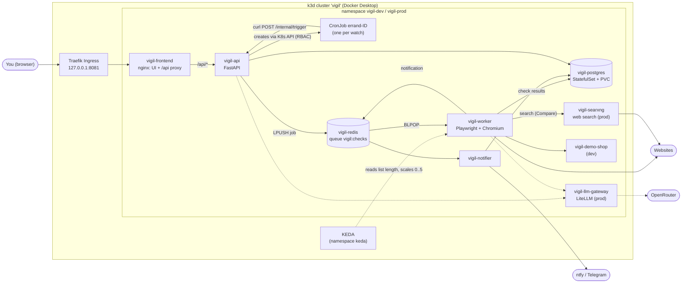
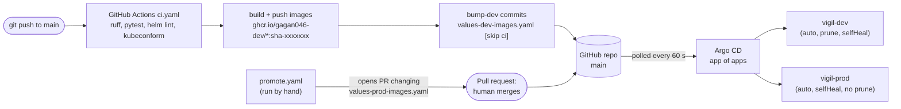

# Vigil

**Tell an AI agent in plain English what to watch on the web. It checks on a schedule and tells you only when your condition is actually met.**

> "Tell me when this laptop drops below ₹1,20,000, check every 30 minutes."

Vigil turns that sentence into a watch, gives it its own Kubernetes **CronJob**, wakes a
browser worker only when there is work to do (KEDA, scale-to-zero), and sends **one**
notification when the price crosses your line - not one every time it checks.

It is a **learning project**: a small but real system used to learn Kubernetes, Helm,
Argo CD (GitOps) and CI/CD from zero, on one Windows PC. Everything runs locally in a
[k3d](https://k3d.io) cluster; the images are built by GitHub Actions and published to GHCR.

| | |
|---|---|
| Repository | <https://github.com/gagan046-dev/vigil> (public) |
| Runs on | k3d (k3s v1.35.5) in Docker Desktop: 1 server + 2 agent nodes |
| URLs (local) | `http://vigil-dev.localhost:8081` · `http://vigil-prod.localhost:8081` · `http://demo.localhost:8081` · `http://argocd.localhost:8081` |
| Status | Phases 1-4 done and verified (see [`docs/notes/`](docs/notes/)) |

---

## What it does

- **Plain-English planning** - `POST /api/plan` turns a sentence into a watch spec
  (URL, kind, threshold, interval). A rule-based parser handles common phrasings; the
  LLM is only asked when the rules had to guess ("attention routing").
- **Six watch kinds** - `price_below`, `price_above`, `text_appears`, `text_disappears`,
  `page_changed`, and `best_price_below` (re-runs a price comparison on a schedule).
- **Price compare** - type a product name or paste a product link on the **Compare** page.
  Vigil searches the web (a self-hosted [SearXNG](https://github.com/searxng/searxng) pod in
  prod), fetches the allow-listed sellers (Flipkart, Amazon.in, Myntra, Croma, Reliance
  Digital, Vijay Sales, Tata CLiQ, AJIO by default), reads each price (JSON-LD, then meta
  tags, then page heuristics, an LLM only as a last resort), rejects listings that are a
  different model, variant or accessory, and ranks the rest. **Track best price** turns a
  comparison into a watch that alerts you when the best price falls below your target.
  Sellers that block bots show up as such (`blocked by robots.txt`, `bot protection`): Vigil
  never bypasses CAPTCHAs, logins or robots.txt. Chapter 9 explains it all.
- **A practical UI** - sidebar with Watches, Compare, Inbox (own page, unread badge),
  Activity and System; server-side paging with page numbers on every long list; light and
  dark themes; keyboard and screen-reader friendly. Plain HTML, CSS and ES modules, no
  framework or build step, under a strict Content-Security-Policy (chapter 10).
- **Dry run before you commit** - `POST /api/dryrun` makes a worker fetch the page right
  now and show what it found (value, CSS selector, whether the condition is true).
- **One CronJob per watch** - the api creates a real Kubernetes CronJob
  (`errand-<id>`, `spec.timeZone: Asia/Kolkata`) whose tiny curl pod pokes the api,
  which queues a check in Redis.
- **Workers that scale on demand** - a KEDA `ScaledObject` scales `vigil-worker`
  (Playwright + Chromium) on the length of the Redis list `vigil:checks`; in dev it goes
  down to **0 pods** when the queue is empty.
- **Cheap path first** - if the page text hash is unchanged, nothing else runs. Selectors
  are learned and self-heal when the page layout changes.
- **Fires on transition** - a notification is sent when the condition *becomes* true,
  not on every check (verified: still exactly one notification minutes later).
- **Inbox + optional push** - notifications land in the in-app inbox (Postgres) and,
  if configured, on [ntfy](https://ntfy.sh) and/or Telegram.
- **LLM with guard rails** - prod talks to a LiteLLM gateway (OpenRouter free models,
  with a fallback model) under a daily call budget. With no key, Vigil keeps working on
  its deterministic paths.
- **Polite and safe fetching** - SSRF guard, robots.txt, one request per site every 5 s,
  plus an egress NetworkPolicy that blocks private address ranges for the worker.
- **A demo shop** (dev only) - a fake store at `demo.localhost` whose price, stock and
  layout you can change from `/admin` to see Vigil react.

## Architecture



And how code reaches the cluster (Phases 3 and 4):



## Learn Kubernetes with this repo

The `docs/learn/` folder is a beginner course built on this exact codebase. Every chapter
explains the idea first (with analogies and diagrams), then walks through the real
files line by line, and ends with "Try it yourself", "Common mistakes" and "Key words".

| # | Chapter |
|---|---|
| 00 | [Start here: what Vigil is, the big picture, the phases](docs/learn/00-start-here.md) |
| 01 | [Kubernetes from zero: cluster, nodes, control plane, k3s/k3d](docs/learn/01-kubernetes-from-zero.md) |
| 02 | [Phase 1: Pods, Deployments, Services, config and storage](docs/learn/02-phase1-pods-deployments-services.md) |
| 03 | [Phase 1: security (RBAC, Pod Security, NetworkPolicies) and scaling (CronJobs, KEDA)](docs/learn/03-phase1-security-and-scaling.md) |
| 04 | [Phase 2: packaging Vigil with Helm](docs/learn/04-phase2-helm.md) |
| 05 | [Phase 3: GitOps with Argo CD and Sealed Secrets](docs/learn/05-phase3-argocd-gitops.md) |
| 06 | [Phase 4: CI/CD with GitHub Actions, from push to GitOps](docs/learn/06-phase4-ci-to-gitops.md) |
| 07 | [How Vigil works inside: the life of a watch](docs/learn/07-how-vigil-works.md) |
| 08 | [Troubleshooting: what broke and how it was fixed](docs/learn/08-troubleshooting.md) |
| 09 | [Price compare: search engines, SearXNG, JSON-LD, matching, tracking the best price](docs/learn/09-price-compare.md) |
| 10 | [The frontend: router, API client, paging, themes, accessibility, CSP](docs/learn/10-frontend.md) |
| - | [Glossary (80+ terms)](docs/learn/GLOSSARY.md) |

Also at the repo root:

- [TECH-STACK.md](TECH-STACK.md) - every tool and exact version, and which file uses it
- [COMMANDS.md](COMMANDS.md) - copy-paste commands for every phase, debugging and cleanup
- [docs/notes/](docs/notes/) - the raw verification notes (real commands and outputs)

## The four phases (git tags)

Each phase is a git tag, so you can see exactly what changed:

| Tag | Commit | What it adds | See the change |
|---|---|---|---|
| `phase-1` | `24a94f1` | The app + raw Kubernetes YAML in `k8s/` (namespace `vigil`) | `git show phase-1 --stat` |
| `phase-2` | `3115c1e` | Helm chart `charts/vigil` with dev and prod values | `git diff phase-1 phase-2 -- k8s charts` |
| `phase-3` | `1d5ce67` | Argo CD, app of apps, KEDA + sealed-secrets as apps, dev and prod envs | `git diff phase-2 phase-3 -- gitops charts` |
| `phase-4` | `095d4e4` | CI: tests, Helm checks, GHCR images, auto-deploy to dev, promotion PR to prod | `git diff phase-3 phase-4 -- .github charts` |

## Quick start

Needs: Windows 10/11 with Docker Desktop (about 8 GB free for the VM), `kubectl`,
`k3d` 5.9, `helm` 4. Run from the repo root in PowerShell. Full details and every
other command are in [COMMANDS.md](COMMANDS.md).

```powershell
# 1. the cluster (1 server + 2 agents, ingress on 127.0.0.1:8081)
k3d cluster create --config cluster/k3d-config.yaml

# 2. Argo CD + the app of apps -> KEDA, sealed-secrets, vigil-dev, vigil-prod come from git
powershell -ExecutionPolicy Bypass -File scripts\phase3-up.ps1

# 3. watch everything become Synced / Healthy
kubectl get applications -n argocd

# 4. open the app
start http://vigil-dev.localhost:8081
```

Then try the end-to-end demo (plans a watch, drops the demo shop's price, waits for the
notification):

```powershell
powershell -ExecutionPolicy Bypass -File scripts\demo.ps1 -Vigil http://vigil-dev.localhost:8081 -Namespace vigil-dev
```

> **Note on prod on a fresh cluster:** `gitops/envs/prod/vigil-secrets.sealed.yaml` was
> encrypted for the original cluster's sealed-secrets key. A new cluster has a new key,
> so `vigil-prod` will not get its Secret until you re-seal it - see
> [COMMANDS.md -> Secrets](COMMANDS.md#11-your-actions-secrets-and-notifications).
> Prod also runs the locally built `:dev` images until a promotion PR is merged, so
> import them first (`scripts\import-images.ps1`, plus `ghcr.io/berriai/litellm:v1.103.2`).
> Dev pulls its CI-built images from GHCR and works out of the box.

Want to learn step by step instead? Start at Phase 1 with raw YAML
(`scripts\phase1-up.ps1`) and follow the chapters in order.

## Repository layout

```text
app/            Python package "vigil" (api, worker, notifier, planner, demo shop) + 247 tests
frontend/       static UI served by unprivileged nginx, proxies /api to vigil-api
cluster/        k3d cluster definition
k8s/            Phase 1: raw Kubernetes manifests, applied in numeric order
charts/vigil/   Phase 2: the Helm chart (values.yaml, values-dev.yaml, values-prod.yaml, *-images.yaml)
gitops/         Phase 3: Argo CD bootstrap, child Applications, prod SealedSecret
.github/        Phase 4: CI and promotion workflows
scripts/        PowerShell helpers (import images, phase bring-up, demo, dev secret)
docs/           learning chapters and verification notes
```

## Security notes

- The repo is public. No real secret is committed: dev uses clearly labelled
  `dev-only-insecure-*` placeholders, and prod's Secret is a **SealedSecret** (encrypted;
  only the controller inside the cluster can decrypt it).
- The OpenRouter API key is **not** in the repo. Adding it is a user step (sealed, never
  plain) - see [COMMANDS.md](COMMANDS.md#11-your-actions-secrets-and-notifications).
- Every pod runs under the Pod Security Standard **restricted** (non-root, read-only
  root filesystem, no privilege escalation, all capabilities dropped).
- Default-deny NetworkPolicies; only the api may use the Kubernetes API, and only for
  CronJobs in its own namespace (Role + RoleBinding).
- GitHub Actions are pinned to full commit SHAs; the workflow token is read-only by
  default and each job asks only for what it needs.

## Honest limitations

- It is a single-PC learning setup: plain HTTP, `*.localhost` hosts, no TLS, no backups.
- Argo CD polls git every 60 s (no webhook - the cluster is not reachable from the internet).
- The cluster's DNS needs a small fix for `ghcr.io` (Docker Desktop's DNS times out on
  AAAA queries); `scripts\phase3-up.ps1` applies it. Re-run it after recreating the nodes.
- Compare depends on what shops publish: many big retailers block automated visitors or
  show prices only after a JavaScript step, so some rows will honestly say "bot protection"
  or "no price found". Real SearXNG search has been run only in Docker so far; dev uses
  fictional demo sellers (see `docs/notes/compare-verification.md`).
- Free LLM models can be slow or rate-limited; Vigil falls back to its rules when they fail.
