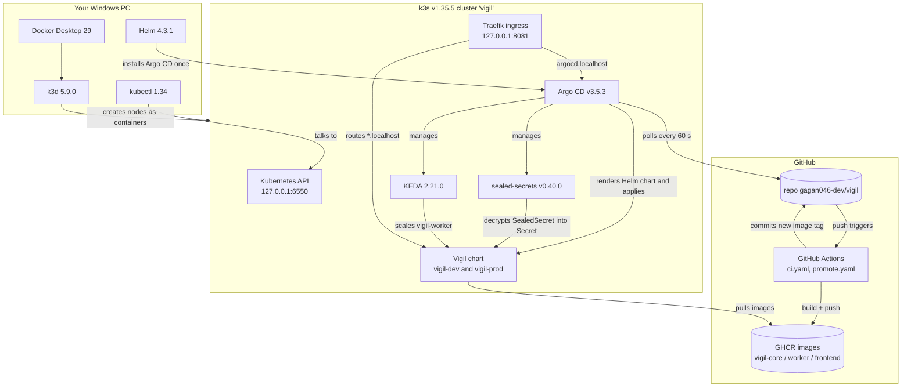
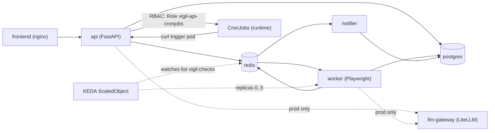

# Vigil tech stack

Every tool Vigil uses, the exact version, where it lives in the repo, and why it is there.
All versions are pinned (no `latest`, no floating tags), so the project builds the same way
next month as it does today.

New to these words? Each one has a one-line definition in
[docs/learn/GLOSSARY.md](docs/learn/GLOSSARY.md).

## At a glance

### Platform and cluster

| Tool | Exact version | Role in Vigil | Defined in |
|---|---|---|---|
| Docker Desktop | 29 (16 GB VM) | Runs the k3d "nodes" as containers; builds images locally | - |
| k3d | 5.9.0 | Creates a k3s cluster inside Docker (1 server + 2 agents) | `cluster/k3d-config.yaml` |
| k3s (Kubernetes) | v1.35.5 (`rancher/k3s:v1.35.5-k3s1`) | The Kubernetes distribution itself | `cluster/k3d-config.yaml` |
| kubectl | 1.34 | Command-line client for the Kubernetes API | used by all `scripts/*.ps1` |
| Traefik | bundled with k3s | Ingress controller: routes `*.localhost:8081` to Services | `className: traefik` in `charts/vigil/values.yaml` |
| local-path provisioner | bundled with k3s | Creates PersistentVolumes on the node's disk | `storageClassName: local-path` |
| Helm | 4.3.1 (local), v4.3.0 (CI) | Package manager / template engine for Kubernetes YAML | `charts/vigil/` |
| KEDA | Helm chart 2.21.0 | Scales `vigil-worker` on the Redis queue length, down to 0 | `gitops/apps/keda.yaml` |
| Argo CD | Helm chart argo-cd 10.9.4 (app v3.5.3) | GitOps: keeps the cluster equal to git | `gitops/bootstrap/` |
| Sealed Secrets | chart 2.20.0 (controller v0.40.0, kubeseal 0.40.0) | Encrypts Secrets so they can live in a public repo | `gitops/apps/sealed-secrets.yaml` |

### Container images

| Image | Exact tag | Used for | Defined in |
|---|---|---|---|
| `python` | `3.12.14-slim-bookworm` | Base of `vigil-core` (api, notifier, demo shop, migrate) | `app/Dockerfile` |
| `mcr.microsoft.com/playwright/python` | `v1.63.0-noble` | Base of `vigil-worker` (Chromium preinstalled) | `app/Dockerfile.worker` |
| `nginxinc/nginx-unprivileged` | `1.30.4-alpine` | Base of `vigil-frontend` (UI + `/api` proxy, port 8080) | `frontend/Dockerfile` |
| `postgres` | `17.11-alpine` | Database: watches, checks, notifications | `charts/vigil/values.yaml` (`postgres.image`) |
| `redis` | `8.2.10-alpine` | Job queue, dry-run replies, LLM budget, politeness slots | `charts/vigil/values.yaml` (`redis.image`) |
| `curlimages/curl` | `8.22.0` | CronJob trigger pods and the `helm test` pod | `values.yaml` (`trigger.image`, `tests.image`) |
| `searxng/searxng` | `2026.10.4-d48c4b555` | Self-hosted metasearch for Compare (prod only; JSON API) | `values.yaml` (`searxng.image`) |
| `ghcr.io/berriai/litellm` | `v1.103.2` | LLM gateway in prod (OpenRouter, fallback model) | `values.yaml` (`llmGateway.image`) |
| `ghcr.io/gagan046-dev/vigil-core` / `-worker` / `-frontend` | `sha-<7 hex>` (CI) or `:dev` (local) | Vigil's own images | `values-dev-images.yaml`, `values-prod-images.yaml` |

### Python libraries (`app/requirements*.txt`)

| Library | Version | Why |
|---|---|---|
| fastapi | 0.142.2 | HTTP API (`app/vigil/api.py`) and the demo shop |
| uvicorn[standard] | 0.54.0 | ASGI server that runs FastAPI |
| httpx | 0.28.1 | HTTP client: page fetches, LLM calls, ntfy/Telegram |
| redis | 8.1.0 | Redis client (queue, budget, rate limits) |
| psycopg[binary] | 3.3.6 | PostgreSQL driver |
| psycopg-pool | 3.3.3 | Connection pool for psycopg |
| pydantic | 2.13.5 | Validates the watch spec (`ErrandSpec`) and API bodies |
| kubernetes | 36.0.3 | The api creates/updates/deletes CronJobs |
| beautifulsoup4 | 4.15.0 | HTML parsing, price/text extraction, CSS selectors |
| prometheus-client | 0.26.0 | `/metrics` on api (8000), worker (9100), notifier (9101) |
| playwright | 1.63.0 | Headless Chromium for JavaScript-rendered pages (worker only) |
| pytest | 9.1.1 | Test runner (247 tests) - dev only |
| fakeredis | 2.39.0 | In-memory Redis for tests - dev only |
| respx | 0.23.1 | Mocks httpx calls in tests - dev only |
| ruff | 0.16.10 | Linter + formatter - dev only |

### CI (GitHub Actions, pinned to full commit SHAs)

| Action / tool | Version | Job |
|---|---|---|
| `actions/checkout` | v7.0.1 (`3d3c42e5...`) | all jobs |
| `actions/setup-python` | v7.0.0 (`5fda3b95...`) | lint + test |
| `azure/setup-helm` | v5.0.1 (`9bc31f4e...`), installs Helm v4.3.0 | helm lint + template |
| kubeconform | v0.8.0 (checksum verified) | schema check of the rendered chart |
| `docker/setup-buildx-action` | v4.4.1 (`f87e5991...`) | build + push |
| `docker/login-action` | v4.6.0 (`dbcb8138...`) | build + push (GHCR) |
| `docker/metadata-action` | v6.2.0 (`dc802804...`) | build + push (`sha-` tag) |
| `docker/build-push-action` | v7.4.0 (`c3c9e263...`) | build + push (GHA layer cache) |
| GitHub Container Registry (GHCR) | - | stores the public images |

### LLM (prod only, optional)

| Piece | Value | Defined in |
|---|---|---|
| Model alias the app asks for | `vigil-smart` | `values.yaml` `config.llmModel` |
| Primary model | `openrouter/nvidia/nemotron-3-super-120b-a12b:free` | `values.yaml` `llmGateway.primaryModel` |
| Fallback model | `openrouter/google/gemma-4-31b-it:free` | `values.yaml` `llmGateway.fallbackModel` |
| Daily budget | 40 calls (counter in Redis) | `values.yaml` `config.llmDailyBudget` |

### Price compare (web search, prod; offline demo in dev)

| Piece | Value | Defined in |
|---|---|---|
| Search provider | `demo` in dev (fictional demo-shop sellers, offline), `searxng` in prod | `values.yaml` `config.searchProvider` |
| SearXNG | image `searxng/searxng:2026.10.4-d48c4b555`, Service `vigil-searxng:8080`, user 977, read-only root filesystem | `templates/searxng.yaml`, `values.yaml` `searxng` |
| SearXNG settings | JSON output on, limiter and image proxy off | `vigil.searxngSettings` in `templates/searxng.yaml` |
| SearXNG secret key | key `searxng-secret` of `vigil-secrets` (SealedSecret in prod) | `searxng.secretKey`, `gitops/envs/prod/vigil-secrets.sealed.yaml` |
| Seller allow-list | `flipkart.com, amazon.in, myntra.com, croma.com, reliancedigital.in, vijaysales.com, tatacliq.com, ajio.com` | `config.compareSellers` |
| Page budget | 8 seller pages per comparison (1 to 20) | `config.compareMaxPages` |
| Price sources, in order | JSON-LD, meta tags, price heuristics, LLM (max 3 calls) | `app/vigil/offers.py`, `compare.py` |
| Match thresholds | accept 0.75, review 0.5 | `app/vigil/matching.py` |
| Network rules | `allow-searxng` (only the worker, TCP 8080) and a worker egress rule | `templates/networkpolicies.yaml` |

Dev has `searxng.enabled: false` (saves about 200 MB of RAM); prod has it on.

## Tech stack by folder

| Folder | What is in it | Tools / languages | Phase |
|---|---|---|---|
| `app/vigil/` | api, worker, notifier, planner, scheduler, extract, evaluate, llm, demo shop, migrate; price compare: `compare`, `search`, `offers`, `matching` | Python 3.12, FastAPI, Playwright, BeautifulSoup, psycopg, redis, kubernetes client | 1 |
| `app/tests/` | 16 test files, 247 tests | pytest, fakeredis, respx | 1 |
| `app/Dockerfile*` | `vigil-core` (multi-stage) and `vigil-worker` images, non-root users 10001 / 1001 | Docker | 1 |
| `frontend/` | Static UI: hash router, ES modules, CSS design tokens (light/dark), no framework or build step; nginx config proxying `/api/` to `vigil-api`, strict CSP; `dev/mock-server.py` for UI work | HTML, CSS, JavaScript, nginx-unprivileged | 1 |
| `cluster/` | `k3d-config.yaml`: nodes, k3s version, ports 8081 and 6550 | k3d, k3s | 1 |
| `k8s/` | Raw manifests `00-namespace` ... `40-networkpolicies`, applied in order | Kubernetes YAML, kubectl | 1 |
| `scripts/` | `import-images`, `create-dev-secret`, `phase1-up`, `phase2-up`, `phase3-up`, `demo` | PowerShell 5.1, curl.exe | 1-3 |
| `charts/vigil/` | Helm chart: `Chart.yaml`, `values*.yaml`, `templates/` incl. `_helpers.tpl`, `NOTES.txt`, `tests/` | Helm (Go templates), KEDA CRD, LiteLLM | 2 |
| `gitops/bootstrap/` | `argocd-values.yaml` (Argo CD settings), `root-app.yaml` (app of apps) | Argo CD, Helm | 3 |
| `gitops/apps/` | Child Applications: `keda`, `sealed-secrets`, `vigil-dev`, `vigil-prod` | Argo CD Application CRD | 3 |
| `gitops/envs/prod/` | `vigil-secrets.sealed.yaml` (encrypted prod Secret) | Sealed Secrets, kubeseal | 3 |
| `.github/workflows/` | `ci.yaml` (test, check, build, bump dev), `promote.yaml` (PR to prod) | GitHub Actions, GHCR | 4 |
| `.github/scripts/` | `write-image-values.sh` - writes the `*-images.yaml` values files | Bash | 4 |
| `docs/` | `learn/` course chapters, `notes/` verification logs | Markdown, Mermaid | - |

## How the tools relate

Inside the Vigil chart:

## Kubernetes / Helm / Argo CD / CI topics implemented

Where to look in the repo to see each concept for real. Phase 1 file in `k8s/`,
the Helm version of the same thing in `charts/vigil/templates/`.

### Kubernetes

| Topic | Where | Notes |
|---|---|---|
| Cluster with control plane + workers | `cluster/k3d-config.yaml` | `servers: 1`, `agents: 2` |
| Namespace + Pod Security Standard `restricted` | `k8s/00-namespace.yaml`, `scripts/phase2-up.ps1`, `managedNamespaceMetadata` in `gitops/apps/vigil-dev.yaml` | enforce + warn + audit labels |
| ConfigMap -> env vars (`envFrom`) | `k8s/01-configmap.yaml`, `templates/configmap.yaml` | `vigil-config` |
| Secret + `secretKeyRef` (incl. `optional: true`) | `k8s/02-secret.example.yaml`, `scripts/create-dev-secret.ps1`, `templates/secret.yaml`, `_helpers.tpl` (`vigil.envLlmKey`) | random values, never printed |
| StatefulSet + PersistentVolumeClaim | `k8s/10-postgres.yaml`, `k8s/11-redis.yaml`, `templates/postgres.yaml`, `templates/redis.yaml` | `local-path` storage |
| Deployment + rolling update | `k8s/20-api.yaml`, `templates/api.yaml` | `maxUnavailable: 0, maxSurge: 1` |
| Service (ClusterIP) and DNS names | every component file | `vigil-api:8000`, `vigil-redis:6379` ... |
| initContainer (DB migration) | `templates/api.yaml` (`migrate`) | `python -m vigil.migrate`, advisory lock |
| Liveness / readiness probes | `templates/api.yaml` (`/healthz`, `/readyz`), `templates/worker.yaml` (`/metrics`) | |
| Resource requests / limits | every Deployment; values in `values.yaml` | |
| securityContext (non-root, read-only root FS, drop ALL) | `_helpers.tpl` (`vigil.podSecurity`, `vigil.containerSecurity`) | |
| emptyDir volumes (incl. RAM-backed `/dev/shm`) | `templates/worker.yaml` | Chromium needs shared memory |
| topologySpreadConstraints | `templates/api.yaml` | spread replicas across nodes |
| terminationGracePeriodSeconds | `templates/worker.yaml` (90 s) | finish the current check on scale-down |
| ServiceAccount + Role + RoleBinding (RBAC) | `k8s/20-api.yaml`, `templates/api.yaml` | api may only manage CronJobs in its namespace |
| CronJob + Job created at runtime | `app/vigil/scheduler.py` (`build_cronjob`) | `spec.timeZone: Asia/Kolkata`, label `vigil.dev/errand-id` |
| Ingress (host-based routing) | `k8s/30-ingress.yaml`, `templates/ingress.yaml` | Traefik, `*.localhost` |
| NetworkPolicy: default deny + allow rules + egress | `k8s/40-networkpolicies.yaml`, `templates/networkpolicies.yaml` | `default-deny-ingress`, `worker-egress` blocks private CIDRs; `allow-searxng` (only the worker may reach SearXNG) plus a worker egress rule to it |
| Custom Resource (CRD) usage | `ScaledObject` (KEDA), `Application` (Argo CD), `SealedSecret` | |
| Event-driven autoscaling / scale to zero | `templates/worker.yaml` (ScaledObject) | Redis list `vigil:checks`, min 0 (dev) / 1 (prod), max 5 |
| Image import into nodes | `scripts/import-images.ps1` | `docker save` -> `ctr images import` |

### Helm

| Topic | Where |
|---|---|
| Chart metadata, chart vs app version, `kubeVersion` | `charts/vigil/Chart.yaml` |
| Default values + per-environment overrides | `values.yaml`, `values-dev.yaml`, `values-prod.yaml` |
| Several `-f` files layered (images separate) | `values-dev-images.yaml`, `values-prod-images.yaml`, `gitops/apps/vigil-*.yaml` |
| Named templates (`define` / `include`), `nindent`, `toYaml` | `templates/_helpers.tpl` |
| Conditionals (`if`, `with`) to switch components on/off | `templates/demo-shop.yaml`, `templates/llm-gateway.yaml`, `templates/secret.yaml`, `templates/worker.yaml` |
| Config checksum annotation -> pods roll on config change | `_helpers.tpl` (`vigil.configChecksums`), `templates/llm-gateway.yaml` |
| `helm test` hook | `templates/tests/test-api.yaml` |
| Post-install notes | `templates/NOTES.txt` |
| Install / upgrade / rollback / history | `scripts/phase2-up.ps1`, `docs/notes/platform-verification.md` |
| `helm lint --strict`, `helm template` + kubeconform | `.github/workflows/ci.yaml` (job `helm`) |
| Files excluded from the chart package | `charts/vigil/.helmignore` |

### Argo CD and GitOps

| Topic | Where |
|---|---|
| Installing Argo CD with Helm (the one manual step) | `gitops/bootstrap/argocd-values.yaml`, `scripts/phase3-up.ps1` |
| App of apps | `gitops/bootstrap/root-app.yaml` -> `gitops/apps/` |
| Application from a Helm repo chart | `gitops/apps/keda.yaml` |
| Application from a chart in another git repo | `gitops/apps/sealed-secrets.yaml` |
| Application from this repo's chart + value files | `gitops/apps/vigil-dev.yaml` |
| Multi-source Application | `gitops/apps/vigil-prod.yaml` (`sources:` chart + `gitops/envs/prod`) |
| Automated sync, `prune`, `selfHeal`, retry with backoff | all `gitops/apps/*.yaml` (prod has `prune: false`) |
| Sync waves (ordering) | `argocd.argoproj.io/sync-wave` in apps, `templates/configmap.yaml`, `postgres.yaml`, `redis.yaml`, the SealedSecret |
| `CreateNamespace` + `managedNamespaceMetadata` | `gitops/apps/vigil-dev.yaml`, `vigil-prod.yaml` |
| `ignoreDifferences` + `ServerSideApply` | `gitops/apps/keda.yaml` |
| Adopting an existing Helm release | `gitops/apps/keda.yaml` (header comment) |
| Reconciliation interval | `timeout.reconciliation: 60s` in `argocd-values.yaml` |
| Sealed Secrets (encrypt, commit, controller decrypts) | `gitops/envs/prod/vigil-secrets.sealed.yaml` |
| Rollback by `git revert`, self-heal demo | commits `814c072` / `c9429ed`, `docs/notes/gitops-verification.md` |

### CI/CD (GitHub Actions)

| Topic | Where |
|---|---|
| Triggers, `paths-ignore`, `concurrency` | `.github/workflows/ci.yaml` (top) |
| Least-privilege `permissions` per job | `ci.yaml` (`packages: write` only in build, `contents: write` only in bump-dev) |
| Actions pinned to commit SHAs | every `uses:` line |
| Lint + tests | job `lint-test` |
| Chart validation | job `helm` (lint, template, kubeconform) |
| Matrix build of 3 images, GHA layer cache | job `build-push` |
| Immutable image tags `sha-<7 hex>` | `docker/metadata-action` with `type=sha` |
| Auto-deploy to dev by committing to git (no cluster credentials in CI) | job `bump-dev`, `.github/scripts/write-image-values.sh` |
| Loop prevention | `[skip ci]` + `GITHUB_TOKEN` pushes |
| Promotion to prod by pull request | `.github/workflows/promote.yaml` (`workflow_dispatch`) |
