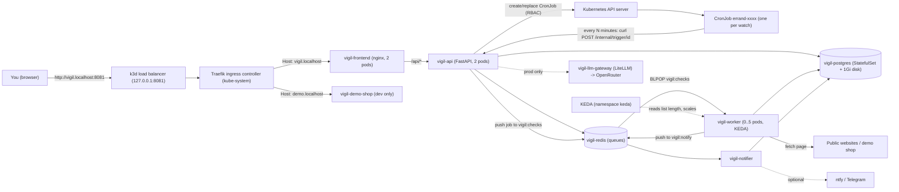
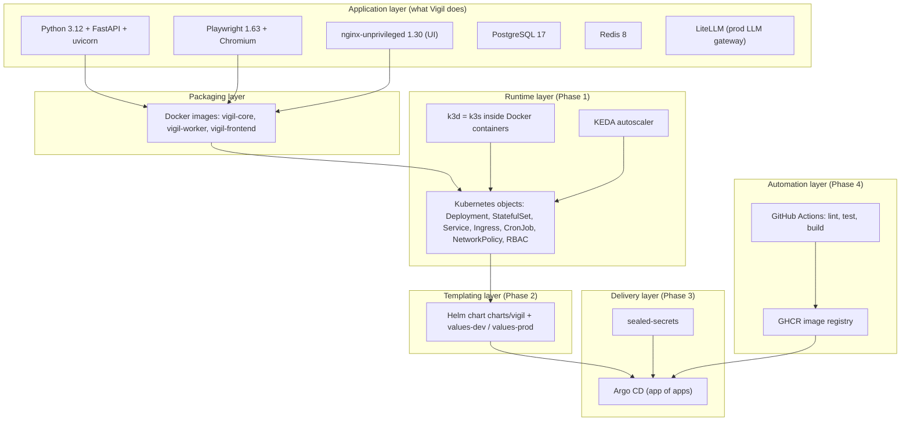
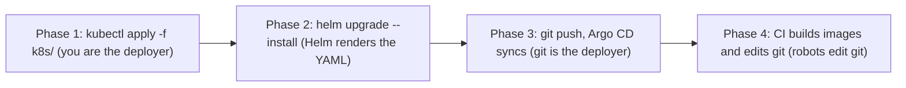

# 00 - Start here

> **Who this guide is for:** you know basic Docker (images, containers, `docker run`,
> `docker compose`) from earlier projects, and you have **never** used Kubernetes, Helm
> or Argo CD. Every idea is explained from zero, with an everyday analogy first and the
> real YAML from this repository second.

---

## 1. What is Vigil?

Vigil is "an AI agent that keeps watch on web pages for you". You type a sentence in
plain English, for example:

> *Tell me when http://vigil-demo-shop:8000/static drops below ₹1,20,000, check every minute*

and Vigil:

1. **plans** a watch ("errand") from that sentence - kind `price_below`, threshold
   `120000`, every `1` minute (rules first, an LLM only when the sentence is unclear),
2. **dry-runs** it - a worker fetches the page right now and shows you what it found,
3. **keeps watch** - it creates a Kubernetes **CronJob** that fires on the schedule,
4. **checks** the page every time (plain HTTP, or a headless Chromium browser for
   JavaScript-heavy pages),
5. **notifies** you exactly once when the condition becomes true (in-app inbox,
   optionally ntfy or Telegram).

This is the real output recorded in `docs/notes/platform-verification.md`:

```text
Plan  -> kind price_below, threshold 120000.0, every_minutes 1, source rules
Dry run -> ok True, value 134990.0, condition_true False, selector span.price-now
Keep watch -> errand 6989d0b7-...  schedule '*/1 * * * *'
first check: baseline 134990.0
POST demo.localhost:8081/admin/price {value:114990}
NOTIFICATION: Price drop: Aurora 15 (RTX 5070) is ₹1,14,990 (target < ₹1,20,000, was ₹1,34,990)
```

The app itself is small on purpose. **The real subject of this project is the platform
around it**: how to run it on Kubernetes, package it with Helm, deploy it with Argo CD
(GitOps), and ship new versions automatically with CI.

> **Analogy for the whole project.** Think of Vigil as a small security company.
> The *receptionist* (frontend) takes your request, the *manager* (api) writes it in the
> logbook (Postgres) and sets an alarm clock (CronJob) for it. When the alarm rings, a
> slip goes into the *in-tray* (Redis queue). *Guards* (workers) take slips from the
> in-tray and go look at the website. If something happened, they put a note in the
> *out-tray* and the *messenger* (notifier) delivers it to you. Kubernetes is the
> *building manager* who makes sure there are always enough staff at their desks.

---

## 2. The big picture

### 2.1 The running system (one environment)



Read it left to right:

| Box | What it is | Where it is defined |
|---|---|---|
| k3d load balancer | A small container that forwards `127.0.0.1:8081` on your PC into the cluster | `cluster/k3d-config.yaml` |
| Traefik | The "front door" of the cluster, picks a backend by hostname | built into k3s; rules in `k8s/30-ingress.yaml` |
| vigil-frontend | nginx serving the web UI and forwarding `/api/*` | `frontend/`, `k8s/23-frontend.yaml` |
| vigil-api | FastAPI backend: plan, dry run, store, create CronJobs | `app/vigil/api.py`, `k8s/20-api.yaml` |
| vigil-postgres | Database: watches, checks, inbox | `k8s/10-postgres.yaml` |
| vigil-redis | Queues `vigil:checks` and `vigil:notify`, budgets, politeness | `k8s/11-redis.yaml`, `app/vigil/queue.py` |
| CronJob `errand-...` | The alarm clock for one watch, **created at runtime by the api** | `app/vigil/scheduler.py` |
| vigil-worker | Fetches pages (httpx or Playwright/Chromium), evaluates, queues notifications | `app/vigil/worker.py`, `k8s/21-worker.yaml` |
| KEDA | Scales the worker 0..5 on the queue length | `k8s/21-worker.yaml` (ScaledObject) |
| vigil-notifier | Delivers notifications to the inbox (and ntfy/Telegram) | `app/vigil/notifier.py`, `k8s/22-notifier.yaml` |
| vigil-demo-shop | A fake shop so demos never scrape real websites | `app/vigil/demo_shop.py`, `k8s/24-demo-shop.yaml` |
| vigil-llm-gateway | LiteLLM proxy to OpenRouter, production only | `charts/vigil/templates/llm-gateway.yaml` |

### 2.2 The tech stack



Each layer only adds one new idea on top of the previous one. That is exactly how the
four phases are built.

---

## 3. The four phases (and their git tags)

Every phase is a git tag, so you can always look at the repository exactly as it was.

| Phase | Git tag | New idea | Main folders | Namespace(s) |
|---|---|---|---|---|
| 1 | `phase-1` | Raw Kubernetes YAML, applied with `kubectl apply` | `cluster/`, `k8s/`, `scripts/phase1-up.ps1` | `vigil` |
| 2 | `phase-2` | The same objects as a **Helm chart** with dev/prod values | `charts/vigil/`, `scripts/phase2-up.ps1` | `vigil` |
| 3 | `phase-3` | **GitOps**: Argo CD deploys from GitHub; secrets sealed | `gitops/`, `scripts/phase3-up.ps1` | `vigil-dev`, `vigil-prod` |
| 4 | `phase-4` | **CI**: GitHub Actions builds images, bumps dev, opens a prod PR | `.github/` | `vigil-dev`, `vigil-prod` |



Useful commands to explore the history:

```bash
git tag                                   # phase-1 phase-2 phase-3 phase-4
git show --stat phase-1                   # what Phase 1 added
git diff --stat phase-1 phase-2           # Phase 2: 23 files changed, almost all new chart files
git diff phase-1 phase-2 -- k8s charts    # k8s/ is unchanged; charts/ is new
git diff --stat phase-2 phase-3 -- gitops # the Argo CD Applications
git diff --stat phase-3 phase-4 -- .github
git checkout phase-1                      # look around (then: git checkout main)
```

> The raw `k8s/` folder was **kept** after Phase 1 so you can still read and replay it.
> Today the cluster runs Vigil through Argo CD in `vigil-dev` and `vigil-prod`.

---

## 4. How to read this guide

| Chapter | File | You will learn |
|---|---|---|
| 00 | this file | What Vigil is, the architecture, the phases |
| 01 | [01-kubernetes-from-zero.md](01-kubernetes-from-zero.md) | Cluster, node, control plane, API server, etcd, scheduler, kubelet, k3s/k3d, kubeconfig, namespaces, the reconciliation loop |
| 02 | [02-phase1-pods-deployments-services.md](02-phase1-pods-deployments-services.md) | Pods, ReplicaSets, Deployments, labels, Services and DNS, probes, resources, ConfigMap, Secret, StatefulSet + PVC, initContainers, Ingress - walking through `k8s/*.yaml` |
| 03 | [03-phase1-security-and-scaling.md](03-phase1-security-and-scaling.md) | ServiceAccount + RBAC, runtime CronJobs, Pod Security Standards, securityContext, NetworkPolicies, the SSRF guard, KEDA and the HPA |
| 04 | [04-phase2-helm.md](04-phase2-helm.md) | Phase 2: packaging Vigil as a Helm chart with dev/prod values |
| 05 | [05-phase3-argocd-gitops.md](05-phase3-argocd-gitops.md) | Phase 3: GitOps with Argo CD, app of apps, Sealed Secrets |
| 06 | [06-phase4-ci-to-gitops.md](06-phase4-ci-to-gitops.md) | Phase 4: GitHub Actions builds images, bumps dev, promotes prod by PR |
| 07 | [07-how-vigil-works.md](07-how-vigil-works.md) | Inside the app: planner, worker, extraction, notifications |
| - | [GLOSSARY.md](GLOSSARY.md) | Every technical word, A to Z |

Every chapter has the same shape:

1. **The idea in plain words** with an analogy.
2. **A diagram** (Mermaid - GitHub draws it for you).
3. **The real file** from this repo, then a table: `Line | What it does | Why it matters / what breaks without it`.
4. **Try it yourself** - commands that were really run (from `docs/notes/`).
5. **Common mistakes** and **Key words**.

How to read YAML in this guide - the 30-second version:

```yaml
apiVersion: apps/v1        # which "version of the dictionary" this object uses
kind: Deployment           # what kind of object it is
metadata:                  # its name tag: name, namespace, labels
  name: vigil-api
spec:                      # what you WANT (the desired state)
  replicas: 2
# status:                  # what IS (filled in by Kubernetes, never by you)
```

Indentation is meaning in YAML (2 spaces, never tabs). `key: value` is a map entry,
`- item` is a list entry, `{a: 1, b: 2}` and `[x, y]` are short inline forms of the
same thing - this repo uses the inline form often to keep files short.

---

## 5. Your PC setup (what this project runs on)

| Tool | Version | Used for |
|---|---|---|
| Docker Desktop | 29 (16 GB VM) | Runs the k3d "nodes" as containers, builds images |
| k3d | 5.9.0 | Creates the cluster (`k3d cluster create --config cluster/k3d-config.yaml`) |
| k3s | v1.35.5 | The Kubernetes distribution inside k3d |
| kubectl | 1.34 | Talks to the Kubernetes API |
| helm | 4.3.1 | Installs charts (KEDA, Argo CD, Vigil's own chart) |
| gh | logged in | GitHub repo, workflow runs |

Fixed addresses (other projects on this PC use 3000, 8000, 8080, ...):

| Address | What |
|---|---|
| `https://127.0.0.1:6550` | Kubernetes API (kubectl talks here) |
| `http://vigil.localhost:8081` | Phase 1/2 UI |
| `http://vigil-dev.localhost:8081` / `http://vigil-prod.localhost:8081` | Phase 3+ UIs |
| `http://demo.localhost:8081` | Demo shop (`/admin` changes price/stock) |
| `http://argocd.localhost:8081` | Argo CD UI (Phase 3+) |

Any `*.localhost` name points to `127.0.0.1` in browsers and on Windows, so no hosts-file
edits are needed.

---

## Try it yourself

```powershell
# Is the cluster up?
kubectl config current-context            # k3d-vigil
kubectl get nodes                         # 1 server + 2 agents, all Ready

# What is running today (Phase 3+ deploys to vigil-dev and vigil-prod)?
kubectl get pods -n vigil-dev
kubectl get cronjobs -n vigil-dev         # one CronJob per watch you created

# Open the UI and the demo shop
start http://vigil-dev.localhost:8081
start http://demo.localhost:8081/admin

# Run the end-to-end demo (Phase 1/2 addresses by default)
powershell -ExecutionPolicy Bypass -File scripts\demo.ps1
# Against the dev environment of Phase 3+:
powershell -ExecutionPolicy Bypass -File scripts\demo.ps1 -Vigil http://vigil-dev.localhost:8081 -Namespace vigil-dev
```

## Common mistakes

| Mistake | What happens | Fix |
|---|---|---|
| Typing `curl` in Windows PowerShell 5.1 | It is an alias for `Invoke-WebRequest`, flags like `-sS` fail | Use `curl.exe` (as `scripts/demo.ps1` does) |
| Sending `₹` directly on the Windows command line | The console code page mangles it; the planner sees no price and falls back to `page_changed` | Put JSON in a UTF-8 file and use `--data-binary @file` |
| Using port 8080 for the cluster | Clashes with another project on this PC | Vigil uses 8081 (see `cluster/k3d-config.yaml`) |
| Reading `k8s/` and expecting it to be what runs today | Today Argo CD deploys the Helm chart to `vigil-dev`/`vigil-prod` | Use `-n vigil-dev`; replay Phase 1 only on purpose |

## Key words

- **Errand / watch** - one thing Vigil keeps an eye on (URL + condition + interval).
- **Cluster** - a group of machines that Kubernetes manages as one computer (chapter 01).
- **Manifest** - a YAML file describing Kubernetes objects (`k8s/*.yaml`).
- **Helm chart** - a template package that produces manifests (Phase 2).
- **GitOps** - "git is the source of truth"; a robot (Argo CD) makes the cluster match git (Phase 3).
- **CI** - Continuous Integration: robots test and build every push (Phase 4).
- **Namespace** - a named folder inside the cluster (`vigil`, `vigil-dev`, `vigil-prod`).
- **Tag (git)** - a fixed name for a commit, here `phase-1` .. `phase-4`.
