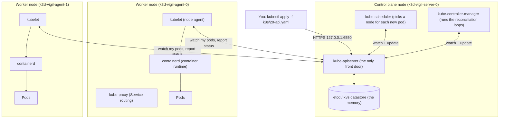
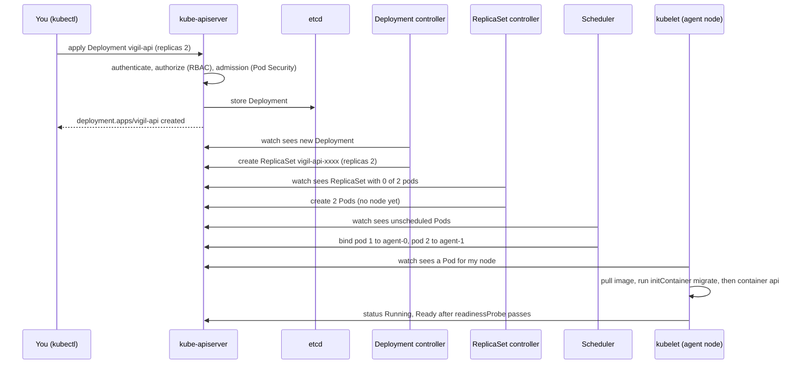
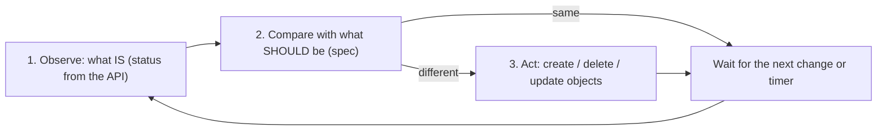
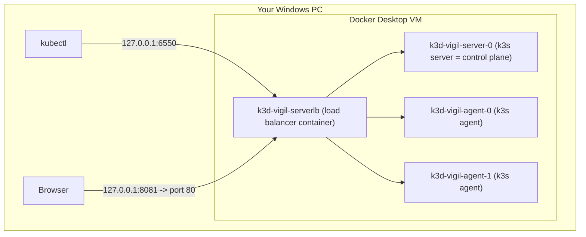
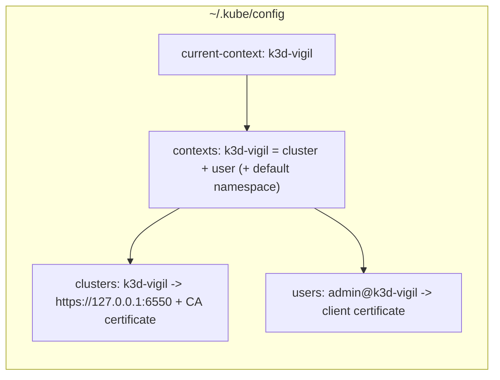

# 01 - Kubernetes from zero

> **Goal of this chapter:** understand what Kubernetes *is* before touching any Vigil
> YAML. You will learn the parts of a cluster, how `kubectl` finds it, what k3s and k3d
> are, what a namespace is, and the single most important idea in Kubernetes: the
> **reconciliation loop**.

---

## 1. Why Kubernetes at all? (from Docker to Kubernetes)

With Docker you say **"run this container"**:

```bash
docker run -d -p 8000:8000 vigil-core:dev
```

That is an *order*. If the container crashes at 3 a.m., nobody restarts it. If the PC
dies, it is gone. If you need 5 copies, you start 5 by hand.

With Kubernetes you say **"I want 2 copies of this container to exist, always"**:

```yaml
kind: Deployment
spec:
  replicas: 2
```

That is a *wish* (a **desired state**). Kubernetes keeps comparing the wish with
reality, forever, and fixes any difference. A crashed container is restarted, a missing
copy is recreated, a dead machine's work is moved to another machine.

| | Docker (imperative) | Kubernetes (declarative) |
|---|---|---|
| You say | "do this now" | "this is how it should be" |
| Crash at 3 a.m. | stays down (unless a restart policy catches it) | recreated automatically |
| Many machines | one host | many nodes act as one |
| Scaling | start more by hand | change one number, or let an autoscaler do it |
| Networking between apps | container names on one Docker network | Services + cluster DNS across all nodes |

> **Analogy:** Docker is a cook you tell "make one pizza". Kubernetes is a restaurant
> manager you tell "there must always be 2 pizzas on the counter". The manager keeps
> looking at the counter and orders a new pizza whenever one is missing.

---

## 2. The parts of a cluster

A **cluster** is a set of machines (**nodes**) that Kubernetes runs as one big computer.
Nodes come in two roles:

- **Control plane** (in k3s called a *server*): the brain. It stores the desired state
  and makes decisions.
- **Worker nodes** (in k3s called *agents*): the muscles. They actually run your containers.



| Part | Analogy | What it really does |
|---|---|---|
| **kube-apiserver** | the reception desk | Every request (from you, from kubelets, from controllers, from Vigil's api) goes through it. It checks who you are (authentication), whether you may do it (RBAC, chapter 03), whether the object is allowed (admission, e.g. Pod Security), then stores it. |
| **etcd** (k3s: embedded datastore) | the filing cabinet | A key-value database holding every object: Deployments, Secrets, Pods... Only the API server talks to it. |
| **kube-scheduler** | the seating host | Sees a new pod with no node, looks at the free CPU/memory on each node and the pod's `requests`, and writes the chosen node into the pod. |
| **kube-controller-manager** | the shift supervisors | Many small loops ("controllers"): the Deployment controller, the ReplicaSet controller, the Job controller, the CronJob controller... each one fixes one kind of difference between wish and reality. |
| **kubelet** | the floor worker on each node | Watches the API for pods assigned to *its* node, tells the container runtime to start them, runs their **probes**, reports status back. |
| **containerd** | the actual cook | The container runtime (same engine Docker uses inside). It pulls images and runs containers. |
| **kube-proxy / networking** | the internal phone system | Makes Service IPs work and gives every pod its own IP. k3s uses flannel for pod networking and kube-router for NetworkPolicies. |
| **CoreDNS** | the phone book | Turns names like `vigil-postgres` into IP addresses (chapter 02). |

Key fact: **nothing talks to etcd except the API server, and nothing changes the cluster
except through the API server.** kubectl, the scheduler, the kubelet, Argo CD and even
Vigil's own api (when it creates CronJobs) are all just API clients.

---

## 3. What happens when you `kubectl apply`



Notice: `kubectl` returned "created" **long before** the pods were running. kubectl
only stores your wish; controllers make it real afterwards. That is why the scripts
in this repo use `kubectl rollout status` to *wait*:

```powershell
# scripts/phase1-up.ps1
function WaitRollout($kind, $name, $timeout = "240s") {
    kubectl rollout status "$kind/$name" -n $ns --timeout=$timeout
    if ($LASTEXITCODE -ne 0) { throw "$kind/$name did not become ready" }
}
```

---

## 4. The reconciliation loop - the heart of Kubernetes

Every controller runs the same tiny program, forever:



Examples you will see in this project:

| Controller | Wish (spec) | Reality | Action |
|---|---|---|---|
| ReplicaSet controller | `replicas: 2` for vigil-api | one pod crashed and was deleted | creates a new pod |
| kubelet | container `api` should run | process exited | restarts the container (`RESTARTS` goes up) |
| CronJob controller | schedule `*/1 * * * *` | a minute boundary passed | creates a Job, which creates a trigger pod |
| KEDA + HPA (chapter 03) | ~3 queued jobs per worker | 9 jobs in `vigil:checks`, 1 worker | scales vigil-worker to 3 |
| **Vigil's own api** | one CronJob per active watch in Postgres | a CronJob is missing or extra | `reconcile()` creates/deletes CronJobs |
| Argo CD (Phase 3) | the chart in git | someone ran `kubectl scale --replicas=5` | sets it back to 2 within seconds |

The Vigil api really contains its own reconciliation loop, written in the same spirit.
From `app/vigil/scheduler.py`:

```python
    def reconcile(self, errands: list[dict]) -> dict:
        wanted = {e["id"]: e for e in errands}
        existing = self.api.list_namespaced_cron_job(self.namespace, label_selector=LABEL_ERRAND)
        deleted = 0
        present: set[str] = set()
        for cj in existing.items:
            eid = (cj.metadata.labels or {}).get(LABEL_ERRAND)
            if eid not in wanted:
                self._delete_name(cj.metadata.name)  # another api replica may have deleted it already
                deleted += 1
            else:
                present.add(eid)
        created = 0
        for eid, errand in wanted.items():
            self.upsert(errand)  # also refreshes drifted specs (e.g. a new TRIGGER_IMAGE)
            created += eid not in present
        return {"created": created, "deleted": deleted}
```

| Line | What it does | Why it matters / what breaks without it |
|---|---|---|
| `wanted = {...}` | The desired state: every watch stored in Postgres | Postgres is Vigil's "source of truth" for schedules |
| `list_namespaced_cron_job(..., label_selector=LABEL_ERRAND)` | Observe: all CronJobs carrying the label `vigil.dev/errand-id` | Without the label filter it could touch CronJobs it does not own |
| `if eid not in wanted: self._delete_name(...)` | Act: delete orphans (watch was deleted while the API call failed) | Without it, deleted watches would keep firing forever |
| `self.upsert(errand)` | Act: create, or replace if it exists (HTTP 409) | Also repairs "drift", e.g. a changed trigger image |

It runs once at api start-up with retries (`_reconcile_loop` in `app/vigil/api.py`,
up to 20 attempts with doubling delay), so the cluster heals after restarts.

> **Takeaway:** in Kubernetes you never "run" things. You **describe** things, and loops
> make reality match. Argo CD in Phase 3 is just one more loop - one that reads git.

---

## 5. k3s and k3d - a real cluster on one PC

- **Kubernetes** is the open-source system (the "upstream" project).
- **k3s** is a small, certified Kubernetes *distribution* by Rancher/SUSE: a single
  binary with batteries included - **Traefik** (ingress), **CoreDNS**, **local-path**
  storage provisioner, **flannel** networking, a **NetworkPolicy** controller, and an
  embedded datastore instead of a separate etcd cluster.
- **k3d** runs k3s *inside Docker containers*. Each "node" is a container on your PC.



The whole cluster is defined in one file:

```yaml
# cluster/k3d-config.yaml
apiVersion: k3d.io/v1alpha5
kind: Simple
metadata:
  name: vigil                     # cluster name -> kube context "k3d-vigil"
servers: 1                        # control-plane node (runs the Kubernetes API)
agents: 2                         # worker nodes (run our pods)
image: rancher/k3s:v1.35.5-k3s1   # pinned k3s (Kubernetes) version
kubeAPI:
  host: "127.0.0.1"               # only reachable from this PC
  hostIP: "127.0.0.1"
  hostPort: "6550"                # kubectl talks to https://127.0.0.1:6550
ports:
  # Host port 8081 -> port 80 of the k3d load balancer -> Traefik ingress inside the cluster.
  # So http://vigil.localhost:8081 reaches our Ingress. (8080 is used by another project.)
  - port: 127.0.0.1:8081:80
    nodeFilters:
      - loadbalancer
options:
  k3d:
    wait: true                    # block until the nodes are ready
  kubeconfig:
    updateDefaultKubeconfig: true # add the cluster to ~/.kube/config
    switchCurrentContext: true    # and make it the active kubectl context
```

| Line | What it does | Why it matters / what breaks without it |
|---|---|---|
| `apiVersion: k3d.io/v1alpha5` / `kind: Simple` | This is a **k3d** config file, not a Kubernetes object | `kubectl apply` cannot read it; only `k3d cluster create --config` can |
| `name: vigil` | Cluster name; containers are `k3d-vigil-*`, context `k3d-vigil` | Other k3d clusters on the PC keep their own names |
| `servers: 1` | One control-plane node | One is enough on a laptop (no high availability) |
| `agents: 2` | Two worker nodes | Lets you see pods spread over nodes (`topologySpreadConstraints` in chapter 02) |
| `image: rancher/k3s:v1.35.5-k3s1` | Pins the Kubernetes version | Without a pin, a re-create could silently give a different version |
| `host/hostIP: "127.0.0.1"` | API only on localhost | Binding to 0.0.0.0 would expose the cluster API to your network |
| `hostPort: "6550"` | Fixed API port | A random port would change your kubeconfig every re-create |
| `port: 127.0.0.1:8081:80` + `nodeFilters: [loadbalancer]` | Maps PC port 8081 to port 80 of the load balancer, where Traefik listens | Without it, nothing from your browser can reach the Ingress; 8080 is taken by another project |
| `wait: true` | `k3d cluster create` waits until nodes are ready | The next script step might fail on a half-started cluster |
| `updateDefaultKubeconfig` / `switchCurrentContext` | Adds credentials to `~/.kube/config` and selects the cluster | Without them kubectl would talk to a different cluster (or none) |

> **Images in k3d:** the nodes have their own containerd, separate from Docker Desktop's
> images. Local images like `vigil-core:dev` must be copied in. `scripts/import-images.ps1`
> streams `docker save` into `ctr -n k8s.io images import` on every node, because
> `k3d image import` could report success while importing nothing with Docker Desktop's
> containerd image store.

---

## 6. kubeconfig and contexts - how kubectl knows where to go

`kubectl` reads `~/.kube/config` (the **kubeconfig**). It holds three lists:



- A **context** = which cluster + which user (+ optionally a default namespace).
- `current-context` is the one kubectl uses when you do not pass `--context`.

```bash
kubectl config get-contexts            # list all; * marks the current one
kubectl config current-context         # k3d-vigil
kubectl config use-context k3d-vigil   # switch
kubectl cluster-info                   # Kubernetes control plane is running at https://127.0.0.1:6550
```

> Your kubeconfig contains a **private key**. Never commit it or paste it anywhere.

---

## 7. Namespaces - folders inside the cluster

A **namespace** is a named folder for objects. Two objects can have the same name in
different namespaces (that is how `vigil-dev` and `vigil-prod` both have a `vigil-api`).

| Namespace | Who made it | What lives there |
|---|---|---|
| `kube-system` | k3s | CoreDNS, Traefik, metrics-server, local-path provisioner (and sealed-secrets in Phase 3) |
| `keda` | Helm (Phase 1), Argo CD (Phase 3+) | The KEDA operator |
| `vigil` | `k8s/00-namespace.yaml` (Phase 1/2) | The whole app |
| `argocd` | Helm (Phase 3) | Argo CD |
| `vigil-dev`, `vigil-prod` | Argo CD (Phase 3+) | The app, one copy per environment |

The Phase 1 namespace file:

```yaml
# k8s/00-namespace.yaml
apiVersion: v1
kind: Namespace
metadata:
  name: vigil
  labels:
    app.kubernetes.io/part-of: vigil
    pod-security.kubernetes.io/enforce: restricted
    pod-security.kubernetes.io/enforce-version: latest
    pod-security.kubernetes.io/warn: restricted
    pod-security.kubernetes.io/warn-version: latest
    pod-security.kubernetes.io/audit: restricted
    pod-security.kubernetes.io/audit-version: latest
```

| Line | What it does | Why it matters / what breaks without it |
|---|---|---|
| `apiVersion: v1` | Namespace is a "core" object (no group) | Wrong apiVersion = "no matches for kind" |
| `name: vigil` | The folder name | All other files say `namespace: vigil` and need it to exist first (hence the `00-` prefix) |
| `app.kubernetes.io/part-of: vigil` | A standard label (who owns this) | Lets you select all Vigil objects with one label |
| `pod-security.kubernetes.io/enforce: restricted` | Reject pods that break the strictest built-in security profile | Explained fully in chapter 03; without it a root/privileged pod would be accepted |
| `warn` / `audit` | Also warn in kubectl output and record in the audit log | You see problems at `apply` time, not only as missing pods |

Things that are **namespaced**: Pods, Deployments, Services, ConfigMaps, Secrets, Roles,
CronJobs, NetworkPolicies, Ingresses. Things that are **cluster-wide**: Nodes,
Namespaces, PersistentVolumes, ClusterRoles, StorageClasses, CustomResourceDefinitions.

Deleting a namespace deletes everything inside it - that is how Phase 1 was removed
before Phase 2: `kubectl delete namespace vigil`.

---

## 8. Objects, apiVersion, kind, spec and status

Every Kubernetes object has the same skeleton. Ask the cluster to explain any field:

```bash
kubectl explain deployment.spec.replicas
kubectl explain pod.spec.containers.securityContext
kubectl api-resources | findstr cronjob      # NAME cronjobs  SHORTNAMES cj  APIVERSION batch/v1
```

| Field | Written by | Meaning |
|---|---|---|
| `apiVersion` | you | API group + version, e.g. `apps/v1`, `batch/v1`, `networking.k8s.io/v1`, `keda.sh/v1alpha1` |
| `kind` | you | The type: `Deployment`, `Service`, ... |
| `metadata` | you (+ cluster adds uid, timestamps) | name, namespace, labels, annotations |
| `spec` | you | the desired state |
| `status` | the controllers | the observed state |

`keda.sh/v1alpha1` (ScaledObject) is not built into Kubernetes - KEDA adds it with a
**CustomResourceDefinition (CRD)**. Argo CD does the same for `Application`. Kubernetes
can be extended with new kinds, and each comes with its own controller (its own loop).

---

## Try it yourself

All taken from `docs/notes/platform-verification.md`.

```powershell
# Create the cluster (only once; it keeps running in Docker Desktop)
k3d cluster create --config cluster/k3d-config.yaml

# The nodes
kubectl get nodes
#   NAME                 STATUS   ROLES           AGE   VERSION
#   k3d-vigil-agent-0    Ready    <none>          15h   v1.35.5+k3s1
#   k3d-vigil-agent-1    Ready    <none>          15h   v1.35.5+k3s1
#   k3d-vigil-server-0   Ready    control-plane   15h   v1.35.5+k3s1

# The node "machines" are really Docker containers
docker ps --filter "label=k3d.cluster=vigil" --format "{{.Names}} {{.Ports}}"
#   k3d-vigil-serverlb 127.0.0.1:8081->80/tcp, 127.0.0.1:6550->6443/tcp
#   k3d-vigil-agent-1 / k3d-vigil-agent-0 / k3d-vigil-server-0 / k3d-vigil-tools (k3d helper)

# The add-ons k3s ships with (kube-proxy and the API server run inside the k3s
# process itself, so they do not show up as pods)
kubectl get pods -n kube-system
#   coredns-...  local-path-provisioner-...  metrics-server-...
#   svclb-traefik-... (one per node: forwards node port 80 to Traefik)  traefik-...

# Namespaces and their labels
kubectl get namespaces --show-labels

# Watch the reconciliation loop: delete a pod and see it come back
kubectl get pods -n vigil-dev -l app.kubernetes.io/component=frontend
kubectl delete pod -n vigil-dev <one-of-the-frontend-pods>
kubectl get pods -n vigil-dev -l app.kubernetes.io/component=frontend -w   # a new pod appears

# Events = the controllers' diary
kubectl get events -n vigil-dev --sort-by=.lastTimestamp
```

The recorded "self-healing after a restart" (2026-10-21): after Docker restarted the
k3d nodes, every pod recovered on its own within about 2 minutes - nobody ran any command.

## Common mistakes

| Mistake | Symptom | Fix |
|---|---|---|
| kubectl pointed at another cluster | `kubectl get pods` shows strange things or "connection refused" | `kubectl config use-context k3d-vigil` |
| Forgetting `-n <namespace>` | "No resources found in default namespace." | Add `-n vigil-dev` (or `-n vigil` for Phase 1) |
| Thinking `apply` = "it runs now" | "created" but pods are Pending/CrashLoopBackOff | `kubectl rollout status`, `kubectl describe pod`, `kubectl get events` |
| Using a local image the nodes do not have | `ErrImagePull` / `ImagePullBackOff` | `scripts/import-images.ps1`, and `imagePullPolicy: IfNotPresent` |
| Docker Desktop DNS inside nodes timing out on AAAA lookups | `dial tcp: lookup ghcr.io: Try again` | Add `nameserver 1.1.1.1` to each node's resolv.conf (done by `scripts/phase3-up.ps1`) |
| Editing a pod directly | Change disappears when the pod is recreated | Change the Deployment (or, from Phase 3, git) |

## Key words

- **Cluster** - the set of nodes Kubernetes manages as one.
- **Node** - one machine (here: one Docker container) in the cluster.
- **Control plane** - API server + datastore + scheduler + controller manager (the brain).
- **kube-apiserver** - the only entry point; authenticates, authorizes, admits and stores objects.
- **etcd** - the key-value store of all objects (k3s embeds a datastore by default).
- **Scheduler** - assigns new pods to nodes based on requests and constraints.
- **Controller** - a loop that makes one kind of reality match its spec.
- **kubelet** - the agent on every node that starts pods and runs probes.
- **containerd** - the container runtime that actually runs containers.
- **Desired state / spec** - what you want; **status** - what is.
- **Reconciliation loop** - observe, compare, act, repeat.
- **k3s** - a lightweight Kubernetes distribution; **k3d** - k3s in Docker containers.
- **kubeconfig** - `~/.kube/config`, the list of clusters, users and contexts.
- **Context** - cluster + user (+ namespace) kubectl uses.
- **Namespace** - a folder for namespaced objects.
- **CRD** - CustomResourceDefinition; adds new object kinds (ScaledObject, Application).
