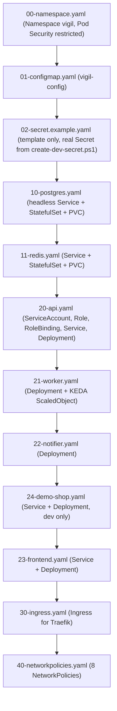
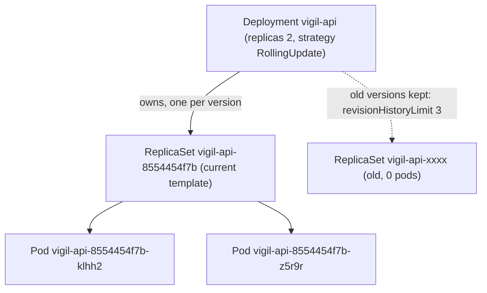
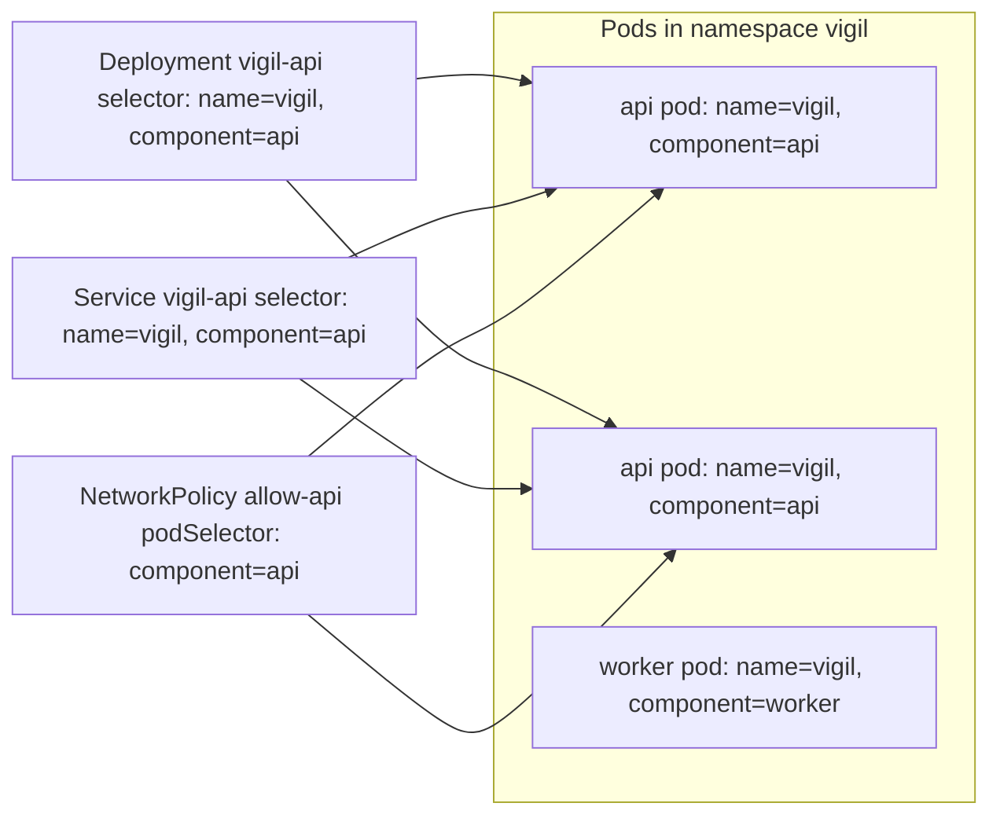
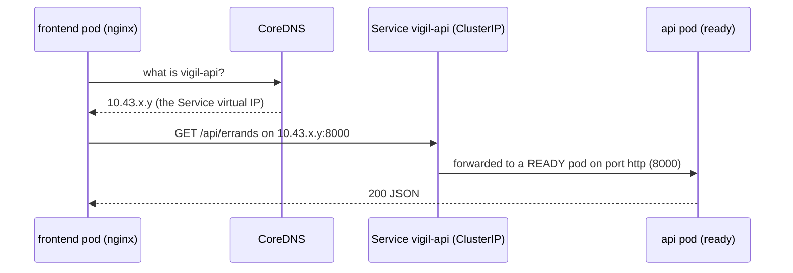
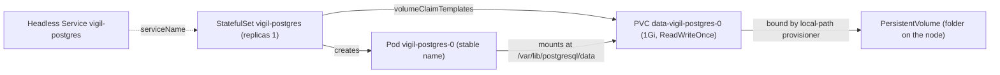
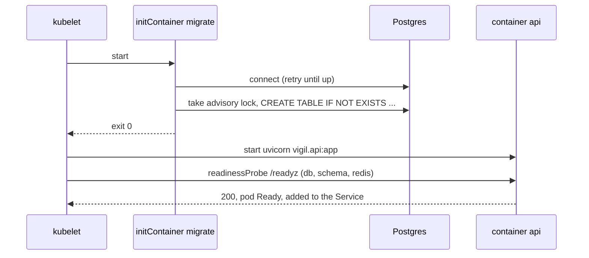
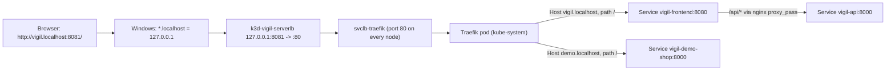
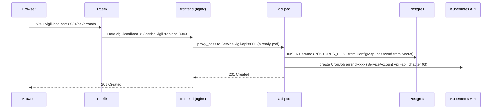

# 02 - Phase 1: Pods, Deployments, Services and friends

> **Goal of this chapter:** read every file in `k8s/` and understand each building block:
> Pod, ReplicaSet, Deployment, labels and selectors, Service and cluster DNS, probes,
> resources, ConfigMap, Secret, StatefulSet + PersistentVolumeClaim, initContainers,
> volumes, and Ingress with Traefik.
>
> Git tag: `phase-1` (`git show --stat phase-1`). The `k8s/` folder has not changed since
> (`git diff phase-1 phase-2 -- k8s` prints nothing).

---

## 0. The map of `k8s/`

The number prefix is the order in which `scripts/phase1-up.ps1` applies the files:
things others depend on come first.



> `23-frontend.yaml` is applied **after** `24-demo-shop.yaml` on purpose: the frontend's
> nginx looks up the name `vigil-api` once when it starts, so the api Service must exist
> first (comment at the top of `23-frontend.yaml`).

Chapter 03 covers the security parts (RBAC, Pod Security, securityContext,
NetworkPolicies, KEDA). This chapter covers everything else.

---

## 1. Pod - the smallest thing Kubernetes runs

> **Analogy:** a container is a person; a **Pod** is a desk. Usually one person per desk,
> sometimes a helper sits at the same desk (sidecar), and sometimes someone prepares the
> desk before the worker arrives (initContainer). Everyone at the desk shares the same
> phone number (IP address) and can pass papers around (shared volumes).

- A Pod has **one IP address** shared by its containers; they reach each other on `localhost`.
- Pods are **disposable**. When a pod dies it is not repaired - a *new* pod with a new
  name and a new IP replaces it. That is why you never connect to a pod IP directly
  (you use a Service, section 4) and never write pods by hand (you use a Deployment).

In this project the only "naked" pods are the ones created by Jobs (CronJob triggers,
chapter 03) and the Helm test pod in Phase 2. Everything else comes from a *template*
inside a Deployment or StatefulSet.

---

## 2. Deployment -> ReplicaSet -> Pods



- **ReplicaSet**: "keep exactly N pods matching this label selector alive".
- **Deployment**: manages ReplicaSets so you can **change** the pod template safely.
  Change the image -> a new ReplicaSet is created, scaled up, the old one scaled down
  (a **rolling update**). The pod name `vigil-api-8554454f7b-klhh2` is
  `<deployment>-<hash of the template>-<random>`.

### The api Deployment (`k8s/20-api.yaml`, Deployment part)

```yaml
apiVersion: apps/v1
kind: Deployment
metadata:
  name: vigil-api
  namespace: vigil
  labels: {app.kubernetes.io/name: vigil, app.kubernetes.io/component: api, app.kubernetes.io/part-of: vigil}
spec:
  replicas: 2                                   # two copies: one can die/restart while the other serves
  revisionHistoryLimit: 3
  strategy:
    type: RollingUpdate
    rollingUpdate: {maxUnavailable: 0, maxSurge: 1}   # never drop below 2 ready pods during an update
  selector:
    matchLabels: {app.kubernetes.io/name: vigil, app.kubernetes.io/component: api}
  template:
    metadata:
      labels: {app.kubernetes.io/name: vigil, app.kubernetes.io/component: api, app.kubernetes.io/part-of: vigil}
    spec:
      serviceAccountName: vigil-api
      automountServiceAccountToken: true        # needed: the api calls the Kubernetes API (CronJobs)
      securityContext:
        runAsNonRoot: true
        runAsUser: 10001                        # the "vigil" user baked into the vigil-core image
        runAsGroup: 10001
        seccompProfile: {type: RuntimeDefault}  # block dangerous Linux system calls
      # Spread the two replicas over different nodes when possible.
      topologySpreadConstraints:
        - maxSkew: 1
          topologyKey: kubernetes.io/hostname
          whenUnsatisfiable: ScheduleAnyway
          labelSelector:
            matchLabels: {app.kubernetes.io/name: vigil, app.kubernetes.io/component: api}
```

| Line | What it does | Why it matters / what breaks without it |
|---|---|---|
| `apiVersion: apps/v1` / `kind: Deployment` | Deployments live in the `apps` API group | A typo gives "no matches for kind" |
| `metadata.labels` | Labels on the Deployment object itself | Only for humans/tools to find it; they do NOT select pods |
| `replicas: 2` | The wish: 2 pods | With 1, every restart or update means downtime for the UI's API calls |
| `revisionHistoryLimit: 3` | Keep 3 old ReplicaSets | Enables `kubectl rollout undo`; without a limit old ReplicaSets pile up (default 10) |
| `strategy.type: RollingUpdate` | Replace pods a few at a time | The alternative `Recreate` kills all pods first (downtime) |
| `maxUnavailable: 0` | Never have fewer than 2 ready pods during an update | A new pod must pass readiness before an old one is removed |
| `maxSurge: 1` | Allow 1 extra pod (3 total) during an update | With `maxUnavailable: 0` and `maxSurge: 0` an update could never make progress |
| `selector.matchLabels` | Which pods this Deployment owns | Must match `template.metadata.labels`, otherwise the API rejects it. **Immutable** after creation |
| `template` | The pod blueprint | Any change here = a new ReplicaSet = a rolling update |
| `template.metadata.labels` | Labels stamped on every pod | The Service and NetworkPolicies find pods by these |
| `serviceAccountName: vigil-api` | Identity of the pod for the Kubernetes API | Chapter 03 - lets the api create CronJobs |
| `topologySpreadConstraints` | Prefer putting the 2 replicas on different nodes | If both land on one node and it dies, both die. `ScheduleAnyway` = a preference, not a hard rule |

### Labels and selectors - how objects find each other

Labels are sticky notes (`key: value`) on objects. **Selectors** are queries over labels.
Kubernetes does not link objects by name; it links them by labels.



This repo uses the recommended `app.kubernetes.io/*` label set on every object:

| Label | Value here | Meaning |
|---|---|---|
| `app.kubernetes.io/name` | `vigil` | the application |
| `app.kubernetes.io/component` | `api`, `worker`, `postgres`, ... | which part |
| `app.kubernetes.io/part-of` | `vigil` | the bigger system |

Phase 2's Helm chart adds `app.kubernetes.io/instance` to the selectors - and because
selectors are immutable, the Phase-1 objects could not be "adopted" by Helm; namespace
`vigil` was deleted first (see `docs/notes/platform-verification.md`).

---

## 3. The container section: image, ports, env, resources

Still `k8s/20-api.yaml`, the main container:

```yaml
      containers:
        - name: api
          image: vigil-core:dev                 # local image imported into k3d
          imagePullPolicy: IfNotPresent         # use the imported image, never pull
          # (default command of the image: uvicorn vigil.api:app on port 8000)
          ports:
            - {name: http, containerPort: 8000}
          envFrom:
            - configMapRef: {name: vigil-config}   # every key of the ConfigMap -> env var
          env:
            - name: POSTGRES_PASSWORD
              valueFrom: {secretKeyRef: {name: vigil-secrets, key: postgres-password}}
            - name: VIGIL_INTERNAL_TOKEN        # checked on POST /internal/trigger/<id>
              valueFrom: {secretKeyRef: {name: vigil-secrets, key: internal-token}}
          securityContext:                      # container-level part of the "restricted" profile
            allowPrivilegeEscalation: false     # no setuid tricks to become root
            readOnlyRootFilesystem: true        # the image's files cannot be modified
            capabilities: {drop: ["ALL"]}       # no special Linux privileges at all
          resources:
            requests: {cpu: 50m, memory: 128Mi} # reserved for scheduling
            limits: {cpu: 500m, memory: 384Mi}  # hard ceiling
```

| Line | What it does | Why it matters / what breaks without it |
|---|---|---|
| `name: api` | Container name inside the pod | Used in `kubectl logs <pod> -c api` |
| `image: vigil-core:dev` | The image built from `app/Dockerfile` | Same image also runs the notifier, demo shop and migrate (different `command`) |
| `imagePullPolicy: IfNotPresent` | Use the node's copy if present | With `Always` the node would try a registry that does not have `vigil-core:dev` -> `ErrImagePull` |
| `ports: name: http` | Documents the port and gives it a **name** | The Service and probes say `targetPort: http` / `port: http`, so the number lives in one place |
| `envFrom: configMapRef` | Every key in `vigil-config` becomes an env var | `app/vigil/config.py` reads `POSTGRES_HOST`, `REDIS_URL`, ... from the environment |
| `env ... secretKeyRef` | One key from the Secret becomes one env var | Passwords never appear in the YAML; missing key/Secret = pod stuck in `CreateContainerConfigError` |
| `securityContext` | Hardening - chapter 03 | Required by the namespace's `restricted` profile |
| `resources.requests` | What the scheduler reserves: 0.05 CPU, 128 MiB | Without requests the scheduler cannot plan and nodes can be overbooked |
| `resources.limits` | The ceiling: 0.5 CPU, 384 MiB | CPU above the limit is throttled; **memory above the limit = the container is killed (OOMKilled)** |

Units: `50m` = 50 millicores = 0.05 of a CPU core; `128Mi` = 128 mebibytes.

Look at how the resources match each job:

| Component | requests | limits | Why |
|---|---|---|---|
| frontend (nginx) | 10m / 16Mi | 200m / 64Mi | static files, tiny |
| api | 50m / 128Mi | 500m / 384Mi | Python web app |
| worker | 100m / 384Mi | 1 / 1536Mi | runs Chromium: "memory-hungry" |
| postgres | 50m / 128Mi | 500m / 512Mi | database |
| redis | 20m / 32Mi | 300m / 256Mi | started with `--maxmemory 200mb`, below the limit |

---

## 4. Service and cluster DNS - stable names for moving pods

Pods come and go with new IPs. A **Service** gives a group of pods (chosen by label
selector) **one stable name and virtual IP**, and load-balances across the *ready* pods.

> **Analogy:** a Service is a company's switchboard number. Employees (pods) change desks
> and phone extensions, but you always dial the same number and get whoever is available.

```yaml
# k8s/20-api.yaml - Service part
apiVersion: v1
kind: Service
metadata:
  name: vigil-api                               # the frontend proxies /api/ to http://vigil-api:8000
  namespace: vigil
  labels: {app.kubernetes.io/name: vigil, app.kubernetes.io/component: api, app.kubernetes.io/part-of: vigil}
spec:
  type: ClusterIP                               # reachable inside the cluster only
  selector: {app.kubernetes.io/name: vigil, app.kubernetes.io/component: api}
  ports:
    - {name: http, port: 8000, targetPort: http}
```

| Line | What it does | Why it matters / what breaks without it |
|---|---|---|
| `name: vigil-api` | Becomes the DNS name `vigil-api` | `frontend/nginx.conf` has `server vigil-api:8000;` built in, and CronJob triggers call `http://vigil-api:8000` (`TRIGGER_API_URL`) |
| `type: ClusterIP` | A virtual IP inside the cluster only (the default) | Nothing outside the cluster can reach it directly - the Ingress is the only way in |
| `selector` | Which pods receive traffic | A label typo = a Service with **no endpoints** = "connection refused" |
| `port: 8000` | The port clients use on the Service | |
| `targetPort: http` | The pod port (by name) traffic is sent to | Change the container port number in one place only |

### How DNS names work

CoreDNS (in `kube-system`) creates a name for every Service:

```text
vigil-api                              # from a pod in the same namespace
vigil-api.vigil                        # <service>.<namespace>
vigil-api.vigil.svc.cluster.local      # fully qualified
```

The KEDA ScaledObject uses the fully qualified form because KEDA runs in **another
namespace** (`keda`) and must say which namespace it means:

```yaml
        address: vigil-redis.vigil.svc.cluster.local:6379
```



The ConfigMap relies on DNS too: `POSTGRES_HOST: "vigil-postgres"`,
`REDIS_URL: "redis://vigil-redis:6379/0"`.

### Headless Service (Postgres)

```yaml
# k8s/10-postgres.yaml
apiVersion: v1
kind: Service
metadata:
  name: vigil-postgres
  namespace: vigil
  labels: {app.kubernetes.io/name: vigil, app.kubernetes.io/component: postgres, app.kubernetes.io/part-of: vigil}
spec:
  clusterIP: None
  selector: {app.kubernetes.io/name: vigil, app.kubernetes.io/component: postgres}
  ports:
    - name: postgres
      port: 5432
      targetPort: postgres
```

| Line | What it does | Why it matters / what breaks without it |
|---|---|---|
| `clusterIP: None` | **Headless**: no virtual IP; DNS returns the pod IP(s) directly | A StatefulSet needs a governing headless Service; it also gives each pod a name like `vigil-postgres-0.vigil-postgres` |
| `targetPort: postgres` | The named container port | |

---

## 5. Probes - how Kubernetes knows a pod is healthy

The **kubelet** runs probes against every container:

| Probe | Question | On failure |
|---|---|---|
| **livenessProbe** | "Is the process still alive?" | The container is **restarted** |
| **readinessProbe** | "Can it serve traffic right now?" | The pod is **removed from the Service** (no restart) until it passes again |
| startupProbe | "Has it finished starting?" | (not used in this repo) |

```yaml
# k8s/20-api.yaml
          # liveness = "is the process alive?" (no dependencies, so a DB outage
          # does not cause pointless restarts)
          livenessProbe:
            httpGet: {path: /healthz, port: http}
            initialDelaySeconds: 10
            periodSeconds: 15
            failureThreshold: 3
          # readiness = "can it serve right now?" (db + redis + schema). A pod that
          # is not ready is removed from the Service until it recovers.
          readinessProbe:
            httpGet: {path: /readyz, port: http}
            initialDelaySeconds: 5
            periodSeconds: 10
            failureThreshold: 3
```

And the two endpoints in `app/vigil/api.py`:

```python
    @app.get("/healthz")
    def healthz() -> dict:
        return {"ok": True}

    @app.get("/readyz")
    def readyz(deps: Deps = Depends(get_deps)) -> JSONResponse:
        checks = {}
        for name, fn in (("db", deps.store.ping), ("schema", deps.store.schema_present), ("redis", deps.r.ping)):
            try:
                checks[name] = bool(fn())
            except Exception:
                checks[name] = False
        ok = all(checks.values())
        return JSONResponse({"ok": ok, **checks}, status_code=200 if ok else 503)
```

| Line | What it does | Why it matters / what breaks without it |
|---|---|---|
| `livenessProbe.httpGet /healthz` | Asks "are you alive?"; `/healthz` checks nothing else | If liveness also checked the DB, a DB outage would restart every api pod in a loop - pointless |
| `initialDelaySeconds: 10` | Wait 10 s after start before the first check | Too short = a slow start looks like death -> restart loop |
| `periodSeconds: 15`, `failureThreshold: 3` | Check every 15 s, restart after 3 failures (~45 s) | Tolerates a short hiccup |
| `readinessProbe /readyz` | 200 only if db + schema + redis are OK, else 503 | A pod that cannot reach Postgres gets no traffic, instead of returning errors to users |
| `periodSeconds: 10` | Re-checked every 10 s | Pods rejoin the Service quickly once dependencies are back |

Real recovery from `docs/notes/platform-verification.md`: after the nodes restarted,
"api readiness waited for postgres/redis", and everything was back within about 2 minutes.

Other probe styles used in `k8s/`:

| File | Probe | Why this style |
|---|---|---|
| `10-postgres.yaml` | `exec: pg_isready -U vigil -d vigil -h 127.0.0.1` | Postgres does not speak HTTP; run a command inside the container |
| `11-redis.yaml` | `exec: redis-cli ping` | same idea for Redis |
| `21-worker.yaml`, `22-notifier.yaml` | `httpGet /metrics` on the metrics port | These are queue consumers with no web API; the Prometheus metrics server is the "I am alive" signal |
| `23-frontend.yaml` | `httpGet /healthz` | nginx answers `200 ok` itself, no upstream dependency (`frontend/nginx.conf`) |

---

## 6. ConfigMap - settings outside the image

> **Analogy:** the image is a printed book; the ConfigMap is a sticky note with
> settings you can change without reprinting the book.

```yaml
# k8s/01-configmap.yaml (excerpt)
apiVersion: v1
kind: ConfigMap
metadata:
  name: vigil-config
  namespace: vigil
  labels:
    app.kubernetes.io/part-of: vigil
data:
  VIGIL_ENV: "dev"
  # Where the data stores are. "vigil-postgres" / "vigil-redis" are Service names:
  # Kubernetes DNS turns them into the right pod IPs.
  POSTGRES_HOST: "vigil-postgres"
  POSTGRES_PORT: "5432"
  POSTGRES_DB: "vigil"
  POSTGRES_USER: "vigil"
  REDIS_URL: "redis://vigil-redis:6379/0"
  # LLM: "fake" = never call a model; every feature uses its deterministic path.
  LLM_MODE: "fake"
  ...
  # Scheduling: the api creates one Kubernetes CronJob per watch ("errand").
  SCHEDULER: "kubernetes"
  SCHEDULE_TZ: "Asia/Kolkata"
  MIN_INTERVAL_MINUTES: "1"          # dev only; production uses 5
  TRIGGER_IMAGE: "curlimages/curl:8.22.0"
  TRIGGER_API_URL: "http://vigil-api:8000"
  INTERNAL_TOKEN_SECRET: "vigil-secrets"
  ALLOWED_INTERNAL_HOSTS: "vigil-demo-shop"
  HOST_MIN_GAP_MS: "5000"            # politeness: at most one request per host every 5 s
```

| Line | What it does | Why it matters / what breaks without it |
|---|---|---|
| `kind: ConfigMap` | Non-secret key/value settings | Same image runs dev and prod with different settings |
| `data:` values in quotes | All values are **strings** | `5432` unquoted is a number and the API rejects the ConfigMap |
| `POSTGRES_HOST: "vigil-postgres"` | Service name, resolved by DNS | No IP addresses anywhere in the config |
| `LLM_MODE: "fake"` | Dev never calls a model | Free, deterministic demos and tests |
| `SCHEDULER: "kubernetes"` | The api creates real CronJobs | `internal` = a thread inside the api (local runs); `none` = no scheduling |
| `SCHEDULE_TZ: "Asia/Kolkata"` | Becomes the CronJob's `timeZone` | Daily checks run at 08:00 local time, not UTC |
| `TRIGGER_IMAGE` / `TRIGGER_API_URL` | What each CronJob pod runs and calls | See chapter 03 |
| `ALLOWED_INTERNAL_HOSTS` | The one internal host the SSRF guard lets through | Without it the worker would refuse to watch the demo shop |

How it is used: `envFrom: - configMapRef: {name: vigil-config}` in the api, worker,
notifier and migrate containers.

> **Important:** env vars are read when the container **starts**. Changing a ConfigMap
> does not change running pods - you must restart them
> (`kubectl rollout restart deployment/vigil-api -n vigil`). Phase 2's Helm chart solves
> this with a `checksum/config` annotation that rolls the pods automatically.

---

## 7. Secret - sensitive values

```yaml
# k8s/02-secret.example.yaml
apiVersion: v1
kind: Secret
metadata:
  name: vigil-secrets
  namespace: vigil
  labels:
    app.kubernetes.io/part-of: vigil
type: Opaque
stringData:
  postgres-password: "CHANGE-ME-placeholder"   # password of the "vigil" database user
  internal-token: "CHANGE-ME-placeholder"      # bearer token CronJob triggers send to /internal/trigger
  # Optional, only for the LLM gateway in production:
  # openrouter-api-key: "<your key>"
```

| Line | What it does | Why it matters / what breaks without it |
|---|---|---|
| `kind: Secret`, `type: Opaque` | Arbitrary key/value secret | Kept separate from the ConfigMap so access can be limited and values are not printed by default |
| `stringData:` | Plain-text input; Kubernetes stores it **base64-encoded** in `data:` | base64 is **encoding, not encryption** - anyone who can read the Secret can decode it |
| `postgres-password` | Used by Postgres (`POSTGRES_PASSWORD`) and by every app pod | All must agree, or apps get "password authentication failed" |
| `internal-token` | Shared secret between CronJob trigger pods and the api | Without it anyone in the cluster could trigger checks |

This file is an **example only**. The real Secret is made by
`scripts/create-dev-secret.ps1`, which never prints or saves the values:

```powershell
$pg = New-RandomToken 24
$tok = New-RandomToken 32

# --dry-run=client -o yaml builds the Secret locally; "kubectl apply -f -" sends it.
# The values only travel through the pipe, never to the screen or disk.
kubectl create secret generic $Name -n $Namespace `
    --from-literal=postgres-password=$pg `
    --from-literal=internal-token=$tok `
    --dry-run=client -o yaml | kubectl apply -f - | Out-Null
```

| Line | What it does | Why it matters |
|---|---|---|
| `New-RandomToken` | Cryptographically secure random bytes (`RandomNumberGenerator`) | Not guessable, different on every cluster |
| `--dry-run=client -o yaml` | Builds the Secret YAML locally without sending it | ... |
| `\| kubectl apply -f -` | Sends that YAML from the pipe | The values never touch disk or the screen, so they cannot leak into git |
| existing-Secret check (earlier in the script) | Keeps an existing Secret unless `-Force` | Changing the password after Postgres initialised its volume would lock the apps out |

The notifier shows **optional** keys:

```yaml
            - name: TELEGRAM_BOT_TOKEN
              valueFrom: {secretKeyRef: {name: vigil-secrets, key: telegram-bot-token, optional: true}}
```

`optional: true` = the pod starts even when the key is missing (Telegram is simply off).

Phase 3 replaces "create the Secret by hand" with a **SealedSecret** that is safe to commit.

---

## 8. StatefulSet + PersistentVolumeClaim - for databases

A Deployment's pods are interchangeable cattle: random names, no own disk. A database
needs a **stable identity** and **its own disk** that survives restarts.



| | Deployment | StatefulSet |
|---|---|---|
| Pod names | `vigil-api-8554454f7b-klhh2` (random) | `vigil-postgres-0`, `-1`, ... (stable) |
| Storage | shared or none | one PVC **per pod**, kept when the pod is replaced |
| Start/stop order | all at once | one by one, in order |
| Use for | stateless apps (api, worker, frontend) | databases, queues (postgres, redis) |

```yaml
# k8s/10-postgres.yaml - StatefulSet (excerpt)
apiVersion: apps/v1
kind: StatefulSet
metadata:
  name: vigil-postgres
  namespace: vigil
spec:
  serviceName: vigil-postgres
  replicas: 1                                   # one database instance (no replication in this project)
  ...
      securityContext:                          # pod-level security ("restricted" profile)
        runAsNonRoot: true
        runAsUser: 70                           # the "postgres" user in the alpine image
        runAsGroup: 70
        fsGroup: 70                             # volumes are made writable for group 70
        seccompProfile: {type: RuntimeDefault}  # block dangerous Linux system calls
      containers:
        - name: postgres
          image: postgres:17.11-alpine
          env:
            - {name: POSTGRES_DB, value: vigil}
            - {name: POSTGRES_USER, value: vigil}
            - name: POSTGRES_PASSWORD           # read from the Secret, never written in YAML
              valueFrom:
                secretKeyRef: {name: vigil-secrets, key: postgres-password}
            # Data goes in a sub-folder of the volume (initdb wants an empty folder it owns).
            - {name: PGDATA, value: /var/lib/postgresql/data/pgdata}
          securityContext:
            allowPrivilegeEscalation: false
            readOnlyRootFilesystem: true        # only the mounted volumes below are writable
            capabilities: {drop: ["ALL"]}
          volumeMounts:
            - {name: data, mountPath: /var/lib/postgresql/data}
            - {name: run, mountPath: /var/run/postgresql}   # unix socket + lock file
            - {name: tmp, mountPath: /tmp}
      volumes:
        - name: run
          emptyDir: {}
        - name: tmp
          emptyDir: {}
  # One PersistentVolumeClaim per pod. k3s' built-in "local-path" provisioner
  # creates the actual disk folder on the node.
  volumeClaimTemplates:
    - metadata:
        name: data
      spec:
        accessModes: ["ReadWriteOnce"]
        storageClassName: local-path
        resources:
          requests:
            storage: 1Gi
```

| Line | What it does | Why it matters / what breaks without it |
|---|---|---|
| `kind: StatefulSet` | Stable pod name + own disk | A Deployment with a PVC would break on rolling updates (two pods fighting over one ReadWriteOnce disk) |
| `serviceName: vigil-postgres` | Links to the headless Service | Required field; gives the pod its stable DNS name |
| `replicas: 1` | One database | Postgres replication is a separate topic, out of scope |
| `runAsUser: 70` / `fsGroup: 70` | Run as the image's postgres user; make volumes group-writable | Without `fsGroup` the non-root user cannot write to the new volume -> initdb fails |
| `POSTGRES_PASSWORD` from Secret | The database user's password | Set only on **first** initialisation of the volume |
| `PGDATA: .../pgdata` | Data in a sub-folder of the mount | The mount root may contain `lost+found`; initdb needs an empty folder it owns |
| `readOnlyRootFilesystem: true` + `run`/`tmp` emptyDirs | Image files are read-only; only the listed mounts are writable | Postgres writes its socket and lock file to `/var/run/postgresql` - without that emptyDir it cannot start |
| `volumeClaimTemplates` | Creates PVC `data-vigil-postgres-0` | The disk outlives the pod; deleting the pod keeps the data |
| `accessModes: ["ReadWriteOnce"]` | Mountable by one node at a time | Fine for a single database pod |
| `storageClassName: local-path` | k3s' built-in provisioner creates a folder on the node | Wrong class name = PVC stays `Pending` forever |
| `storage: 1Gi` | Requested size | Plenty for watches and checks |

Redis (`k8s/11-redis.yaml`) uses the same pattern, with
`args: ["redis-server", "--appendonly", "yes", "--dir", "/data", "--save", "", "--maxmemory", "200mb"]`
so queued jobs survive a restart (append-only file on the PVC) and memory stays bounded.

### Volumes in this repo

| Volume type | Lives | Used for |
|---|---|---|
| `persistentVolumeClaim` (via `volumeClaimTemplates`) | beyond the pod | Postgres and Redis data |
| `emptyDir: {}` | as long as the pod | `/tmp` scratch space when the root filesystem is read-only |
| `emptyDir: {sizeLimit: 512Mi}` | as long as the pod, capped | worker `/tmp` |
| `emptyDir: {medium: Memory, sizeLimit: 256Mi}` | in RAM | worker `/dev/shm` - Chromium needs shared memory |

---

## 9. initContainers - prepare the desk first

An **initContainer** runs **to completion before** the main containers start. If it
fails, the kubelet retries it and the main container never starts.

```yaml
# k8s/20-api.yaml
      # An initContainer runs to completion BEFORE the main container starts.
      # It creates the database tables (idempotent + advisory lock, so two pods
      # starting at once is safe) and waits for postgres if it is not up yet.
      initContainers:
        - name: migrate
          image: vigil-core:dev
          imagePullPolicy: IfNotPresent
          command: ["python", "-m", "vigil.migrate"]
          envFrom:
            - configMapRef: {name: vigil-config}
          env:
            - name: POSTGRES_PASSWORD
              valueFrom: {secretKeyRef: {name: vigil-secrets, key: postgres-password}}
          securityContext:
            allowPrivilegeEscalation: false
            readOnlyRootFilesystem: true
            capabilities: {drop: ["ALL"]}
          resources:
            requests: {cpu: 20m, memory: 64Mi}
            limits: {cpu: 300m, memory: 128Mi}
```

| Line | What it does | Why it matters / what breaks without it |
|---|---|---|
| `initContainers:` | Runs before `containers:` | The api would start against a database without tables |
| `image: vigil-core:dev` + `command: python -m vigil.migrate` | Same image, different program (`app/vigil/migrate.py`) | No separate migration image to build |
| "idempotent + advisory lock" | Safe to run many times and in parallel | Two api replicas start at the same time - both run migrate |
| "waits for postgres" | Retries until the DB answers | Makes start order between files less fragile |
| own `securityContext` and `resources` | initContainers are checked by Pod Security too | Missing them = the whole pod is rejected in a `restricted` namespace |



You see this as `Init:0/1` in `kubectl get pods` while it runs.

---

## 10. Ingress and Traefik - the front door

A Service of type ClusterIP is internal only. An **Ingress** describes HTTP routing
rules ("this hostname/path goes to that Service"). An **ingress controller** reads those
rules and does the routing - k3s ships **Traefik** for this.



```yaml
# k8s/30-ingress.yaml
apiVersion: networking.k8s.io/v1
kind: Ingress
metadata:
  name: vigil
  namespace: vigil
  labels: {app.kubernetes.io/name: vigil, app.kubernetes.io/part-of: vigil}
spec:
  ingressClassName: traefik
  rules:
    - host: vigil.localhost                     # the Vigil UI (and /api via the frontend's nginx)
      http:
        paths:
          - path: /
            pathType: Prefix
            backend:
              service:
                name: vigil-frontend
                port: {number: 8080}
    - host: demo.localhost                      # the demo shop (dev only)
      http:
        paths:
          - path: /
            pathType: Prefix
            backend:
              service:
                name: vigil-demo-shop
                port: {number: 8000}
```

| Line | What it does | Why it matters / what breaks without it |
|---|---|---|
| `apiVersion: networking.k8s.io/v1` | Current Ingress API | Old `extensions/v1beta1` no longer exists |
| `ingressClassName: traefik` | Which controller should handle this Ingress | Without it, no controller may pick it up -> 404 from Traefik |
| `host: vigil.localhost` | Match on the HTTP `Host` header | One port (8081) serves many apps, told apart by name |
| `path: /`, `pathType: Prefix` | Everything under `/` | `Exact` would only match `/` itself |
| `backend.service.name/port` | Where to send it | Must be a Service in the **same namespace** as the Ingress |

The api is **not** in the Ingress. Browser calls to `/api/*` go to nginx, which proxies
them (`frontend/nginx.conf`):

```nginx
upstream vigil_api {
    server vigil-api:8000;
    keepalive 16;
}
...
    location /api/ {
        proxy_pass http://vigil_api;
        ...
        proxy_read_timeout 75s;
    ...
    # /internal/* is only for in-cluster CronJob triggers, never via the public frontend.
    location /internal/ {
        return 404;
    }
```

| Line | Why it matters |
|---|---|
| `server vigil-api:8000` | Service DNS name; resolved once at nginx start, so the api Service must exist first |
| `proxy_read_timeout 75s` | Dry runs wait up to 60 s for a worker (`DRYRUN_TIMEOUT_SECONDS: "60"`) |
| `location /internal/ { return 404; }` | The trigger endpoint can never be reached from the browser |

---

## 11. Putting it together - one request, end to end



---

## Try it yourself

From `docs/notes/platform-verification.md`. Phase 1 lives in namespace `vigil`; today's
cluster runs Phase 3+ in `vigil-dev`/`vigil-prod`. Read-only commands work in `vigil-dev`
right away; to **replay** Phase 1 itself see the last block.

```powershell
# Everything at a glance
kubectl get deploy,sts,rs,pods,svc,ingress -n vigil-dev

# Deployment -> ReplicaSet -> Pods ownership
kubectl get rs -n vigil-dev -l app.kubernetes.io/component=api
kubectl describe deploy vigil-api -n vigil-dev           # strategy, events, conditions

# Labels and selectors
kubectl get pods -n vigil-dev --show-labels
kubectl get pods -n vigil-dev -l app.kubernetes.io/component=api -o wide   # which node each runs on

# Service -> endpoints (the ready pod IPs behind a Service)
kubectl get endpointslices -n vigil-dev -l kubernetes.io/service-name=vigil-api

# DNS from inside the cluster (a throwaway pod)
kubectl run dnstest -n default --rm -it --restart=Never --image=curlimages/curl:8.22.0 -- nslookup vigil-api.vigil-dev.svc.cluster.local

# Probes, init containers, events of one pod
kubectl describe pod -n vigil-dev -l app.kubernetes.io/component=api

# ConfigMap and Secret (keys only - never print secret values)
kubectl get configmap vigil-config -n vigil-dev -o yaml
kubectl describe secret vigil-secrets -n vigil-dev       # shows key names and sizes, not values

# StatefulSet storage
kubectl get pvc -n vigil-dev                             # data-vigil-postgres-0, data-vigil-redis-0  Bound  1Gi
kubectl get storageclass                                 # local-path (default)

# Ingress
curl.exe -s -o NUL -w "UI %{http_code}" http://vigil-dev.localhost:8081/   # UI 200

# Rolling update and rollback by hand (in dev, Argo CD will undo it - see Phase 3)
kubectl rollout history deployment/vigil-api -n vigil-dev
```

Replaying Phase 1 exactly as it was (namespace `vigil`; note that `demo.localhost` is
then claimed by two Ingresses - the dev one and this one):

```powershell
powershell -ExecutionPolicy Bypass -File scripts\import-images.ps1   # copy local images into every node
powershell -ExecutionPolicy Bypass -File scripts\phase1-up.ps1       # applies k8s/00..40 in order + waits
powershell -ExecutionPolicy Bypass -File scripts\demo.ps1            # end-to-end demo with curl.exe
kubectl get pods -n vigil
kubectl delete namespace vigil                                       # clean up afterwards
```

## Common mistakes

| Mistake | Symptom | Fix |
|---|---|---|
| Selector does not match template labels | API error "selector does not match template labels" | Copy the same labels into both |
| Changing a selector on an existing Deployment/StatefulSet | `field is immutable` (seen 9x in the Phase 2 dry run) | Delete and recreate (or use a new namespace) |
| Service selector typo | Service has no endpoints, "connection refused" | `kubectl get endpointslices`, compare `--show-labels` |
| Unquoted numbers in a ConfigMap | "cannot unmarshal number into string" | Quote every value: `"5432"` |
| Expecting ConfigMap edits to apply live | Old values in the pod | `kubectl rollout restart deploy/<name>` (Helm's checksum annotation automates it) |
| Liveness probe that checks dependencies | All pods restart in a loop when the DB is down | Liveness = "process alive" only; dependencies go in readiness |
| Memory limit too low for Chromium | `OOMKilled`, `RESTARTS` climbing | Worker limit is `1536Mi`, plus a RAM-backed `/dev/shm` |
| `readOnlyRootFilesystem` without a writable `/tmp` | App crashes writing temp files / pid files | Mount an `emptyDir` at `/tmp` (every component here does) |
| Wrong `storageClassName` | PVC `Pending` forever | k3s provides `local-path` |
| Missing `ingressClassName` or wrong host | Traefik `404 page not found` | Check `kubectl get ingress -A` and the `Host` you use |
| Starting the frontend before the api Service exists | nginx fails: "host not found in upstream vigil-api" | Apply `20-api.yaml` first (as `phase1-up.ps1` does) |

## Key words

- **Pod** - one or more containers sharing an IP and volumes; disposable.
- **ReplicaSet** - keeps N identical pods alive.
- **Deployment** - manages ReplicaSets; rolling updates and rollbacks.
- **Rolling update** - replace pods gradually (`maxSurge`, `maxUnavailable`).
- **Label / selector** - key/value tags and the queries that match them.
- **Service** - stable name + virtual IP in front of ready pods; **ClusterIP** = internal only.
- **Headless Service** - `clusterIP: None`; DNS returns pod IPs.
- **CoreDNS** - cluster DNS: `<service>.<namespace>.svc.cluster.local`.
- **Endpoints / EndpointSlice** - the list of ready pod IPs behind a Service.
- **Liveness / readiness probe** - restart if dead / remove from Service if not ready.
- **requests / limits** - reserved resources / hard ceiling (OOMKilled above the memory limit).
- **ConfigMap** - non-secret settings; **Secret** - sensitive values (base64, not encrypted).
- **StatefulSet** - stable pod names and per-pod storage.
- **PVC / PV / StorageClass** - a claim for disk / the actual disk / who creates disks (`local-path`).
- **emptyDir** - a temporary volume that lives as long as the pod.
- **initContainer** - runs to completion before the main containers.
- **Ingress / ingress controller (Traefik)** - HTTP routing rules / the thing that applies them.
