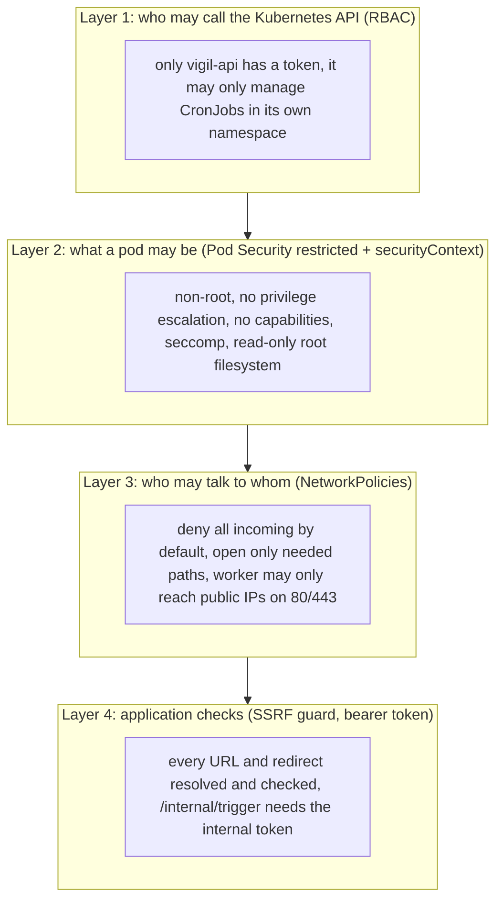
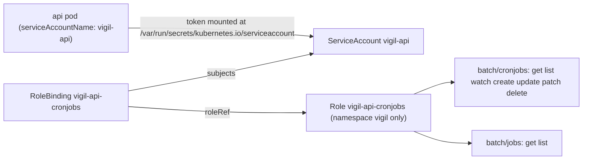
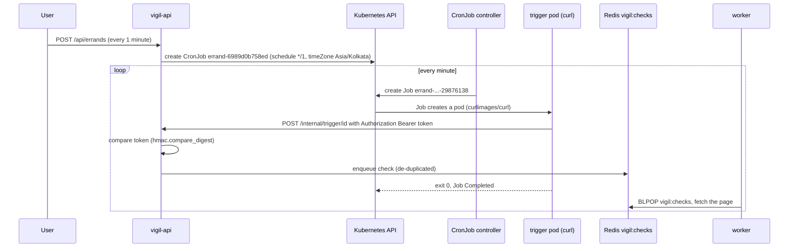
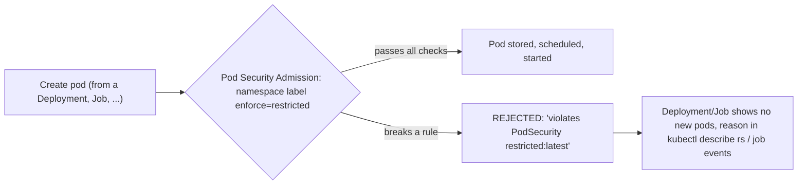
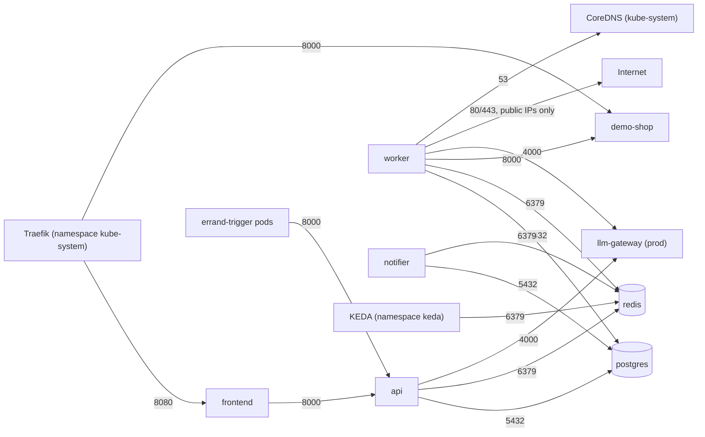
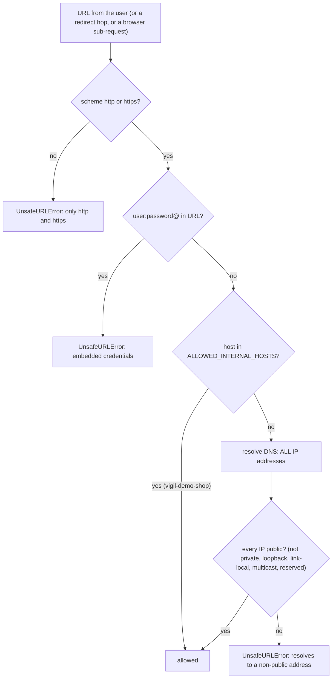
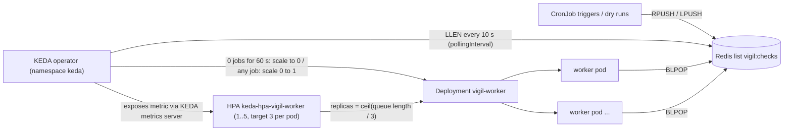
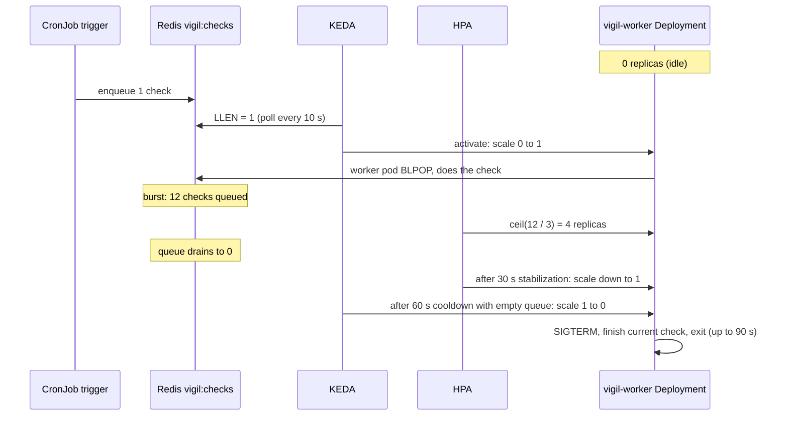

# 03 - Phase 1: Security and scaling

> **Goal of this chapter:** understand how Vigil is locked down and how it scales:
> ServiceAccount + RBAC (why the api may create CronJobs, and nothing else), the
> CronJobs and Jobs the api creates **at runtime**, Pod Security Standards
> (`restricted`), every `securityContext` line, NetworkPolicies (a firewall between
> pods), the SSRF guard in the worker's code, and KEDA + the HorizontalPodAutoscaler.
>
> Files: `k8s/00-namespace.yaml`, `k8s/20-api.yaml`, `k8s/21-worker.yaml`,
> `k8s/40-networkpolicies.yaml`, `app/vigil/scheduler.py`, `app/vigil/fetch.py`.

---

## 1. The security layers at a glance

Vigil's worker fetches **any URL a user types in**. That is a dangerous job, so security
is built in layers - if one layer fails, the next one still holds.



---

## 2. ServiceAccount + RBAC - why the api can create CronJobs

### 2.1 The idea

Every request to the Kubernetes API is checked: **who are you** (authentication) and
**are you allowed to do this** (authorization). Humans use the certificate in their
kubeconfig. **Pods** use a **ServiceAccount** - an identity for software.

**RBAC** (Role-Based Access Control) uses three objects:

> **Analogy:** a **ServiceAccount** is an employee badge. A **Role** is a list of doors
> ("may open the CronJob cupboard on floor `vigil`"). A **RoleBinding** is the HR form
> that says "this badge gets that list of doors".



Why does the api need this at all? Because Vigil's scheduling design is "**one real
Kubernetes CronJob per watch**". When you click *Keep watch*, the api calls the
Kubernetes API to create a CronJob. No other component ever talks to the Kubernetes API.

### 2.2 The YAML (`k8s/20-api.yaml`)

```yaml
apiVersion: v1
kind: ServiceAccount
metadata:
  name: vigil-api
  namespace: vigil
---
# A Role is namespaced: these rules apply in namespace "vigil" ONLY
# (a ClusterRole would apply to the whole cluster - not needed, so not used).
apiVersion: rbac.authorization.k8s.io/v1
kind: Role
metadata:
  name: vigil-api-cronjobs
  namespace: vigil
rules:
  - apiGroups: ["batch"]                        # CronJobs and Jobs live in the "batch" API group
    resources: ["cronjobs"]
    verbs: ["get", "list", "watch", "create", "update", "patch", "delete"]
  - apiGroups: ["batch"]
    resources: ["jobs"]
    verbs: ["get", "list"]                      # read-only: to see whether triggers ran
---
apiVersion: rbac.authorization.k8s.io/v1
kind: RoleBinding
metadata:
  name: vigil-api-cronjobs
  namespace: vigil
subjects:
  - kind: ServiceAccount
    name: vigil-api
    namespace: vigil
roleRef:
  apiGroup: rbac.authorization.k8s.io
  kind: Role
  name: vigil-api-cronjobs
```

| Line | What it does | Why it matters / what breaks without it |
|---|---|---|
| `kind: ServiceAccount`, `name: vigil-api` | Creates the identity | Without it pods use the namespace's `default` account, which has no rights -> `403 Forbidden` when creating a CronJob |
| `kind: Role` (not ClusterRole) | Rules valid **only in namespace `vigil`** | Even a hacked api cannot touch other namespaces |
| `apiGroups: ["batch"]` | CronJobs/Jobs belong to the `batch` group (`batch/v1`) | `""` (core group) would not match them |
| `resources: ["cronjobs"]` + 7 verbs | Full control over CronJobs | `create` (new watch), `update` (replace, used on HTTP 409), `delete` (watch removed), `list` (reconcile) |
| `resources: ["jobs"]`, `get list` | Read-only view of Jobs | Can see whether triggers ran, cannot start arbitrary Jobs |
| No pods, secrets, deployments | Least privilege | The api cannot read Secrets or exec into pods through the API |
| `subjects` | Who gets the rights: the ServiceAccount (with its namespace) | Wrong namespace here = binding silently grants nothing |
| `roleRef` | Which Role is granted | **Immutable** - to change it, delete and recreate the binding |

And in the Deployment:

```yaml
    spec:
      serviceAccountName: vigil-api
      automountServiceAccountToken: true        # needed: the api calls the Kubernetes API (CronJobs)
```

Every *other* component says `automountServiceAccountToken: false` - postgres, redis,
worker, notifier, frontend, demo shop, and the CronJob trigger pods. No token in the
pod = nothing to steal if that pod is broken into.

### 2.3 How the Python code uses it (`app/vigil/scheduler.py`)

```python
NS_FILE = Path("/var/run/secrets/kubernetes.io/serviceaccount/namespace")
...
    @property
    def api(self):
        if self._api is None:
            from kubernetes import client, config

            config.load_incluster_config()
            self._api = client.BatchV1Api()
        return self._api
```

| Line | What it does | Why it matters |
|---|---|---|
| `NS_FILE` | The mounted ServiceAccount folder also contains the pod's namespace | The same image works in `vigil`, `vigil-dev` and `vigil-prod` without configuration |
| `config.load_incluster_config()` | Reads the mounted token + CA certificate and the `KUBERNETES_SERVICE_HOST` env var | No kubeconfig file is needed inside the cluster |
| `client.BatchV1Api()` | Client for the `batch/v1` group | Matches `apiGroups: ["batch"]` in the Role |

---

## 3. CronJobs and Jobs created at runtime

### 3.1 The idea

- A **Job** runs a pod until it **completes** successfully (a one-off task).
- A **CronJob** creates a Job **on a schedule** (`*/5 * * * *` = every 5 minutes),
  like the Linux `cron`.

Vigil's CronJobs are **not in any YAML file in git** - the api builds them in Python
when a user creates a watch.



Why a tiny `curl` pod that calls the api, instead of the CronJob running the check
itself? The trigger pod needs **no database password, no browser, no internet**. It only
needs the internal token and the api's address. All real work happens in the worker,
which KEDA scales (section 7).

### 3.2 The manifest the api builds (`build_cronjob` in `app/vigil/scheduler.py`)

```python
    return {
        "apiVersion": "batch/v1",
        "kind": "CronJob",
        "metadata": {"name": cronjob_name(eid), "labels": labels},
        "spec": {
            "schedule": schedule_for(errand),
            "timeZone": settings.schedule_tz,
            "concurrencyPolicy": "Forbid",
            "startingDeadlineSeconds": 120,
            "successfulJobsHistoryLimit": 1,
            "failedJobsHistoryLimit": 1,
            "suspend": not errand.get("active", True),
            "jobTemplate": {
                "metadata": {"labels": labels},
                "spec": {
                    "backoffLimit": 1,
                    "activeDeadlineSeconds": 60,
                    "ttlSecondsAfterFinished": 600,
                    "template": {
                        "metadata": {"labels": pod_labels},
                        "spec": {
                            "restartPolicy": "Never",
                            "automountServiceAccountToken": False,
                            "securityContext": {
                                "runAsNonRoot": True,
                                "runAsUser": 100,
                                "seccompProfile": {"type": "RuntimeDefault"},
                            },
                            "containers": [container],
                        },
                    },
                },
            },
        },
    }
```

| Line | What it does | Why it matters / what breaks without it |
|---|---|---|
| `name: cronjob_name(eid)` | `"errand-" + first 12 hex chars of the id` | Names must be short (a CronJob name over 52 chars is rejected because Jobs append a suffix) |
| `labels` incl. `vigil.dev/errand-id` | Marks the CronJob as Vigil's | `reconcile()` lists by this label to find orphans |
| `schedule` | From `cron_for()` in `models.py`: `*/N * * * *` (<60 min), `0 * * * *`, `0 */H * * *`, or `0 8 * * *` (daily) | The interval is snapped to an allowed value first |
| `timeZone: Asia/Kolkata` | From `SCHEDULE_TZ` | Without it, "daily at 8" means 08:00 UTC |
| `concurrencyPolicy: Forbid` | Skip a run if the previous Job is still running | No pile-up of trigger pods if the api is slow |
| `startingDeadlineSeconds: 120` | A run missed by more than 2 min is skipped | After downtime you do not get a burst of catch-up runs |
| `successful/failedJobsHistoryLimit: 1` | Keep only the last Job of each kind | Hundreds of watches x old Jobs would clutter the namespace |
| `suspend: not active` | Pausing a watch suspends its CronJob | Paused watches cost nothing |
| `backoffLimit: 1` | Retry a failed pod once | Next minute's run will try again anyway |
| `activeDeadlineSeconds: 60` | Kill a Job running longer than 60 s | A hung curl cannot live forever |
| `ttlSecondsAfterFinished: 600` | Delete finished Jobs (and pods) after 10 min | Automatic clean-up |
| `restartPolicy: Never` | Do not restart the container inside the same pod | Required for Jobs to be `Never` or `OnFailure` |
| pod label `component: errand-trigger` | Identifies trigger pods | The NetworkPolicy `allow-api` only lets **these** (and the frontend) reach the api |
| `automountServiceAccountToken: False` | No Kubernetes token in the trigger pod | It never talks to the Kubernetes API |
| `runAsUser: 100`, `seccompProfile` | Pod-level restricted settings | The namespace would reject the pod otherwise - and the CronJob would silently create no pods |

The container part:

```python
        "args": [
            "-fsS", "-m", "10",
            # A brand-new pod can start before the NetworkPolicy controller has
            # allowed its IP (k3s/kube-router), so the first connect may be refused.
            # Retry briefly; the check queue de-duplicates, so a retry is harmless.
            "--retry", "5", "--retry-delay", "2", "--retry-connrefused",
            "-X", "POST",
            "-H", "Authorization: Bearer $(VIGIL_INTERNAL_TOKEN)",
            f"$(VIGIL_API_URL)/internal/trigger/{eid}",
        ],
        "env": [
            {
                "name": "VIGIL_INTERNAL_TOKEN",
                "valueFrom": {"secretKeyRef": {"name": settings.internal_token_secret, "key": "internal-token"}},
            },
            {"name": "VIGIL_API_URL", "value": settings.trigger_api_url},
        ],
```

| Line | What it does | Why it matters |
|---|---|---|
| `-fsS -m 10` | Fail on HTTP errors, quiet, show errors, 10 s max | A 401/404 makes the Job **fail** visibly |
| `--retry 5 --retry-connrefused` | Retry if the connection is refused | Real k3s quirk: a new pod's IP may not yet be allowed by the NetworkPolicy controller. A real trigger log: `curl: (7) Failed to connect to vigil-api:8000 after 65 ms` followed by `{"queued":true}` - the retry saved the run |
| `$(VIGIL_INTERNAL_TOKEN)` | **Kubernetes** expands `$(VAR)` in args from the container's env | The token is never written into the CronJob object - only a reference to the Secret |
| `secretKeyRef ... internal-token` | Token comes from `vigil-secrets` | Same Secret the api reads, so they match |

On the api side (`app/vigil/api.py`) the token is compared in constant time:

```python
        if (
            not token
            or scheme.lower() != "bearer"
            or not hmac.compare_digest(supplied.strip().encode(), token.encode())
        ):
            raise HTTPException(401, "unauthorized", headers={"WWW-Authenticate": "Bearer"})
```

`hmac.compare_digest` takes the same time whether the first or the last character is
wrong, so the token cannot be guessed by measuring response times.

> **GitOps note (Phase 3):** these runtime CronJobs are not in git and carry no Argo CD
> tracking annotation, so Argo CD neither shows them as drift nor prunes them
> (`docs/notes/gitops-verification.md`).

---

## 4. Pod Security Standards - `restricted`

### 4.1 The idea

**Pod Security Admission** is built into the API server. A namespace label chooses one
of three standard profiles, and every pod is checked **when it is created**:

| Profile | Meaning |
|---|---|
| `privileged` | anything goes |
| `baseline` | blocks the obvious dangers (privileged containers, host network, ...) |
| `restricted` | the strictest: must run as non-root, no privilege escalation, drop ALL capabilities, seccomp on, only safe volume types |



The labels from `k8s/00-namespace.yaml`:

```yaml
    pod-security.kubernetes.io/enforce: restricted
    pod-security.kubernetes.io/enforce-version: latest
    pod-security.kubernetes.io/warn: restricted
    pod-security.kubernetes.io/warn-version: latest
    pod-security.kubernetes.io/audit: restricted
    pod-security.kubernetes.io/audit-version: latest
```

| Label | Effect |
|---|---|
| `enforce: restricted` | Breaking pods are **rejected** |
| `warn: restricted` | `kubectl apply` prints a warning for anything that would break the rules (also for Deployments, before pods exist) |
| `audit: restricted` | Violations are recorded in the API server's audit log |
| `*-version: latest` | Use the rules of the current Kubernetes version |

Important: a **Deployment** that would create bad pods is still accepted - only the
**pods** are rejected. You then see a Deployment stuck at `0/2` with the reason in
`kubectl describe replicaset ...`. The `warn` label exists so you notice at `apply` time.

> In Phase 2, `helm install --create-namespace` would NOT add these labels, so
> `scripts/phase2-up.ps1` creates and labels the namespace first; in Phase 3 Argo CD adds
> them through `managedNamespaceMetadata`.

### 4.2 `securityContext` - line by line

`securityContext` exists at two levels: **pod** (applies to all containers) and
**container**. From the api (`k8s/20-api.yaml`):

```yaml
      securityContext:                          # pod level
        runAsNonRoot: true
        runAsUser: 10001                        # the "vigil" user baked into the vigil-core image
        runAsGroup: 10001
        seccompProfile: {type: RuntimeDefault}  # block dangerous Linux system calls
      ...
          securityContext:                      # container level
            allowPrivilegeEscalation: false     # no setuid tricks to become root
            readOnlyRootFilesystem: true        # the image's files cannot be modified
            capabilities: {drop: ["ALL"]}       # no special Linux privileges at all
```

| Line | What it does | Required by `restricted`? | What breaks without it |
|---|---|---|---|
| `runAsNonRoot: true` | kubelet refuses to start the container if it would run as UID 0 | **yes** | Pod rejected. With it, an image that defaults to root fails with `CreateContainerConfigError` |
| `runAsUser: 10001` | Run as this numeric user | (helps satisfy `runAsNonRoot`) | The image also says `USER 10001:10001` (`app/Dockerfile`); a **numeric** user lets the kubelet verify "non-root" |
| `runAsGroup: 10001` | Primary group | no | Files created get a predictable group |
| `fsGroup` (postgres 70, redis 1000, worker 1001) | Volumes are made writable for this group | no | Non-root user cannot write to the new PVC -> database cannot initialise |
| `seccompProfile: RuntimeDefault` | containerd's default syscall filter blocks rarely-needed, dangerous Linux system calls | **yes** | Pod rejected |
| `allowPrivilegeEscalation: false` | A process cannot gain more privileges than its parent (no setuid binaries such as `sudo`) | **yes** | Pod rejected |
| `capabilities: {drop: ["ALL"]}` | Removes all Linux capabilities (e.g. `NET_RAW`, `CHOWN`) | **yes** | Pod rejected |
| `readOnlyRootFilesystem: true` | The container cannot change its own files | no - extra hardening on top | An attacker cannot drop tools or modify code; needs an `emptyDir` at `/tmp` |
| `automountServiceAccountToken: false` | No API token in the pod | no - extra hardening | A broken-into pod cannot talk to the Kubernetes API |

The user IDs come from the images:

| Component | UID | Where that user comes from |
|---|---|---|
| api, notifier, demo shop, migrate | 10001 | `app/Dockerfile`: `useradd --system --uid 10001 ... vigil`, `USER 10001:10001` |
| worker | 1001 | `pwuser` from the Playwright image; `app/Dockerfile.worker`: `USER 1001:1001` |
| frontend | 101 | `nginx` user of `nginxinc/nginx-unprivileged` (listens on 8080, not 80, because ports below 1024 need a capability) |
| postgres | 70 | `postgres` user in the alpine image |
| redis | 999 | `redis` user in the alpine image |
| CronJob trigger | 100 | the `curl_user` of `curlimages/curl` |

Why does Chromium still work with all this? Chromium's own sandbox would need extra
kernel privileges; Playwright launches Chromium without it by default, so the worker
relies on the container's isolation (non-root, no capabilities, seccomp, read-only
root, egress policy). The pod gives Chromium the writable places it needs:

```yaml
            - {name: HOME, value: /tmp}         # Chromium writes its profile under $HOME
      ...
        - name: dshm
          emptyDir: {medium: Memory, sizeLimit: 256Mi}   # RAM-backed /dev/shm
```

and the code launches it with `self._pw.chromium.launch(args=["--disable-dev-shm-usage"])`
(`app/vigil/fetch.py`), so Chromium keeps big shared-memory files in `/tmp` instead of
filling a small `/dev/shm`.

---

## 5. NetworkPolicies - a firewall between pods

### 5.1 The idea

By default **every pod can reach every other pod** in the whole cluster. A
**NetworkPolicy** selects pods and lists which traffic is allowed:

- Once a pod is selected by any policy with `policyTypes: [Ingress]`, **only** the
  listed incoming traffic is allowed (everything else is dropped).
- Same for `Egress` (outgoing).
- Policies **add up** (a union of allows). There is no "deny" rule - you deny by
  selecting a pod and allowing nothing.

k3s enforces them with its embedded controller (kube-router). Probes from the kubelet on
the same node are always allowed.

> **Analogy:** default Kubernetes is an open-plan office where anyone can walk to any
> desk. NetworkPolicies turn it into an office with badge-locked doors; each policy is a
> sign saying who may come through which door.

### 5.2 The allowed paths



### 5.3 The YAML (`k8s/40-networkpolicies.yaml`, the key policies)

**1) Default deny:**

```yaml
apiVersion: networking.k8s.io/v1
kind: NetworkPolicy
metadata:
  name: default-deny-ingress
  namespace: vigil
spec:
  podSelector: {}                               # {} = every pod in the namespace
  policyTypes: [Ingress]                        # no ingress rules listed = nothing allowed in
```

| Line | What it does | Why it matters / what breaks without it |
|---|---|---|
| `podSelector: {}` | Selects **all** pods in `vigil` | Every pod now starts as "nobody may connect" |
| `policyTypes: [Ingress]` + no `ingress:` list | Allow nothing incoming | Without it, the other policies would only *add* rules to an open network |

**3) The api - only from the frontend and trigger pods:**

```yaml
spec:
  podSelector:
    matchLabels: {app.kubernetes.io/component: api}
  policyTypes: [Ingress]
  ingress:
    - from:
        - podSelector:
            matchLabels: {app.kubernetes.io/component: frontend}
        - podSelector:
            matchLabels: {app.kubernetes.io/component: errand-trigger}
      ports:
        - {protocol: TCP, port: 8000}
```

| Line | What it does | Why it matters |
|---|---|---|
| `podSelector: component: api` | This policy is about the api pods | |
| `from:` two `podSelector` items | Two separate list items = **OR** (frontend OR trigger) | Only these may connect; e.g. the worker cannot call the api |
| `errand-trigger` | The label `build_cronjob` puts on trigger pods | Without it every CronJob run fails with "connection refused" |
| `ports: 8000` | Only that port | |

**5) Redis - also from another namespace:**

```yaml
  ingress:
    - from:
        - podSelector:
            matchExpressions:
              - {key: app.kubernetes.io/component, operator: In, values: [api, worker, notifier]}
        - namespaceSelector:
            matchLabels: {kubernetes.io/metadata.name: keda}
      ports:
        - {protocol: TCP, port: 6379}
```

| Line | What it does | Why it matters |
|---|---|---|
| `matchExpressions ... In [api, worker, notifier]` | One rule for three components | Frontend, demo shop, trigger pods cannot read the queues |
| `namespaceSelector: kubernetes.io/metadata.name: keda` | Any pod in namespace `keda` | KEDA must read the list length to scale the worker; without it KEDA's ScaledObject fails |
| `kubernetes.io/metadata.name` | A label Kubernetes puts on every namespace automatically | Lets you select a namespace by its name |

Watch out for this YAML subtlety (used in the worker egress DNS rule):

```yaml
    - to:
        - namespaceSelector:
            matchLabels: {kubernetes.io/metadata.name: kube-system}
          podSelector:
            matchLabels: {k8s-app: kube-dns}
```

`namespaceSelector` and `podSelector` in the **same** list item (no second `-`) = **AND**:
"pods labelled `k8s-app: kube-dns` *in* `kube-system`". With a `-` before `podSelector`
it would mean OR - "anything in kube-system, or any kube-dns pod anywhere".

**8) Worker egress - the internet, but not the inside:**

```yaml
spec:
  podSelector:
    matchLabels: {app.kubernetes.io/component: worker}
  policyTypes: [Egress]                         # from now on only the destinations below are allowed
  egress:
    # DNS lookups (CoreDNS in kube-system)
    - to: [ ...kube-dns, see above... ]
      ports:
        - {protocol: UDP, port: 53}
        - {protocol: TCP, port: 53}
    # Vigil's own services: postgres 5432, redis 6379, demo-shop 8000, llm-gateway 4000
    ...
    # Websites: any address EXCEPT private, loopback, link-local (cloud metadata
    # 169.254.169.254) and carrier-grade NAT ranges.
    - to:
        - ipBlock:
            cidr: 0.0.0.0/0
            except:
              - 10.0.0.0/8                      # includes the k3s pod (10.42/16) and service (10.43/16) ranges
              - 172.16.0.0/12                   # includes Docker networks
              - 192.168.0.0/16
              - 169.254.0.0/16
              - 100.64.0.0/10
              - 127.0.0.0/8
      ports:
        - {protocol: TCP, port: 80}
        - {protocol: TCP, port: 443}
```

| Line | What it does | Why it matters / what breaks without it |
|---|---|---|
| `policyTypes: [Egress]` | Outgoing traffic of the worker is now allow-list only | |
| DNS rule, UDP **and** TCP 53 | Name lookups | Forget it and *every* fetch fails with "could not resolve host" |
| Vigil service rules | Postgres, Redis, demo shop, LLM gateway | The worker must still save results and read jobs |
| `ipBlock cidr: 0.0.0.0/0` | All IPv4 addresses ... | |
| `except: 10/8, 172.16/12, 192.168/16, ...` | ... minus private, Docker, link-local, CGNAT, loopback | A user cannot make the worker reach the Kubernetes API, other pods, your home router or a cloud metadata endpoint |
| `ports: 80, 443` | Only web ports | No SSH, SMTP, database ports on the internet |

---

## 6. The SSRF guard (code layer)

**SSRF** (Server-Side Request Forgery): tricking a server into fetching an address the
attacker cannot reach themselves - for example `http://vigil-postgres:5432/`,
`http://10.43.0.1/` (the Kubernetes API) or `http://169.254.169.254/` (cloud metadata).
A web-watcher is an SSRF machine by design, so the code checks **every** URL.



From `app/vigil/fetch.py`:

```python
def _ip_is_public(ip: str) -> bool:
    try:
        addr = ipaddress.ip_address(ip.split("%", 1)[0])
    except ValueError:
        return False
    if isinstance(addr, ipaddress.IPv6Address) and addr.ipv4_mapped:
        addr = addr.ipv4_mapped
    return addr.is_global and not (
        addr.is_multicast or addr.is_reserved or addr.is_loopback or addr.is_link_local or addr.is_private
    )
```

| Line | What it does | Why it matters |
|---|---|---|
| `ip.split("%", 1)[0]` | Removes an IPv6 zone id (`fe80::1%eth0`) | Otherwise parsing fails |
| `ipv4_mapped` | `::ffff:10.0.0.1` is treated as `10.0.0.1` | Closes a classic bypass |
| `is_global and not (...)` | Only real public internet addresses pass | Private, loopback, link-local (169.254.x.x), multicast, reserved all fail |

```python
    if host in {h.lower() for h in allowed_hosts}:
        return
    try:
        infos = resolver(host, port or (443 if parts.scheme == "https" else 80), proto=socket.IPPROTO_TCP)
    ...
    ips = {info[4][0] for info in infos}
    ...
    for ip in ips:
        if not _ip_is_public(ip):
            raise UnsafeURLError(f"blocked: {host} resolves to a non-public address")
```

| Line | Why it matters |
|---|---|
| `allowed_hosts` check | `ALLOWED_INTERNAL_HOSTS: "vigil-demo-shop"` from the ConfigMap - the only internal exception |
| `resolver(host, ...)` -> **all** IPs | A name with one public and one private IP is blocked |
| check **every** request | `_guard_request` is an httpx event hook, so each redirect hop is checked too; the Playwright browser path checks every request and WebSocket the page makes |

**Why both the code check and the NetworkPolicy?** "DNS rebinding": a hostname can
resolve to a public IP during the check and to `10.x.x.x` a moment later when the
connection is made. The code cannot fully prevent that race - the egress NetworkPolicy
**can**, because it filters the actual packets. Defence in depth.

---

## 7. Scaling: KEDA and the HorizontalPodAutoscaler

### 7.1 The idea

- **HorizontalPodAutoscaler (HPA)** - a built-in controller that changes a Deployment's
  `replicas` based on a metric (CPU, memory, or external metrics). Formula:
  `desired = ceil(current metric / target per pod)`. A plain HPA can only go down to
  **1** pod.
- **KEDA** (Kubernetes Event-Driven Autoscaling) - an add-on that knows ~70 event
  sources (Redis lists, Kafka, cron, ...). You write a **ScaledObject**; KEDA creates and
  feeds an HPA for you, and **KEDA itself** does the step between **0 and 1** pods.

Why not scale on CPU? The worker spends most of its time *waiting* (for websites, for
Chromium). CPU says little; **the queue length** says exactly how much work is waiting.

> **Analogy:** a supermarket opens more checkouts when the queue gets long, not when
> the cashiers start sweating. And at night, with no customers, all checkouts close
> (scale to zero); the first customer makes one open again.



### 7.2 The worker Deployment's scaling-related lines (`k8s/21-worker.yaml`)

```yaml
spec:
  # No "replicas:" on purpose - KEDA owns the replica count. If we set it here,
  # every "kubectl apply" would fight KEDA.
  revisionHistoryLimit: 3
  ...
      # On scale-down Kubernetes sends SIGTERM; the worker finishes the current
      # check (up to ~60 s worst case) and exits. Give it 90 s before SIGKILL.
      terminationGracePeriodSeconds: 90
```

| Line | What it does | Why it matters / what breaks without it |
|---|---|---|
| no `replicas:` | Leaves the number to KEDA/HPA | With `replicas: 1`, every `kubectl apply` resets the count and fights the autoscaler |
| `terminationGracePeriodSeconds: 90` | Time between SIGTERM and SIGKILL | Default is 30 s; a Chromium check could be killed mid-way |

The Python side (`app/vigil/worker.py`) handles that SIGTERM:

```python
    def _stop(signum, _frame):
        log.info("signal %s: finishing current job then exiting", signum)
        worker.stopping = True

    signal.signal(signal.SIGTERM, _stop)
    signal.signal(signal.SIGINT, _stop)
```

### 7.3 The ScaledObject

```yaml
apiVersion: keda.sh/v1alpha1
kind: ScaledObject
metadata:
  name: vigil-worker
  namespace: vigil
spec:
  scaleTargetRef:
    name: vigil-worker                          # the Deployment above
  minReplicaCount: 0                            # dev: no jobs -> no worker pods (saves ~400 MB RAM)
  maxReplicaCount: 5
  pollingInterval: 10                           # look at the queue every 10 s
  cooldownPeriod: 60                            # 60 s of empty queue before scaling back to 0
  advanced:
    horizontalPodAutoscalerConfig:
      behavior:
        scaleDown:
          stabilizationWindowSeconds: 30
          policies:
            - {type: Percent, value: 100, periodSeconds: 15}
  triggers:
    - type: redis
      metadata:
        address: vigil-redis.vigil.svc.cluster.local:6379
        listName: "vigil:checks"
        listLength: "3"                         # target: about 3 queued jobs per worker pod
        activationListLength: "0"               # any queued job at all wakes the first worker
```

| Line | What it does | Why it matters / what breaks without it |
|---|---|---|
| `apiVersion: keda.sh/v1alpha1` | A CRD installed by KEDA | Without KEDA installed: "no matches for kind ScaledObject" (install KEDA first) |
| `scaleTargetRef.name` | The Deployment to scale | |
| `minReplicaCount: 0` | Scale to zero when idle | Saves ~400 MB of RAM in dev; first check waits a few seconds for a pod to start. Prod uses `1` (`values-prod.yaml`) |
| `maxReplicaCount: 5` | Upper bound | Protects the laptop (each worker may use up to 1.5 GiB) and websites |
| `pollingInterval: 10` | KEDA checks the queue every 10 s | Also how fast 0 -> 1 happens |
| `cooldownPeriod: 60` | Wait 60 s of "no work" before 1 -> 0 | Avoids flapping between 0 and 1 |
| `stabilizationWindowSeconds: 30` | HPA scales down based on its highest wish of the last 30 s (default 300 s) | With the default, a single job right after a burst brings back all 5 pods for 5 minutes |
| `Percent 100 / 15 s` | May remove up to 100% of surplus pods every 15 s | Fast scale-down after a burst |
| `type: redis`, `listName: "vigil:checks"` | Metric = `LLEN vigil:checks` | The same list `app/vigil/queue.py` pushes to |
| `address: ...svc.cluster.local` | Full DNS name | KEDA runs in namespace `keda`, so the short name would not resolve |
| `listLength: "3"` | Target 3 jobs per pod: 9 jobs -> 3 pods | |
| `activationListLength: "0"` | Become "active" when length > 0 | Any queued job wakes the first worker |

Note the HPA KEDA creates shows `MINPODS 1` even though the ScaledObject says 0 - the
HPA handles 1..5 and KEDA handles 0 <-> 1:

```text
$ kubectl get hpa -n vigil-dev
NAME                    REFERENCE                 TARGETS             MINPODS   MAXPODS   REPLICAS
keda-hpa-vigil-worker   Deployment/vigil-worker   <unknown>/3 (avg)   1         5         0
```

### 7.4 The scaling loop over time



Recorded in `docs/notes/platform-verification.md`: `vigil-worker-5bb4c8684-wqpcz 1/1
Running 0 29s <- KEDA woke it for the queued check`, and after the Helm install
`scaledobject.keda.sh/vigil-worker ... MIN 0  MAX 5  READY True  ACTIVE False (worker scaled to 0)`.

---

## Try it yourself

Commands from `docs/notes/`. Today's cluster runs in `vigil-dev`; replace with `-n vigil`
if you replayed Phase 1.

```powershell
# --- RBAC: ask the API server what the api's ServiceAccount may do
kubectl auth can-i create cronjobs -n vigil-dev --as=system:serviceaccount:vigil-dev:vigil-api   # yes
kubectl auth can-i create jobs     -n vigil-dev --as=system:serviceaccount:vigil-dev:vigil-api   # no
kubectl auth can-i get secrets     -n vigil-dev --as=system:serviceaccount:vigil-dev:vigil-api   # no
kubectl auth can-i create cronjobs -n vigil-prod --as=system:serviceaccount:vigil-dev:vigil-api  # no (other namespace)
kubectl get role,rolebinding,serviceaccount -n vigil-dev

# --- Runtime CronJobs and their Jobs
kubectl get cronjobs -n vigil-dev
#   NAME                  SCHEDULE      TIMEZONE       SUSPEND   ACTIVE   LAST SCHEDULE
#   errand-c6660d3c02d4   */1 * * * *   Asia/Kolkata   False     0        ...
kubectl get jobs,pods -n vigil-dev -l app.kubernetes.io/component=errand-trigger
kubectl logs -n vigil-dev -l app.kubernetes.io/component=errand-trigger --tail=5
#   {"queued":true}      (sometimes preceded by "curl: (7) Failed to connect" - the retry at work)

# --- Pod Security: try to start a pod with no securityContext (expected: rejected)
kubectl run badpod -n vigil-dev --image=curlimages/curl:8.22.0 --restart=Never -- sleep 5
#   Error from server (Forbidden): pods "badpod" is forbidden: violates PodSecurity "restricted:latest":
#   allowPrivilegeEscalation != false (...), unrestricted capabilities (...),
#   runAsNonRoot != true (...), seccompProfile (...)
kubectl get ns vigil-dev --show-labels

# --- NetworkPolicies
kubectl get networkpolicies -n vigil-dev
kubectl describe networkpolicy worker-egress -n vigil-dev

# --- KEDA / HPA
kubectl get scaledobject,hpa -n vigil-dev
kubectl get pods -n vigil-dev -l app.kubernetes.io/component=worker -w   # appears when a check is queued
# Push the button: create a check now (UI "check now", or the API):
#   POST http://vigil-dev.localhost:8081/api/errands/<id>/check

# --- End-to-end demo (creates a CronJob, waits for the notification)
powershell -ExecutionPolicy Bypass -File scripts\demo.ps1 -Vigil http://vigil-dev.localhost:8081 -Namespace vigil-dev
```

## Common mistakes

| Mistake | Symptom | Fix |
|---|---|---|
| Using a ClusterRole/ClusterRoleBinding "to make it work" | The api could touch every namespace | Keep a namespaced Role; only list the verbs you need |
| Pod uses the `default` ServiceAccount | `403 Forbidden ... cannot create resource "cronjobs"` in api logs | `serviceAccountName: vigil-api` |
| Forgetting `seccompProfile` or `capabilities.drop` on **one** container (incl. initContainers or runtime-built Jobs) | Deployment `0/2`, CronJob runs create no pods; `violates PodSecurity "restricted:latest"` in events | Add the full set to every container; check `kubectl describe rs` / `job` |
| Image runs as a **name** (`USER vigil`) not a number | `container has runAsNonRoot and image has non-numeric user` | `USER 10001:10001` and/or `runAsUser` |
| `readOnlyRootFilesystem` with no writable dirs | App crashes on start | `emptyDir` at `/tmp` (and `/var/run/postgresql` for postgres) |
| Default-deny without a DNS egress rule | Worker: "could not resolve host" for every URL | Allow UDP+TCP 53 to kube-dns |
| Missing `namespaceSelector` for KEDA on Redis | ScaledObject `READY False`, worker never wakes | Allow `kubernetes.io/metadata.name: keda` |
| AND vs OR in `from`/`to` lists | Policy too open or too closed | Same list item = AND, separate `-` items = OR |
| Brand-new pod blocked for a moment by the policy controller | First connect "refused" (seen with trigger pods in k3s) | curl `--retry-connrefused` in the trigger |
| Setting `replicas:` on a KEDA-scaled Deployment | Replicas jump back and forth on every apply/sync | Leave `replicas` out |
| Expecting a plain HPA to reach 0 | HPA `minReplicas` must be >= 1 | Use KEDA's `minReplicaCount: 0` |
| Short grace period | Checks cut off on scale-down | `terminationGracePeriodSeconds: 90` + SIGTERM handler |

## Key words

- **ServiceAccount** - an identity for pods; its token is mounted into the pod.
- **RBAC** - Role-Based Access Control; **Role** (namespaced rules), **ClusterRole** (cluster-wide), **RoleBinding** (grants a Role to subjects).
- **Verb** - an API action: get, list, watch, create, update, patch, delete.
- **API group** - e.g. `batch` (Jobs, CronJobs), `apps` (Deployments), `""` core (Pods, Services).
- **Job** - runs pods until success; **CronJob** - creates Jobs on a schedule.
- **concurrencyPolicy / startingDeadlineSeconds / ttlSecondsAfterFinished** - overlap rule / late-start limit / auto clean-up.
- **Pod Security Admission / Standards** - built-in check of pods against `privileged`, `baseline`, `restricted`.
- **securityContext** - per-pod / per-container security settings.
- **Linux capability** - a slice of root's power (e.g. `NET_BIND_SERVICE`); `drop: ["ALL"]` removes them.
- **seccomp** - a filter on Linux system calls; `RuntimeDefault` = the runtime's safe default.
- **Privilege escalation** - a process gaining more rights than its parent (setuid).
- **NetworkPolicy** - pod-level firewall; **ingress** = incoming, **egress** = outgoing; **ipBlock** = CIDR ranges.
- **SSRF** - Server-Side Request Forgery; **DNS rebinding** - a name changing its IP between check and use.
- **HPA** - HorizontalPodAutoscaler; changes `replicas` from a metric.
- **KEDA / ScaledObject** - event-driven autoscaler and its scaling rule; can scale to zero.
- **pollingInterval / cooldownPeriod / stabilizationWindow** - how often to look / how long before 0 / how long to remember the highest wish.
- **SIGTERM / terminationGracePeriodSeconds** - polite stop signal / time before the hard kill.
