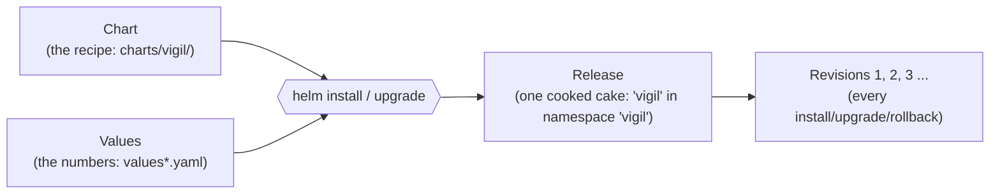
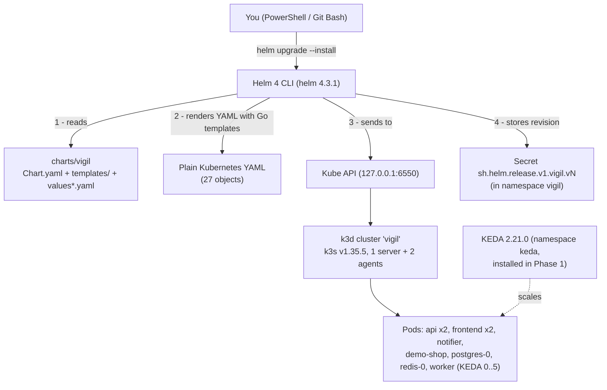
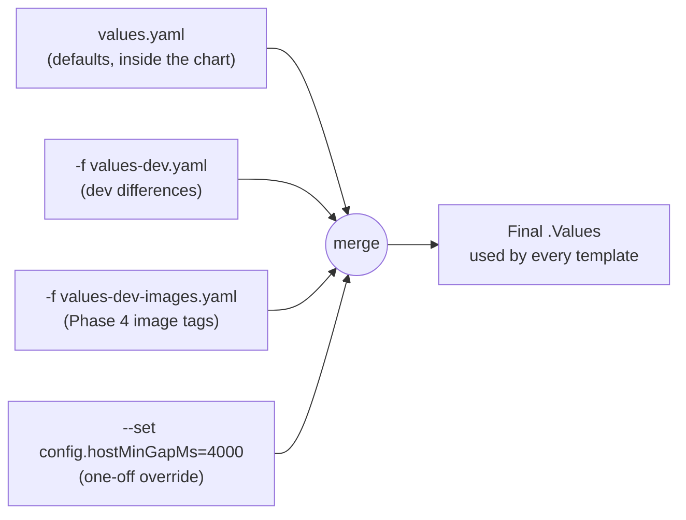
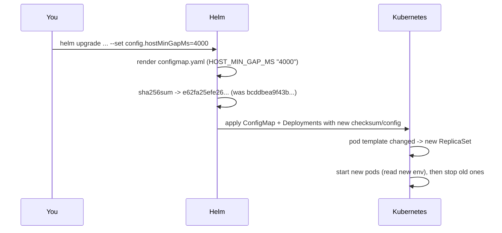
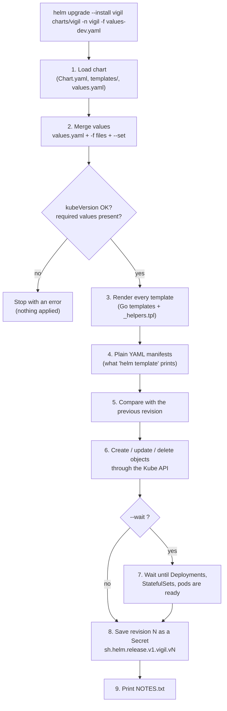
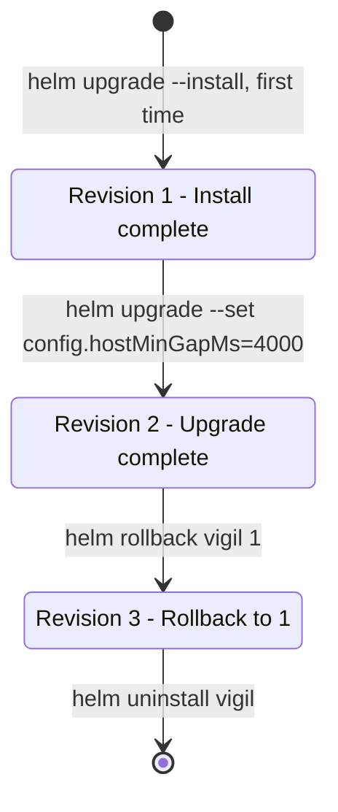

# Chapter 4 - Phase 2: Packaging Vigil with Helm

> **Where we are.** In Phase 1 you deployed Vigil with 13 hand-written YAML files in `k8s/`
> (`kubectl apply -f k8s/00-namespace.yaml` ... `40-networkpolicies.yaml`). It worked, but
> every setting was hard-coded. In Phase 2 we turn those files into a **Helm chart** in
> `charts/vigil/` so that ONE set of templates can produce a dev install, a prod install,
> or anything in between.
>
> See exactly what Phase 2 added:
>
> ```bash
> git diff --stat phase-1 phase-2            # 23 files, +1855 lines, all under charts/ + docs + one script
> git diff phase-1 phase-2 -- charts/vigil/values-dev.yaml
> ```

---

## 4.1 Why Helm? (the problem first)

Imagine you run a bakery and you write a recipe card for "chocolate cake for 8 people".
Next week someone wants a cake for 20 people, and then a vanilla one. If your recipe has
the numbers baked in ("use 3 eggs"), you have to copy the card and edit every line.
A smarter card says "use **{eggs}** eggs" and you keep a small sheet of numbers beside it.

Kubernetes YAML in Phase 1 is the first kind of card. For example `k8s/20-api.yaml` has
`replicas: 2` and `image: vigil-core:dev` written directly in it. To make a prod copy you
would duplicate all 13 files and edit them - and then forget one.

**Helm** is the "smart recipe card" for Kubernetes:

| Without Helm (Phase 1) | With Helm (Phase 2) |
|---|---|
| 13 YAML files with fixed values | ~17 **templates** with `{{ placeholders }}` |
| Copy + edit everything for a second environment | Small `values-dev.yaml` / `values-prod.yaml` files list only the differences |
| `kubectl apply` - Kubernetes has no idea which objects belong together | Helm groups everything into one **release** with a **revision history** |
| Undo = remember what you changed and re-apply by hand | `helm rollback vigil 1` |
| Deleting = delete each object yourself | `helm uninstall vigil` removes exactly what it installed |

Helm is often called "the package manager for Kubernetes" - like `apt` or `pip`, but the
package (a **chart**) contains Kubernetes YAML templates instead of programs.

### The three words you must know



- **Chart** - a folder with templates + default values. Ours is `charts/vigil/`.
- **Values** - the settings that fill in the templates. Defaults live in `values.yaml`;
  you layer extra files on top with `-f`.
- **Release** - one installed copy of a chart, with a name (we always use `vigil`) in a
  namespace. Helm remembers each release's history as numbered **revisions**, stored as
  Kubernetes Secrets in the same namespace.

---

## 4.2 The tech stack of this phase



Nothing about the application changed in this phase: the same images (`vigil-core:dev`,
`vigil-worker:dev`, `vigil-frontend:dev`) run. Only **how they are described and
installed** changed.

---

## 4.3 Chart anatomy - a tour of `charts/vigil/`

```text
charts/vigil/
├── Chart.yaml              identity card: name, chart version, app version
├── .helmignore             files Helm must not pack into the chart
├── values.yaml             ALL settings with their defaults (documented)
├── values-dev.yaml         only what differs for dev  (k3d, fake LLM, demo shop)
├── values-prod.yaml        only what differs for prod (LLM gateway, existing Secret)
├── values-dev-images.yaml  (Phase 4) image tags for dev, written by CI
├── values-prod-images.yaml (Phase 4) image tags for prod, changed by a PR
└── templates/
    ├── _helpers.tpl        reusable snippets - renders nothing by itself
    ├── NOTES.txt           message printed after install
    ├── namespace.yaml      optional Namespace (namespace.create)
    ├── configmap.yaml      vigil-config (non-secret settings)
    ├── secret.yaml         vigil-secrets - only when secrets.create (dev)
    ├── postgres.yaml       headless Service + StatefulSet + PVC template
    ├── redis.yaml          headless Service + StatefulSet
    ├── api.yaml            ServiceAccount + Role + RoleBinding + Service + Deployment
    ├── worker.yaml         Deployment + KEDA ScaledObject
    ├── notifier.yaml       Deployment
    ├── frontend.yaml       Service + Deployment (nginx)
    ├── demo-shop.yaml      dev only
    ├── llm-gateway.yaml    prod only (LiteLLM ConfigMap + Service + Deployment)
    ├── ingress.yaml        host-based routing via Traefik
    ├── networkpolicies.yaml pod firewall rules
    └── tests/test-api.yaml the "helm test" pod
```

### `Chart.yaml` - the identity card

```yaml
apiVersion: v2                 # v2 = Helm 3+ chart format
name: vigil
description: >-
  Vigil - tell an AI agent in plain English what to watch on the web; it checks on a
  schedule (one Kubernetes CronJob per watch) and notifies you only when your
  condition is met.
type: application
version: 0.1.0                 # version of the CHART (bump when templates/values change)
appVersion: "0.1.0"            # version of the Vigil APP it deploys (app/vigil/config.py VERSION)
...
kubeVersion: ">=1.29.0-0"      # CronJob timeZone + KEDA 2.21 need a recent Kubernetes
```

| Line | What it does | Why it matters / what breaks without it |
|---|---|---|
| `apiVersion: v2` | Declares the chart format | `v1` is the old Helm 2 format. Helm 3 and Helm 4 both read `v2` charts. |
| `name: vigil` | The chart's name | Used in the `helm.sh/chart: vigil-0.1.0` label (see `_helpers.tpl`). |
| `type: application` | "This chart installs something" | The other type, `library`, only provides helpers and cannot be installed. |
| `version: 0.1.0` | The **chart's** version | Bump it when templates change, so people can tell two chart builds apart. |
| `appVersion: "0.1.0"` | The **app's** version | Shown in `helm history`; also the fallback image tag in `vigil.image`. Quoted so YAML does not turn it into a number. |
| `kubeVersion: ">=1.29.0-0"` | Minimum Kubernetes version | Helm refuses to install on an older cluster instead of failing halfway. The `-0` lets pre-release builds such as `v1.35.5+k3s1` match. |

---

## 4.4 Templates - YAML with blanks to fill in

A template is a normal Kubernetes YAML file with **Go template** actions inside
`{{ ... }}`. Helm runs each template with a data object called the **root context**
(written as a dot `.`) and writes out plain YAML.

What is inside the dot:

| You write | You get | Example in Vigil |
|---|---|---|
| `.Values.x.y` | a setting from the merged values | `{{ .Values.api.replicas }}` -> `2` |
| `.Release.Name` | the release name | `vigil` |
| `.Release.Namespace` | the namespace you install into | `vigil`, `vigil-dev`, `vigil-prod` |
| `.Release.Service` | who installs | `Helm` (used for the `managed-by` label) |
| `.Chart.AppVersion` | from `Chart.yaml` | `0.1.0` |
| `.Template.BasePath` | the templates folder path | used by the checksum trick |

### The most important template functions used in Vigil

| Function | Meaning | Real use |
|---|---|---|
| `quote` | wrap in quotes | ConfigMap values must be strings: `{{ .Values.config.llmDailyBudget \| quote }}` |
| `default` | fallback value | `.image.tag \| default .root.Chart.AppVersion` |
| `required` | stop with an error if empty | `secret.yaml`: `required "secrets.postgresPassword is required ..."` |
| `toYaml` | turn a map/list into YAML text | `{{- toYaml .Values.api.resources \| nindent 12 }}` |
| `nindent N` | newline + indent N spaces | keeps YAML indentation correct |
| `include` | call a named template from `_helpers.tpl` | `{{ include "vigil.labels" (dict "root" . "component" "api") }}` |
| `dict` | build a small map to pass to `include` | `(dict "root" . "component" "api")` |
| `sha256sum` | fingerprint of a string | the config checksum annotation |
| `if` / `with` / `range` | control flow | `{{- if .Values.demoShop.enabled }}`, `range $k, $v := .Values.config.extra` |

> **The dash.** `{{-` removes whitespace (including the newline) *before* the action,
> `-}}` removes it *after*. Without dashes, every `{{ if }}` leaves an empty line or wrong
> indentation behind, and YAML is very picky about indentation.

### A real template: the api Deployment (excerpt of `templates/api.yaml`)

```yaml
{{- $sel := include "vigil.selectorLabels" (dict "root" . "component" "api") }}
...
apiVersion: apps/v1
kind: Deployment
metadata:
  name: vigil-api
  namespace: {{ .Release.Namespace }}
  labels:
    {{- include "vigil.labels" (dict "root" . "component" "api") | nindent 4 }}
spec:
  replicas: {{ .Values.api.replicas }}
  revisionHistoryLimit: 3
  strategy:
    type: RollingUpdate
    rollingUpdate: {maxUnavailable: 0, maxSurge: 1}   # never fewer ready pods during an update
  selector:
    matchLabels:
      {{- $sel | nindent 6 }}
  template:
    metadata:
      labels:
        {{- include "vigil.labels" (dict "root" . "component" "api") | nindent 8 }}
      annotations:
        {{- include "vigil.configChecksums" . | nindent 8 }}
    spec:
      serviceAccountName: vigil-api
      ...
      initContainers:
        - name: migrate
          image: {{ include "vigil.image" (dict "root" . "image" .Values.api.image) }}
          ...
          command: ["python", "-m", "vigil.migrate"]
      containers:
        - name: api
          image: {{ include "vigil.image" (dict "root" . "image" .Values.api.image) }}
          ...
          resources:
            {{- toYaml .Values.api.resources | nindent 12 }}
```

| Line | What it does | Why it matters / what breaks without it |
|---|---|---|
| `{{- $sel := include ... }}` | Renders the selector labels once and stores them in a variable | The same labels are needed in 3 places (Service selector, Deployment selector, topology spread). One variable = they can never disagree. |
| `name: vigil-api` | Fixed name, not `{{ .Release.Name }}-api` | The app and the frontend's nginx have `vigil-api`, `vigil-redis`, `vigil-postgres` built in. A different name = the frontend's `/api` proxy finds nothing. That is why the chart says "install ONE release per namespace". |
| `namespace: {{ .Release.Namespace }}` | Puts the object where you installed | The same chart lands in `vigil`, `vigil-dev` or `vigil-prod`. |
| `replicas: {{ .Values.api.replicas }}` | Number of api pods from values | Default `2` in `values.yaml`. Change it with a values file or `--set api.replicas=3`. |
| `maxUnavailable: 0, maxSurge: 1` | Rolling update: start 1 new pod before stopping an old one | The UI never loses its backend during `helm upgrade`. |
| `annotations: ... vigil.configChecksums` | Adds `checksum/config` (and `checksum/secret`) | Makes pods restart when the ConfigMap changes - see section 4.7. |
| `initContainers: migrate` | Runs `python -m vigil.migrate` before the api starts | Tables exist before the first request. Safe with 2 replicas: it uses a Postgres advisory lock. |
| `toYaml .Values.api.resources \| nindent 12` | Copies the whole `resources:` block from values | You change CPU/memory in values, never in the template. |

---

## 4.5 `values.yaml` - the settings panel

`values.yaml` holds **every** setting with a safe default and a comment. Templates read
nothing that is not declared here. An excerpt:

```yaml
api:
  replicas: 2
  image:
    registry: ""                      # e.g. ghcr.io (empty = local / Docker Hub)
    repository: vigil-core
    tag: dev
    pullPolicy: IfNotPresent
  resources:
    requests: {cpu: 50m, memory: 128Mi}
    limits: {cpu: 500m, memory: 384Mi}

worker:
  ...
  autoscaling:
    enabled: true
    minReplicas: 1                    # 0 = scale to zero when the queue is empty
    maxReplicas: 5
    listLength: 3                     # target queued jobs per worker pod

secrets:
  name: vigil-secrets
  # true  = this chart creates the Secret from the values below (dev only!)
  # false = the Secret must already exist (created by a script or a SealedSecret).
  create: false
  postgresPassword: ""
  internalToken: ""

tests:
  # false = do not render the "helm test" pod (Argo CD sets this: it has no "helm test").
  enabled: true
```

| Line | What it does | Why it matters / what breaks without it |
|---|---|---|
| `image.registry: ""` | Empty = use the local image name | In Phases 1-3 images were imported into the k3d nodes (`scripts/import-images.ps1`), so no registry. Phase 4 sets `ghcr.io`. |
| `image.tag: dev` | Which build to run | Phase 4 replaces this with immutable tags like `sha-5f612bf`. |
| `pullPolicy: IfNotPresent` | Only pull if the node does not have the image | With imported images, `Always` would try Docker Hub and fail with `ImagePullBackOff`. |
| `requests` / `limits` | Reserve / cap CPU and memory | The scheduler places pods by `requests`; the kernel kills a container that goes over its memory `limit` (`OOMKilled`). |
| `autoscaling.minReplicas: 1` | Default floor for KEDA | Dev overrides it to `0` (scale to zero), prod keeps `1` (no cold start). |
| `secrets.create: false` | Default: do NOT put a password in the chart | Safe default for a public repo. Only dev turns it on, with obviously fake values. |
| `tests.enabled: true` | Render the `helm test` pod | Argo CD (Phase 3) sets it `false` because Argo CD would treat the test pod as a normal object. |

### How values are merged (layering)

Values files are applied **left to right**; later ones win, key by key. Maps are merged
deeply, lists are replaced as a whole.



Example: `values.yaml` says `worker.autoscaling.minReplicas: 1`, `values-dev.yaml` says
`minReplicas: 0`. The final value is `0`, and `maxReplicas: 5` is still there because the
dev file did not mention it.

---

## 4.6 Dev vs prod values side by side

`values-dev.yaml` (complete file):

```yaml
environment: dev

config:
  llmMode: fake                       # no model calls; deterministic paths only
  minIntervalMinutes: 1               # allow "every minute" watches for quick demos
  allowedInternalHosts: vigil-demo-shop   # let the SSRF guard through to the demo shop

# DEV ONLY - the chart creates the Secret with these fixed placeholder values.
# They are NOT secret (they are in a public git repo) and must never be used anywhere
# reachable from outside this PC. Production uses secrets.create: false + a SealedSecret.
secrets:
  create: true
  postgresPassword: dev-only-insecure-postgres-password
  internalToken: dev-only-insecure-internal-token

worker:
  autoscaling:
    minReplicas: 0                    # no queued checks -> no worker pods (saves ~400 MB RAM)

demoShop:
  enabled: true

ingress:
  hosts:
    app: vigil-dev.localhost         # Phase 3: dev and prod share the cluster, so each gets its own host
    demo: demo.localhost
```

`values-prod.yaml` (complete file):

```yaml
environment: prod

config:
  llmMode: gateway                    # use the LiteLLM gateway below
  minIntervalMinutes: 5               # be polite to websites: at most every 5 minutes
  allowedInternalHosts: ""            # no internal hosts may be watched

secrets:
  create: false
  name: vigil-secrets

worker:
  autoscaling:
    minReplicas: 1                    # always one warm worker (no cold start)

demoShop:
  enabled: false

llmGateway:
  enabled: true                       # starts even without an OpenRouter key (optional secretKeyRef)

ingress:
  hosts:
    app: vigil-prod.localhost
```

| Setting | Dev | Prod | Why different |
|---|---|---|---|
| `config.llmMode` | `fake` | `gateway` | Dev never spends money or needs a key; prod uses the LiteLLM gateway. |
| `config.minIntervalMinutes` | `1` | `5` | Fast demos vs. politeness to real websites. |
| `config.allowedInternalHosts` | `vigil-demo-shop` | `""` | The SSRF guard normally blocks in-cluster addresses; dev must reach its demo shop. |
| `secrets.create` | `true` (fake values) | `false` | Prod's Secret comes from a SealedSecret (Chapter 5). |
| `worker.autoscaling.minReplicas` | `0` | `1` | Save RAM on a laptop vs. no cold start. |
| `demoShop.enabled` | `true` | `false` | Prod watches real sites only. |
| `llmGateway.enabled` | (default `false`) | `true` | Renders `templates/llm-gateway.yaml` only in prod. |
| `ingress.hosts.app` | `vigil-dev.localhost` | `vigil-prod.localhost` | Both environments share one cluster and one Traefik in Phase 3. |

> In the Phase-2 commit the dev host was `vigil.localhost`. Phase 3 changed it to
> `vigil-dev.localhost` because dev and prod then run side by side:
> `git diff phase-2 phase-3 -- charts/vigil/values-dev.yaml`.

---

## 4.7 `_helpers.tpl` - write once, use everywhere

Files whose names start with `_` render nothing on their own. They hold **named
templates** (`define`) that other files call with `include`. Think of them as functions.

### Labels and selector labels

```yaml
{{- define "vigil.selectorLabels" -}}
app.kubernetes.io/name: vigil
app.kubernetes.io/instance: {{ .root.Release.Name }}
app.kubernetes.io/component: {{ .component }}
{{- end -}}

{{- define "vigil.labels" -}}
{{ include "vigil.selectorLabels" . }}
app.kubernetes.io/part-of: vigil
app.kubernetes.io/version: {{ .root.Chart.AppVersion | quote }}
app.kubernetes.io/managed-by: {{ .root.Release.Service }}
helm.sh/chart: {{ include "vigil.chart" .root }}
{{- with .root.Values.commonLabels }}
{{ toYaml . }}
{{- end }}
{{- end -}}
```

| Line | What it does | Why it matters / what breaks without it |
|---|---|---|
| `define "vigil.selectorLabels"` | The SMALL label set used by selectors | A Deployment's `spec.selector` **cannot be changed** after creation. Putting a version label here would make every upgrade fail with `field is immutable`. |
| `app.kubernetes.io/instance: {{ .root.Release.Name }}` | Which release owns the pod | New in Phase 2. It is also why Helm could not adopt the Phase-1 objects (their selectors lacked it). |
| `app.kubernetes.io/component` | `api`, `worker`, `postgres`, ... | The NetworkPolicies match pods by this label. A wrong component = traffic blocked. |
| `define "vigil.labels"` | Selector labels + version + manager | Every object gets the full set, so `kubectl get all -l app.kubernetes.io/part-of=vigil` finds everything. |
| `.root` / `.component` | Fields of the `dict` passed in | `include` gives a template only ONE argument, so we pack the root context and the component name into a `dict`. |

### Image reference

```yaml
{{- define "vigil.image" -}}
{{- $tag := .image.tag | default .root.Chart.AppVersion | toString -}}
{{- if .image.registry -}}
{{- printf "%s/%s:%s" .image.registry .image.repository $tag -}}
{{- else -}}
{{- printf "%s:%s" .image.repository $tag -}}
{{- end -}}
{{- end -}}
```

| Line | What it does | Why it matters |
|---|---|---|
| `default .root.Chart.AppVersion` | Empty tag -> chart's `appVersion` | You never end up with `vigil-core:` (invalid). |
| `toString` | Tag as text | A tag like `1.0` would otherwise be a number. |
| `if .image.registry` | `ghcr.io/gagan046-dev/vigil-core:sha-...` vs `vigil-core:dev` | Same template works for imported local images (Phases 1-3) and GHCR (Phase 4). |

### Security contexts that pass Pod Security "restricted"

```yaml
{{- define "vigil.podSecurity" -}}
runAsNonRoot: true
runAsUser: {{ .uid }}
runAsGroup: {{ .gid | default .uid }}
{{- if .fsGroup }}
fsGroup: {{ .fsGroup }}
{{- end }}
seccompProfile:
  type: RuntimeDefault
{{- end -}}

{{- define "vigil.containerSecurity" -}}
allowPrivilegeEscalation: false
readOnlyRootFilesystem: {{ if hasKey . "readOnly" }}{{ .readOnly }}{{ else }}true{{ end }}
capabilities:
  drop: ["ALL"]
{{- end -}}
```

Every pod calls these with its own user id: api `10001`, worker `1001` (the Playwright
image's `pwuser`), postgres `70`, the test pod `100`. If any of the four "restricted"
rules (`runAsNonRoot`, `seccompProfile`, `allowPrivilegeEscalation: false`,
`capabilities.drop: [ALL]`) is missing, the namespace **rejects the pod** (Chapter 8).

---

## 4.8 The checksum annotation trick

**Problem.** Kubernetes restarts a Deployment's pods only when the **pod template**
changes. A ConfigMap is a separate object. If you change `HOST_MIN_GAP_MS` in the
ConfigMap, the running pods keep the old environment variables forever (env vars are read
only when a container starts).

**Trick.** Put a fingerprint of the ConfigMap into the pod template:

```yaml
{{- define "vigil.configChecksums" -}}
checksum/config: {{ include (print .Template.BasePath "/configmap.yaml") . | sha256sum }}
{{- if .Values.secrets.create }}
checksum/secret: {{ include (print .Template.BasePath "/secret.yaml") . | sha256sum }}
{{- end }}
{{- end -}}
```

| Line | What it does | Why it matters / what breaks without it |
|---|---|---|
| `include (print .Template.BasePath "/configmap.yaml") .` | Renders `templates/configmap.yaml` as a string | We fingerprint exactly what will be applied. |
| `\| sha256sum` | 64-character hash of that text | Any change in any setting -> a different hash. |
| `checksum/config:` in `template.metadata.annotations` | The hash becomes part of the pod template | Different pod template -> Kubernetes does a rolling restart. |
| `if .Values.secrets.create` | Only hash the Secret if the chart made it | In prod the Secret is not in the chart; there is nothing to hash. |



The verification notes show it happened for real:

```text
--- before: checksum/config on api + notifier pods
vigil-api-767f7fd7b6-6dqrm        bcddbea9f43b...
vigil-notifier-5556cf5fb9-6bvlx   bcddbea9f43b...
--- after (new ReplicaSets, new hash; ConfigMap HOST_MIN_GAP_MS=4000)
vigil-api-7bb7c9c669-8cj8l        e62fa25efe26...
vigil-api-7bb7c9c669-9vvlx        e62fa25efe26...
vigil-notifier-6b7679fdd4-xgvsq   e62fa25efe26...
```

Notice the pod names: the middle part (`767f7fd7b6` -> `7bb7c9c669`) is the ReplicaSet
hash, so a new name means a new pod template.

The LLM gateway uses the same idea with its own fingerprint, because its routing lives
in a different ConfigMap:

```yaml
checksum/litellm-config: {{ printf "%s|%s|%s" .Values.config.llmModel .Values.llmGateway.primaryModel .Values.llmGateway.fallbackModel | sha256sum }}
```

---

## 4.9 Conditionals: one chart, different objects

Some objects exist only in one environment. `if` blocks decide:

| Template | Guard | Dev | Prod |
|---|---|---|---|
| `secret.yaml` | `{{- if .Values.secrets.create }}` | rendered | skipped |
| `demo-shop.yaml` | `demoShop.enabled` | rendered | skipped |
| `llm-gateway.yaml` | `{{- if .Values.llmGateway.enabled }}` | skipped | rendered |
| `namespace.yaml` | `{{- if .Values.namespace.create }}` | skipped | skipped |
| ScaledObject in `worker.yaml` | `{{- if .enabled }}` (autoscaling) | rendered | rendered |
| `tests/test-api.yaml` | `{{- if .Values.tests.enabled }}` | rendered (Helm) / skipped (Argo CD) | same |

A subtle one in `worker.yaml`:

```yaml
spec:
  {{- /* No replicas when KEDA scales it, otherwise every helm upgrade would fight KEDA. */}}
  {{- if not .Values.worker.autoscaling.enabled }}
  replicas: {{ .Values.worker.replicas }}
  {{- end }}
```

| Line | What it does | Why it matters / what breaks without it |
|---|---|---|
| `if not ...autoscaling.enabled` | Only write `replicas:` when KEDA is off | If Helm wrote `replicas: 1` while KEDA had scaled to 4, every `helm upgrade` would shrink the workers back to 1, and KEDA would scale them up again - a tug of war. |

And in the ScaledObject:

```yaml
  {{- if eq (int .minReplicas) 0 }}
  # Only used for the 0 <-> 1 step (KEDA warns if they are set with minReplicas > 0).
  pollingInterval: {{ .pollingInterval }}
  cooldownPeriod: {{ .cooldownPeriod }}
  {{- end }}
```

`int` converts the value first so the comparison works whether the YAML had `0` or `"0"`.

---

## 4.10 How Helm turns templates into objects (the render flow)



Two commands let you look at step 4 **without touching the cluster**:

```bash
helm template vigil charts/vigil -n vigil -f charts/vigil/values-dev.yaml          # print the YAML
helm template vigil charts/vigil -n vigil -f charts/vigil/values-dev.yaml \
  | kubectl apply --dry-run=server -f -                                           # ask the API server to validate it
```

The second one is stronger: the API server checks schemas and Pod Security without
saving anything. This is how Phase 2 was verified (27 objects, "created (server dry run)",
no Pod Security warnings).

---

## 4.11 Hooks and `helm test`

A **hook** is a template that Helm runs at a special moment instead of as part of the
normal install - for example before an upgrade, or only when you ask for a test. You make
a template a hook with an annotation.

`templates/tests/test-api.yaml`:

```yaml
{{- if .Values.tests.enabled }}
apiVersion: v1
kind: Pod
metadata:
  name: vigil-test-api
  namespace: {{ .Release.Namespace }}
  labels:
    {{- include "vigil.labels" (dict "root" . "component" "helm-test") | nindent 4 }}
  annotations:
    "helm.sh/hook": test
    # delete an old test pod before a new run; keep a failed one for "kubectl logs"
    "helm.sh/hook-delete-policy": before-hook-creation,hook-succeeded
spec:
  restartPolicy: Never
  automountServiceAccountToken: false
  ...
  containers:
    - name: readyz
      image: {{ include "vigil.image" (dict "root" . "image" .Values.tests.image) }}
      # -f: fail on HTTP >= 400 (503 = not ready); retry while pods settle
      args: ["-fsS", "-m", "10", "--retry", "5", "--retry-delay", "3", "--retry-all-errors", "http://vigil-api:8000/readyz"]
{{- end }}
```

| Line | What it does | Why it matters / what breaks without it |
|---|---|---|
| `"helm.sh/hook": test` | Not created by install; only by `helm test` | Without it, the test pod would run once at install and then sit there as "Completed". |
| `hook-delete-policy: before-hook-creation,hook-succeeded` | Delete the old pod before a new test; delete it after success | A second `helm test` would otherwise fail with "pod already exists". A FAILED pod is kept so you can read `kubectl logs vigil-test-api`. |
| `restartPolicy: Never` | Run once | Exit code 0 = test passed, non-zero = failed. |
| `component: helm-test` label | Identity for the NetworkPolicy | `allow-api` lets in `frontend`, `errand-trigger` and `helm-test` only. Without this label the test would time out. |
| `curl -f ... /readyz` | Calls the api's readiness endpoint | `/readyz` returns 503 unless db + schema + redis are OK, and `-f` turns 503 into a failure. |
| `--retry 5 ... --retry-all-errors` | Retry for ~15 s | Pods may still be settling right after install. |

`helm test` is the "smoke test after deploy": it checks the app through its real Service,
inside the cluster, from a pod that obeys the same rules as everything else.

---

## 4.12 Install, upgrade, rollback, history - the release lifecycle



A rollback does **not** delete revision 2. It creates a **new** revision (3) whose content
is a copy of revision 1. History only grows.

### The real commands (from `scripts/phase2-up.ps1` and the verification notes)

```powershell
kubectl delete namespace vigil                     # remove the Phase-1 raw-YAML install
powershell -ExecutionPolicy Bypass -File scripts\phase2-up.ps1
```

What `phase2-up.ps1` does:

```powershell
kubectl create namespace $Namespace --dry-run=client -o yaml | kubectl apply -f - | Out-Null
kubectl label namespace $Namespace --overwrite `
    app.kubernetes.io/part-of=vigil `
    pod-security.kubernetes.io/enforce=restricted pod-security.kubernetes.io/enforce-version=latest `
    ...
helm upgrade --install $Release $chart -n $Namespace `
    -f (Join-Path $chart "values-$Values.yaml") --wait --timeout 6m
helm test $Release -n $Namespace
```

| Line | What it does | Why it matters / what breaks without it |
|---|---|---|
| `kubectl create namespace ... --dry-run=client -o yaml \| kubectl apply -f -` | "Create if missing" | Plain `kubectl create namespace` fails if it already exists; this is re-runnable. |
| `kubectl label namespace ... pod-security...=restricted` | Turns on Pod Security enforcement | `helm install --create-namespace` creates the namespace **without** labels, so the safety net would be off. |
| `helm upgrade --install` | Install if new, upgrade if it exists | One command for the first run and every later run. |
| `--wait --timeout 6m` | Do not report success until pods are ready | Without it Helm says "deployed" as soon as the API accepted the YAML, even if pods then crash. |
| `helm test` | Run the test hook | Proves the api can reach Postgres and Redis. |

Output from the real run:

```text
Release "vigil" does not exist. Installing it now.
STATUS: deployed   REVISION: 1
TEST SUITE:     vigil-test-api
Phase:          Succeeded
```

Upgrade, rollback and history:

```text
$ helm upgrade vigil charts/vigil -n vigil -f charts/vigil/values-dev.yaml --set config.hostMinGapMs=4000 --wait
$ helm rollback vigil 1 -n vigil --wait
Rollback was a success! Happy Helming!

$ helm history vigil -n vigil
REVISION  STATUS      CHART        APP VERSION  DESCRIPTION
1         superseded  vigil-0.1.0  0.1.0        Install complete
2         superseded  vigil-0.1.0  0.1.0        Upgrade complete
3         deployed    vigil-0.1.0  0.1.0        Rollback to 1
```

> **Why the Phase-1 namespace had to go.** A server dry run against the running Phase-1
> namespace failed with nine `field is immutable` errors. The Helm selectors include
> `app.kubernetes.io/instance`, the Phase-1 ones did not, and selectors cannot be edited.
> So the old namespace was deleted and Helm started fresh.

### Where does Helm keep the history?

```bash
kubectl get secrets -n vigil -l owner=helm
# sh.helm.release.v1.vigil.v1, .v2, .v3  (one Secret per revision)
```

Each Secret stores the rendered manifests and the values of that revision. That is what
`helm rollback` and `helm get values vigil -n vigil` read. In Chapter 5 you will see the
same kind of Secrets deleted for KEDA (`kubectl delete secret -n keda -l owner=helm,name=keda`)
when Argo CD takes over.

---

## 4.13 Helm 4 notes

This project uses **Helm 4** (`helm 4.3.1` on the PC, `v4.3.0` in CI). For a beginner
almost nothing is different from the many Helm 3 tutorials online:

- Charts still use `apiVersion: v2` - the same `Chart.yaml` works in Helm 3 and Helm 4.
- `helm install / upgrade --install / rollback / history / test / template / lint /
  uninstall` are used exactly as shown in this chapter.
- Like Helm 3, there is no server-side component (Helm 2's "Tiller" is long gone); Helm
  talks to the Kube API with your kubeconfig.
- Release history is still stored as Secrets in the release namespace.

Where Helm 4 differs, it is mostly in advanced areas (how changes are applied to the
cluster, how `--wait` decides "ready", plugins, some renamed flags). If a blog post shows
a flag that Helm 4 rejects, run `helm <command> --help` to see the current name.

---

## 4.14 Lint: catching mistakes before installing

```text
$ helm lint charts/vigil -f charts/vigil/values-dev.yaml     # same for values-prod.yaml, also --strict
[INFO] Chart.yaml: icon is recommended
1 chart(s) linted, 0 chart(s) failed
```

`helm lint` renders the chart and checks YAML structure and chart conventions. `--strict`
turns warnings into failures - CI (Chapter 6) runs it for both dev and prod values.

---

## Try it yourself

All commands are taken from `docs/notes/platform-verification.md`. Run them from the repo
root with the k3d cluster running. **Note:** after Phase 3 the cluster is managed by Argo
CD, so do these experiments in a *separate* namespace (for example `vigil` as below), not in
`vigil-dev` / `vigil-prod`.

```bash
# 1. Lint both environments
helm lint charts/vigil -f charts/vigil/values-dev.yaml
helm lint charts/vigil --strict -f charts/vigil/values-prod.yaml

# 2. See the YAML Helm would produce (nothing is installed)
helm template vigil charts/vigil -n vigil -f charts/vigil/values-dev.yaml | less
helm template vigil charts/vigil -n vigil -f charts/vigil/values-prod.yaml | grep -n "kind: "

# 3. Server-side dry run in a throw-away namespace
kubectl create ns vigil-dryrun
kubectl label ns vigil-dryrun pod-security.kubernetes.io/enforce=restricted pod-security.kubernetes.io/warn=restricted
helm template vigil charts/vigil -n vigil-dryrun -f charts/vigil/values-dev.yaml | kubectl apply --dry-run=server -f -
kubectl delete ns vigil-dryrun
```

```powershell
# 4. Install, test, upgrade, roll back
powershell -ExecutionPolicy Bypass -File scripts\phase2-up.ps1
helm upgrade vigil charts/vigil -n vigil -f charts/vigil/values-dev.yaml --set config.hostMinGapMs=4000 --wait
kubectl get pods -n vigil -o custom-columns=NAME:.metadata.name,HASH:.metadata.annotations.checksum/config
helm rollback vigil 1 -n vigil --wait
helm history vigil -n vigil
helm test vigil -n vigil

# 5. Clean up
helm uninstall vigil -n vigil
kubectl delete namespace vigil
```

Compare what Helm changed against Phase 1:

```bash
git diff phase-1 phase-2 -- charts
git show phase-2:k8s/20-api.yaml | head -60      # the hard-coded version
```

## Common mistakes

| Mistake | What you see | Fix |
|---|---|---|
| Wrong indentation after `include` | `error converting YAML to JSON: yaml: line N: did not find expected key` | Use `\| nindent N` with the right N; check with `helm template`. |
| Forgetting `quote` on a ConfigMap value | `cannot unmarshal number into ... of type string` | ConfigMap `data` values must be strings: `{{ x \| quote }}`. |
| Changing selector labels in an upgrade | `spec.selector: Invalid value ... field is immutable` | Keep selector labels small and stable (`vigil.selectorLabels`); delete and recreate if you must. |
| Installing over objects that `kubectl apply` created | `invalid ownership metadata` / `field is immutable` | Delete the old objects/namespace first (what Phase 2 did). |
| `--create-namespace` and expecting Pod Security | Pods that should be rejected are accepted | Label the namespace yourself (`phase2-up.ps1`) or let Argo CD do it (`managedNamespaceMetadata`). |
| Changing a ConfigMap and expecting pods to see it | Old settings keep running | The `checksum/config` annotation (already in this chart) or `kubectl rollout restart`. |
| Two releases of this chart in one namespace | Name clashes (`vigil-api` already exists) | One release per namespace - names are fixed on purpose. |
| `secrets.create: true` with empty values | `secrets.postgresPassword is required when secrets.create=true` | Pass a values file with both values (dev) or use `create: false` + an existing Secret. |
| Running `helm test` before pods are ready | Test fails with 503 | Use `--wait` on install/upgrade first. |

## Key words

- **Helm** - the package manager for Kubernetes; turns charts + values into objects.
- **Chart** - a folder with `Chart.yaml`, `values.yaml` and `templates/`.
- **Values** - settings that fill the templates; layered with `-f` and `--set`.
- **Release** - one installed instance of a chart (name + namespace).
- **Revision** - one numbered version of a release; created by install, upgrade and rollback.
- **Template** - YAML with Go template actions `{{ ... }}`.
- **Root context (`.`)** - the data a template sees: `.Values`, `.Release`, `.Chart`, `.Template`.
- **Named template / helper** - a `define` block in `_helpers.tpl`, called with `include`.
- **Pipeline (`|`)** - passes a value through functions: `x | quote | nindent 4`.
- **`helm template`** - render locally and print YAML; no cluster changes.
- **`helm lint`** - static checks of a chart; `--strict` fails on warnings.
- **Hook** - a template run at a special moment (`helm.sh/hook: test`, `pre-upgrade`, ...).
- **`helm test`** - runs the test hooks of a release.
- **Rollback** - a new revision that copies an older one.
- **Checksum annotation** - a hash of config in the pod template, so config changes restart pods.
- **Selector labels** - the immutable labels a controller uses to find its pods.
- **Server-side dry run** - `kubectl apply --dry-run=server`: the API server validates without saving.

---

Previous: [Chapter 3 - Phase 1 security and scaling](03-phase1-security-and-scaling.md) | Next: [Chapter 5 - Argo CD and GitOps](05-phase3-argocd-gitops.md) | [Start here](00-start-here.md)
