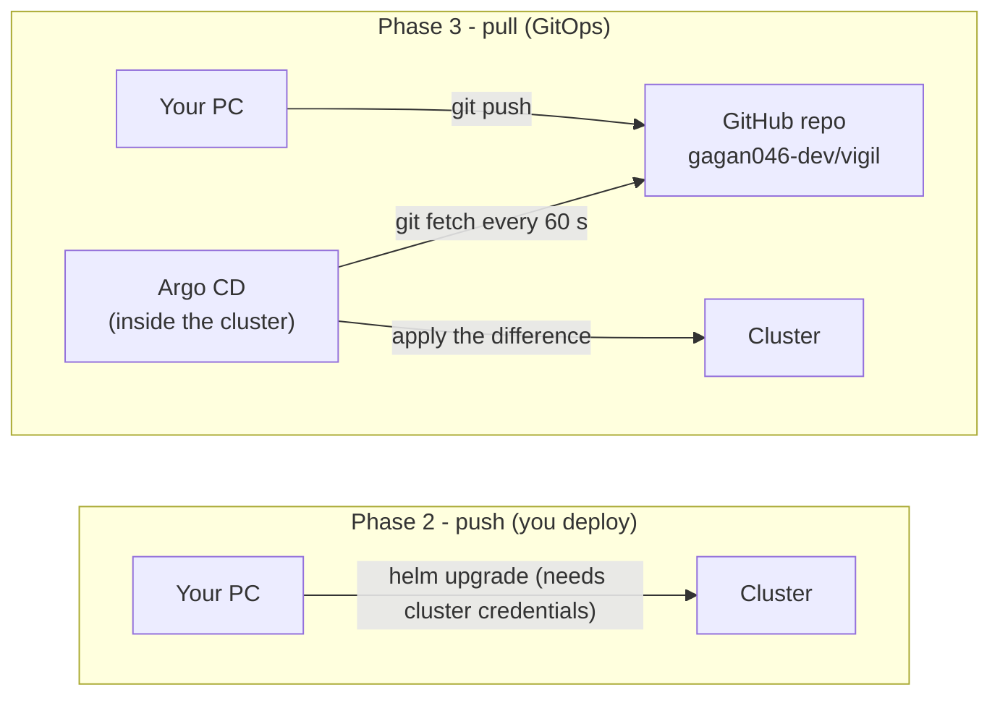
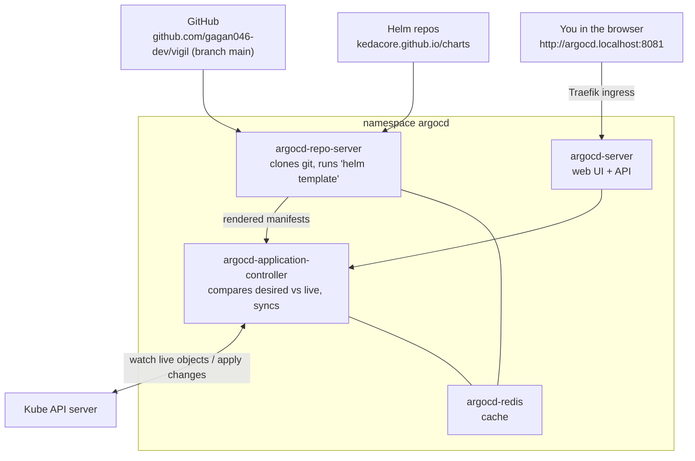
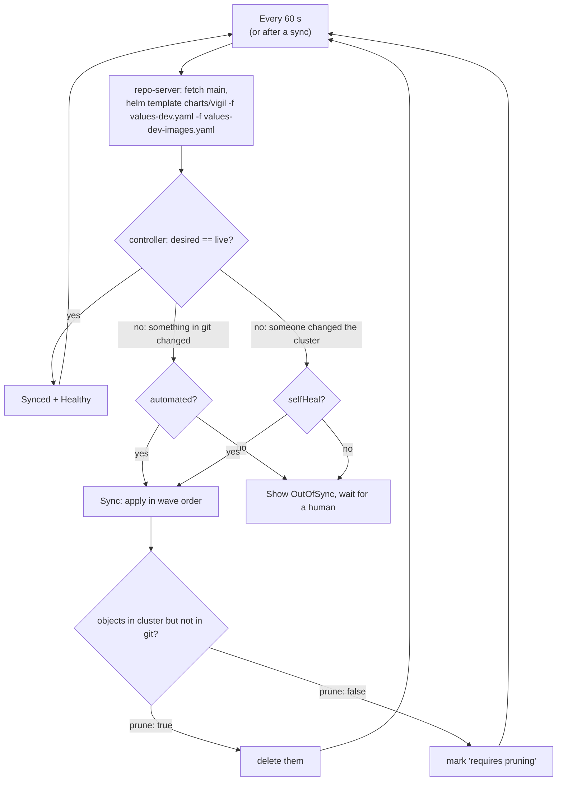
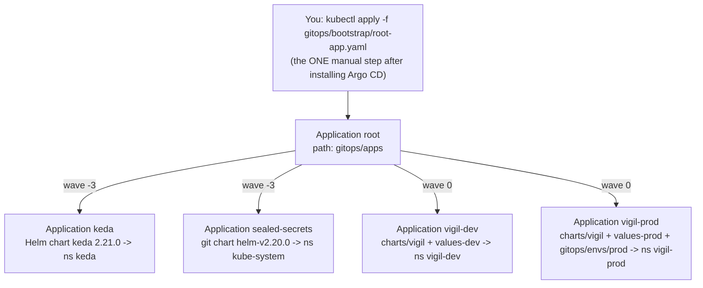
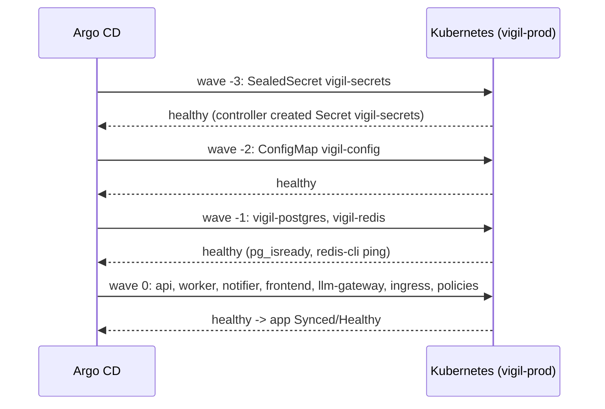
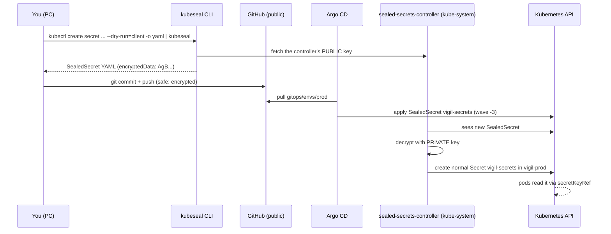
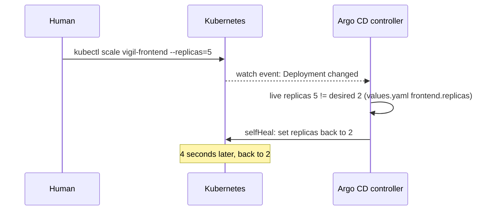
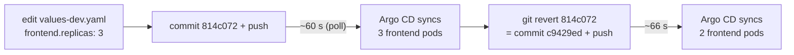

# Chapter 5 - Phase 3: GitOps with Argo CD (and Sealed Secrets)

> **Where we are.** In Phase 2 *you* ran `helm upgrade --install` from your PC. In Phase 3
> nobody runs deploy commands any more. The cluster **pulls** its desired state from the
> public GitHub repo `gagan046-dev/vigil`, and a robot called **Argo CD** keeps the cluster
> equal to git, all day long.
>
> ```bash
> git diff --stat phase-2 phase-3      # gitops/ folder, sync-wave annotations, a SealedSecret
> git log --oneline phase-2..phase-3   # includes the "scale to 3 replicas" demo and its revert
> ```

---

## 5.1 GitOps from zero

### The thermostat analogy

A thermostat does not heat the room once and walk away. You set **20 °C** (the *desired
state*); it keeps measuring the room (the *actual state*); whenever they differ, it acts.
If someone opens a window, the heater comes on by itself.

**GitOps** is a thermostat for your cluster:

- the **desired state** is the YAML in a git repository,
- the **actual state** is what is running in Kubernetes,
- an **agent inside the cluster** (Argo CD) compares them again and again and fixes any
  difference.

### The four GitOps principles

| Principle | Meaning | In Vigil |
|---|---|---|
| **Declarative** | Describe *what* you want, not the steps | Helm chart + Argo CD `Application` YAML |
| **Versioned and immutable** | The desired state lives in git, with history | Every change is a commit on `main`; `git revert` undoes it |
| **Pulled automatically** | An agent pulls from git; nobody pushes into the cluster | Argo CD polls GitHub every 60 s |
| **Continuously reconciled** | Drift is detected and corrected | `selfHeal: true` undid a manual `kubectl scale` in ~5 s |

### Push vs pull



Why pull is nicer:

- Nobody outside the cluster needs admin credentials to it - not your PC, not CI.
- Git history = deploy history. "Who changed prod and when?" is `git log`.
- Undo = `git revert` + push.
- A manual change in the cluster is automatically put back (no silent drift).

---

## 5.2 Argo CD architecture

Argo CD is itself a set of pods in the namespace `argocd`. It was installed with the
Helm chart `argo-cd 10.9.4` (Argo CD v3.5.3), and it is **the only thing installed by hand**.



| Component | Job | Analogy |
|---|---|---|
| **repo-server** | Clones git, renders Helm charts / plain YAML into manifests | The cook who reads the recipe |
| **application-controller** | Compares rendered manifests with live objects; applies differences | The thermostat |
| **server** | Web UI and API (login, buttons, diff view) | The control panel |
| **redis** | Cache of rendered manifests and cluster state | The notepad |

We switched off what we do not need (`gitops/bootstrap/argocd-values.yaml`):

```yaml
global:
  domain: argocd.localhost

configs:
  params:
    # Serve the UI/API over plain HTTP; Traefik in front of it does not terminate TLS here.
    server.insecure: true
  cm:
    # ... poll git every 60 s (default 180 s) so pushes show up quickly during demos.
    timeout.reconciliation: 60s

# Dex = single sign-on connector. Not needed: we log in as the built-in "admin" user.
dex:
  enabled: false

# Not used in this project (no ApplicationSets, no Slack/email notifications).
applicationSet:
  replicas: 0
notifications:
  enabled: false

server:
  ingress:
    enabled: true
    ingressClassName: traefik          # k3s' built-in ingress controller
```

| Line | What it does | Why it matters / what breaks without it |
|---|---|---|
| `global.domain: argocd.localhost` | Host name for the UI ingress | You open `http://argocd.localhost:8081` (k3d maps host 8081 to Traefik). |
| `server.insecure: true` | Argo CD serves plain HTTP | Without it the server redirects to HTTPS, which Traefik does not provide here -> redirect loop. Fine for a local learning cluster only. |
| `timeout.reconciliation: 60s` | Check git every 60 s | Default is 180 s. A push now shows up in about a minute (no webhook possible: the cluster is not reachable from the internet). |
| `dex.enabled: false` | No single sign-on component | Saves memory; we use the built-in `admin` user. |
| `applicationSet.replicas: 0`, `notifications.enabled: false` | Turn off unused controllers | Less RAM on a laptop cluster. |
| `server.ingress` with `traefik` | Exposes the UI | Without it you would need `kubectl port-forward`. |

---

## 5.3 The `Application` - Argo CD's unit of work

An **Application** is a Kubernetes custom resource (kind `Application`, API group
`argoproj.io`) that says: *"take THIS source in git and keep it applied to THIS
destination."* It has three main parts: **source**, **destination**, **syncPolicy**.

`gitops/apps/vigil-dev.yaml`:

```yaml
apiVersion: argoproj.io/v1alpha1
kind: Application
metadata:
  name: vigil-dev
  namespace: argocd
  annotations:
    argocd.argoproj.io/sync-wave: "0"
  finalizers:
    - resources-finalizer.argocd.argoproj.io
spec:
  project: default
  source:
    repoURL: https://github.com/gagan046-dev/vigil.git
    targetRevision: main
    path: charts/vigil
    helm:
      releaseName: vigil
      valueFiles:
        - values-dev.yaml
        - values-dev-images.yaml     # image tags, rewritten by CI (bump-dev job)
      valuesObject:
        tests:
          enabled: false               # the "helm test" pod: Argo CD has no test step
  destination:
    server: https://kubernetes.default.svc
    namespace: vigil-dev
  syncPolicy:
    automated:
      prune: true
      selfHeal: true
    syncOptions:
      - CreateNamespace=true
    # Labels Argo CD puts on the namespace it creates: Pod Security "restricted".
    managedNamespaceMetadata:
      labels:
        app.kubernetes.io/part-of: vigil
        pod-security.kubernetes.io/enforce: restricted
        ...
    retry:
      limit: 5
      backoff: {duration: 10s, factor: 2, maxDuration: 3m}
```

| Line | What it does | Why it matters / what breaks without it |
|---|---|---|
| `namespace: argocd` | Where the Application object itself lives | Argo CD only watches Applications in its own namespace by default. |
| `sync-wave: "0"` | Order among sibling apps | KEDA and sealed-secrets (wave -3) come first. |
| `finalizers: resources-finalizer...` | Deleting the Application also deletes its objects | Without it, deleting the app leaves orphaned pods running. |
| `project: default` | Argo CD "project" (permission group) | `default` allows any repo/namespace - fine for one person. |
| `repoURL` / `targetRevision: main` / `path: charts/vigil` | WHAT to deploy | The repo must be public (or have credentials configured). |
| `helm.releaseName: vigil` | Release name used while rendering | Keeps `app.kubernetes.io/instance: vigil` identical to Phase 2. |
| `valueFiles` | The `-f` files, relative to `path` | Same layering as `helm -f values-dev.yaml -f values-dev-images.yaml`. |
| `valuesObject.tests.enabled: false` | Inline values (like `--set`) | Argo CD renders with `helm template` and has no `helm test` step, so the test pod would be created as an ordinary pod. |
| `destination.server: https://kubernetes.default.svc` | WHERE: "this same cluster" | That address is the in-cluster Kube API. |
| `destination.namespace: vigil-dev` | Target namespace | Fills `.Release.Namespace`. |
| `automated` | Sync on its own when git changes | Without it the app only shows "OutOfSync" and waits for a click. |
| `prune: true` | Delete objects that were removed from git | Without it removed objects stay running forever. |
| `selfHeal: true` | Undo manual changes in the cluster | Without it `kubectl edit` changes persist until the next git change. |
| `CreateNamespace=true` | Create `vigil-dev` if missing | Otherwise the first sync fails with "namespace not found". |
| `managedNamespaceMetadata.labels` | Labels on that namespace | Turns on Pod Security "restricted" - the job `phase2-up.ps1` did by hand. |
| `retry` with backoff 10 s, x2, max 3 m | Retry failed syncs up to 5 times | First syncs can fail briefly (e.g. a CRD not registered yet). |

### How Argo CD reconciles



### Two status words: Sync and Health

| Status | Question it answers | Values |
|---|---|---|
| **Sync status** | Does the cluster match git? | `Synced`, `OutOfSync` |
| **Health status** | Is what is running actually working? | `Healthy`, `Progressing`, `Degraded`, `Missing`, `Suspended` |

An app can be `Synced` but `Degraded` (git applied, but a pod is crash-looping), or
`OutOfSync` but `Healthy` (works, but someone scaled it by hand).

---

## 5.4 App of apps - one Application that creates the others

Applying four Applications by hand would be four manual steps. Instead we apply **one**
root Application that points at a *folder of Applications*.

`gitops/bootstrap/root-app.yaml`:

```yaml
#   root (this file)
#    +-- keda            wave -3  (KEDA operator, namespace keda)
#    +-- sealed-secrets  wave -3  (controller that decrypts SealedSecrets, kube-system)
#    +-- vigil-dev       wave  0  (charts/vigil + values-dev.yaml  -> namespace vigil-dev)
#    +-- vigil-prod      wave  0  (charts/vigil + values-prod.yaml + SealedSecret -> vigil-prod)
apiVersion: argoproj.io/v1alpha1
kind: Application
metadata:
  name: root
  namespace: argocd
  # Deleting the root app also deletes the child Application objects (cascade).
  finalizers:
    - resources-finalizer.argocd.argoproj.io
spec:
  project: default
  source:
    repoURL: https://github.com/gagan046-dev/vigil.git
    targetRevision: main
    path: gitops/apps
  destination:
    server: https://kubernetes.default.svc
    namespace: argocd                  # the child Application objects live in argocd
  syncPolicy:
    automated:
      prune: true                      # a file removed from gitops/apps -> its app is removed
      selfHeal: true                   # someone edits an Application by hand -> reverted
```

| Line | What it does | Why it matters / what breaks without it |
|---|---|---|
| `path: gitops/apps` | Source = a folder of plain YAML | Every file there is an `Application`; the root app "deploys" Applications. |
| `destination.namespace: argocd` | Child Applications are created in `argocd` | Argo CD only picks up Applications in its own namespace. |
| `prune: true` | Removing `gitops/apps/x.yaml` removes app `x` | Your git folder is the full list of what runs. |
| `selfHeal: true` | Hand edits to child Applications are reverted | E.g. someone turns off `selfHeal` on `vigil-prod` in the UI -> put back. |



Bootstrap (from `gitops/bootstrap/argocd-values.yaml` comments and `scripts/phase3-up.ps1`):

```bash
helm repo add argo https://argoproj.github.io/argo-helm
helm upgrade --install argocd argo/argo-cd --version 10.9.4 -n argocd --create-namespace \
  -f gitops/bootstrap/argocd-values.yaml --wait
kubectl apply -f gitops/bootstrap/root-app.yaml
```

Result recorded in the notes:

```text
kubectl get applications -n argocd
  NAME             SYNC STATUS   HEALTH STATUS
  keda             Synced        Healthy
  root             Synced        Healthy
  sealed-secrets   Synced        Healthy
  vigil-dev        Synced        Healthy
```

(`vigil-prod` joined after its SealedSecret was committed.)

### Adopting KEDA instead of reinstalling it

KEDA was installed by hand with Helm in Phase 1. `gitops/apps/keda.yaml` uses the **same**
chart, version, release name, namespace and values, so Argo CD renders identical objects and
just starts tracking them. The keda pods kept their age (15h) and restart count. Then the
old Helm release records were deleted so Helm and Argo CD never both manage KEDA:

```bash
kubectl delete secret -n keda -l owner=helm,name=keda      # 4 secrets v1..v4 deleted
```

Two lines in `keda.yaml` deserve attention:

```yaml
  ignoreDifferences:
    - group: apiregistration.k8s.io
      kind: APIService
      jqPathExpressions: [.spec.caBundle]
    - group: admissionregistration.k8s.io
      kind: ValidatingWebhookConfiguration
      jqPathExpressions: [".webhooks[]?.clientConfig.caBundle"]
  syncPolicy:
    ...
    syncOptions:
      - CreateNamespace=true
      - ServerSideApply=true            # KEDA's CRDs are too big for client-side apply
      - RespectIgnoreDifferences=true
```

| Line | What it does | Why it matters / what breaks without it |
|---|---|---|
| `ignoreDifferences ... caBundle` | Ignore fields KEDA writes itself at runtime | KEDA rotates its own TLS certificate. Without this, Argo CD sees a permanent difference and keeps "fixing" it - the app flips OutOfSync forever. |
| `ServerSideApply=true` | Let the API server merge the change | Client-side apply stores the whole object in an annotation, and KEDA's CRDs are bigger than the 256 KB annotation limit. |
| `RespectIgnoreDifferences=true` | Also ignore those fields while syncing | Otherwise a sync would overwrite KEDA's caBundle with the chart's empty one. |

---

## 5.5 Sync, prune and selfHeal - and why prod is different

`gitops/apps/vigil-prod.yaml` differs from dev in two important ways:

```yaml
spec:
  project: default
  sources:
    - repoURL: https://github.com/gagan046-dev/vigil.git
      targetRevision: main
      path: charts/vigil
      helm:
        releaseName: vigil
        valueFiles:
          - values-prod.yaml
          - values-prod-images.yaml  # image tags, changed only by a promotion PR
        valuesObject:
          tests:
            enabled: false
    - repoURL: https://github.com/gagan046-dev/vigil.git
      targetRevision: main
      path: gitops/envs/prod
  destination:
    server: https://kubernetes.default.svc
    namespace: vigil-prod
  syncPolicy:
    automated:
      prune: false                     # deletions in prod need a human (manual sync with prune)
      selfHeal: true
```

| Line | What it does | Why it matters / what breaks without it |
|---|---|---|
| `sources:` (plural) | Combines two sources into one app | The chart AND the folder holding the encrypted Secret deploy together, so prod cannot start without its Secret. |
| second source `path: gitops/envs/prod` | Plain YAML folder with `vigil-secrets.sealed.yaml` | This is how the SealedSecret reaches the cluster. |
| `values-prod-images.yaml` | Prod's image tags | Changed only by a reviewed pull request (Chapter 6). |
| `prune: false` | Never delete automatically | If a file vanishes from git by mistake, the prod database is NOT deleted; Argo CD shows "requires pruning" and a human decides. |
| `selfHeal: true` | Still undo manual edits | Drift protection stays on. |

| | vigil-dev | vigil-prod |
|---|---|---|
| Values | `values-dev.yaml` + `values-dev-images.yaml` | `values-prod.yaml` + `values-prod-images.yaml` |
| Secret | made by the chart (fake dev values) | SealedSecret from `gitops/envs/prod` |
| Image changes | automatic (CI commits) | pull request + human merge |
| `prune` | `true` | `false` |
| `selfHeal` | `true` | `true` |
| URL | `http://vigil-dev.localhost:8081` | `http://vigil-prod.localhost:8081` |

---

## 5.6 Sync waves - doing things in the right order

During a sync Argo CD applies objects **wave by wave**, lowest number first, and waits for
each wave to be healthy before starting the next. You set the wave with an annotation:

```yaml
metadata:
  annotations:
    argocd.argoproj.io/sync-wave: "-2"   # Argo CD: config + secret before everything else
```

Waves used in this repo (from `grep -rn sync-wave charts gitops`):

| Wave | Objects | Why first/last |
|---|---|---|
| `-3` | Applications `keda`, `sealed-secrets` (inside root); the prod `SealedSecret` (inside vigil-prod) | Platform add-ons and the Secret must exist before anything uses them. |
| `-2` | `ConfigMap vigil-config`, `Secret vigil-secrets` (dev) | Every pod reads them at start. |
| `-1` | Postgres and Redis (Services + StatefulSets) | Data stores before the apps that connect to them. |
| `0` (default) | api, worker, notifier, frontend, ingress, NetworkPolicies, ...; Applications `vigil-dev` / `vigil-prod` | The apps themselves. |



These annotations were added in Phase 3 (`git diff phase-2 phase-3 -- charts`). Helm
simply ignores them, so `helm install` still works.

---

## 5.7 Sealed Secrets explained from zero

### The problem

GitOps says *everything* is in git. But prod needs a database password, and **the repo is
public**. A Kubernetes `Secret` is only base64-encoded - that is an encoding, not
encryption; anyone can decode it with `base64 -d`. Committing a plain Secret = publishing
the password.

### The idea: a padlock only the cluster can open

Think of a padlock you hand out freely. Anyone can snap it shut on a box (encrypt), but
only you have the key (decrypt). The **Sealed Secrets controller** in the cluster creates a
key pair:

- the **public key** (the open padlock) - anyone can use it to encrypt,
- the **private key** - never leaves `kube-system`; only the controller can decrypt.



### The controller Application (`gitops/apps/sealed-secrets.yaml`)

```yaml
spec:
  project: default
  source:
    repoURL: https://github.com/bitnami-labs/sealed-secrets.git
    targetRevision: helm-v2.20.0
    path: helm/sealed-secrets
    helm:
      releaseName: sealed-secrets
      valuesObject:
        # kubeseal looks for a controller called "sealed-secrets-controller" in
        # kube-system by default, so no extra kubeseal flags are needed.
        fullnameOverride: sealed-secrets-controller
  destination:
    server: https://kubernetes.default.svc
    namespace: kube-system
```

| Line | What it does | Why it matters / what breaks without it |
|---|---|---|
| `repoURL: ...sealed-secrets.git` + `path: helm/sealed-secrets` | Chart taken straight from the project's git repo | The Helm repo index (`bitnami-labs.github.io/sealed-secrets/index.yaml`) returned **404** when this was set up, so the same chart is read from git at the release tag. |
| `targetRevision: helm-v2.20.0` | A fixed git tag | Pinned: chart 2.20.0 / controller v0.40.0. |
| `fullnameOverride: sealed-secrets-controller` | Names the controller | `kubeseal` looks for exactly this name in `kube-system` by default; another name means every `kubeseal` call needs extra flags. |
| `namespace: kube-system` | Where the controller (and its private key) lives | Same default `kubeseal` expects. |

### The sealed file (`gitops/envs/prod/vigil-secrets.sealed.yaml`, values shortened)

```yaml
# Safe to commit to a public repo: only the sealed-secrets controller in THIS cluster
# (its private key never leaves kube-system) can decrypt it. It is bound to the name
# vigil-secrets in namespace vigil-prod ("strict" scope) and cannot be reused elsewhere.
apiVersion: bitnami.com/v1alpha1
kind: SealedSecret
metadata:
  name: vigil-secrets
  namespace: vigil-prod
  annotations:
    argocd.argoproj.io/sync-wave: "-3"   # the Secret exists before any pod needs it
spec:
  encryptedData:
    internal-token: AgCTPN4F4TVC3cE+gG/Xvp...
    llm-master-key: AgAdNW5/Bs2tlXTBgmpHXD...
    postgres-password: AgBwcLCPX8HHnVY5Oqfo...
  template:
    metadata:
      name: vigil-secrets
      namespace: vigil-prod
```

| Line | What it does | Why it matters / what breaks without it |
|---|---|---|
| `kind: SealedSecret` | A custom resource the controller understands | Kubernetes itself does not know how to decrypt it; without the controller nothing happens. |
| `name` + `namespace` | The Secret it will become | **Strict scope**: the name and namespace are part of the encryption. Copy the file to `vigil-dev` and it will NOT decrypt. |
| `sync-wave: "-3"` | Applied before everything else in vigil-prod | Pods with `secretKeyRef` to `vigil-secrets` would otherwise fail with `CreateContainerConfigError`. |
| `encryptedData` | One encrypted blob per key | `postgres-password`, `internal-token`, `llm-master-key` - all random. `openrouter-api-key` is not there yet (your job later). |
| `template.metadata` | Metadata of the Secret to create | The resulting Secret is `vigil-secrets` in `vigil-prod`. |

How it was made (random values exist only in shell variables, piped straight into kubeseal,
never printed or saved):

```bash
kubectl create secret generic vigil-secrets -n vigil-prod \
  --from-literal=postgres-password="$(openssl rand -hex 24)" \
  --from-literal=internal-token="$(openssl rand -hex 32)" \
  --from-literal=llm-master-key="sk-$(openssl rand -hex 24)" \
  --dry-run=client -o yaml | kubeseal --format yaml > gitops/envs/prod/vigil-secrets.sealed.yaml
```

| Part | What it does |
|---|---|
| `kubectl create secret ... --dry-run=client -o yaml` | Builds the Secret YAML **locally**; nothing is sent to the cluster. |
| `$(openssl rand -hex 24)` | A random value generated on the spot. |
| `\| kubeseal --format yaml` | Encrypts with the controller's public key. |
| `> gitops/envs/prod/vigil-secrets.sealed.yaml` | Only the encrypted version ever touches disk. |

Adding the OpenRouter key later (only one key is merged in):

```bash
kubectl create secret generic vigil-secrets -n vigil-prod --from-literal=openrouter-api-key=<key> \
  --dry-run=client -o yaml | kubeseal --format yaml --merge-into gitops/envs/prod/vigil-secrets.sealed.yaml
git commit -am "chore: add OpenRouter key (sealed)" && git push
kubectl rollout restart deploy/vigil-llm-gateway -n vigil-prod   # env vars are read at start
```

> **Important.** If the cluster is ever recreated (`k3d cluster delete vigil`), the new
> controller has a **new key pair** and cannot decrypt the old file. Re-run the
> `kubeseal` commands above and commit the new file.

---

## 5.8 The two demos: self-heal and rollback by `git revert`

### Demo 1 - self-heal (someone changes the cluster by hand)

```text
13:46:21  kubectl scale deploy vigil-frontend -n vigil-dev --replicas=5
13:46:22  spec.replicas=5
13:46:26  spec.replicas=2        <- Argo CD (selfHeal) put it back within ~5 s
```



Self-heal reacts to **watch events** from the cluster, which is why it took seconds, not
the 60 s git polling interval.

### Demo 2 - change through git, then undo with `git revert`

```text
commit 814c072 "demo(phase-3): scale dev frontend to 3 replicas via git" (values-dev.yaml: frontend.replicas: 3)
13:46:41 push -> 13:47:40 vigil-frontend spec.replicas=3, app revision 814c0724...
commit c9429ed  git revert 814c072
13:51:10 push -> 13:52:16 vigil-frontend spec.replicas=2
```



You can see both commits in history (`git log --oneline phase-2..phase-3`). This is the
GitOps version of `helm rollback`: the undo is itself a reviewed, recorded commit.

### What Argo CD does NOT manage

The api creates a CronJob per watch at runtime (`errand-c6660d3c02d4` etc.). These are not
in git and carry no Argo CD tracking annotation, so Argo CD neither shows them as drift nor
prunes them. Argo CD only manages what it created.

---

## 5.9 Prod and the LLM gateway (what really happened)

- The LiteLLM image could not be pulled at first (`dial tcp: lookup ghcr.io: Try again` -
  DNS inside the k3d nodes), so it was imported with
  `scripts\import-images.ps1 -Images ghcr.io/berriai/litellm:v1.103.2`. The DNS cause was
  found and fixed in Phase 4 (Chapter 8).
- Without an OpenRouter key the gateway answers `401`, and Vigil falls back to rules:
  `"The AI planner was unavailable; used the rule-based parser."` This is by design
  (Chapter 7).

---

## Try it yourself

```powershell
# Install Argo CD and the root app (DNS fix + helm + kubectl apply)
powershell -ExecutionPolicy Bypass -File scripts\phase3-up.ps1
```

```bash
# Status of all apps
kubectl get applications -n argocd

# Admin password (printed by you, never stored in git)
kubectl -n argocd get secret argocd-initial-admin-secret -o jsonpath="{.data.password}" | base64 -d
#   UI: http://argocd.localhost:8081  user admin
curl -s -o /dev/null -w "%{http_code}" http://argocd.localhost:8081/healthz   # 200

# Pod Security labels set by managedNamespaceMetadata
kubectl get ns vigil-dev --show-labels

# The SealedSecret became a normal Secret (keys only, never print values)
kubectl get sealedsecret,secret vigil-secrets -n vigil-prod

# Self-heal: watch Argo CD undo your change
kubectl scale deploy vigil-frontend -n vigil-dev --replicas=5
kubectl get deploy vigil-frontend -n vigil-dev -w          # 5 -> back to 2 in a few seconds

# Sync waves in the repo
grep -rn "sync-wave" charts gitops

# What Phase 3 changed
git diff phase-2 phase-3 -- charts gitops
```

```powershell
# PowerShell version of the password command
[Text.Encoding]::UTF8.GetString([Convert]::FromBase64String((kubectl -n argocd get secret argocd-initial-admin-secret -o jsonpath="{.data.password}")))
```

## Common mistakes

| Mistake | What you see | Fix |
|---|---|---|
| Fixing something with `kubectl edit` in an Argo CD namespace | Your change disappears seconds later | That is selfHeal working. Change git instead. |
| Pushing and expecting an instant deploy | Nothing for up to a minute | Argo CD polls every 60 s (`timeout.reconciliation`). Click "Refresh" in the UI to check now. |
| Forgetting `CreateNamespace=true` | Sync error: namespace not found | Add the sync option (both Vigil apps have it). |
| `helm upgrade` on something Argo CD manages | Argo CD reverts it; two owners fight | Pick one owner. For KEDA the Helm release Secrets were deleted after adoption. |
| Committing a plain `Secret` | Password public forever (git history!) | Use `kubeseal`; if it happened, rotate the password - deleting the commit is not enough. |
| Re-using a SealedSecret in another namespace / cluster | `no key could decrypt secret` in controller logs | Strict scope + per-cluster keys: re-seal for that namespace / new cluster. |
| Expecting `prune` in prod | Old object marked "requires pruning" | Intended: run a manual sync with prune in the UI after checking. |
| An operator that rewrites its own fields | App forever OutOfSync | `ignoreDifferences` + `RespectIgnoreDifferences=true` (see `keda.yaml`). |
| Leaving `tests.enabled: true` under Argo CD | An extra "test" pod appears as part of the app | `valuesObject: {tests: {enabled: false}}`. |

## Key words

- **GitOps** - git is the single source of truth; an in-cluster agent pulls and reconciles.
- **Desired state / live state** - what git says vs. what is running.
- **Drift** - any difference between desired and live state.
- **Reconciliation loop** - compare, act, repeat.
- **Argo CD** - the GitOps controller used here (v3.5.3, chart argo-cd 10.9.4).
- **Application** - Argo CD resource: source + destination + sync policy.
- **App of apps** - a root Application whose source is a folder of Applications.
- **Sync** - applying git to the cluster. **Synced / OutOfSync** - do they match?
- **Health** - Healthy / Progressing / Degraded / Missing.
- **Automated sync** - sync without a click when git changes.
- **Prune** - delete live objects that are no longer in git.
- **Self-heal** - revert manual changes in the cluster.
- **Sync wave** - annotation that orders objects during a sync (lower first).
- **Finalizer** - makes deletion of the Application also delete its objects.
- **managedNamespaceMetadata** - labels/annotations Argo CD puts on a namespace it creates.
- **ignoreDifferences** - fields Argo CD should not compare.
- **Server-side apply** - the API server merges changes (handles big objects such as CRDs).
- **Sealed Secrets / SealedSecret** - a Secret encrypted with the cluster controller's public key.
- **kubeseal** - CLI that encrypts a Secret into a SealedSecret.
- **Strict scope** - a SealedSecret only decrypts with its original name + namespace.

---

Previous: [Chapter 4 - Helm](04-phase2-helm.md) | Next: [Chapter 6 - CI to GitOps](06-phase4-ci-to-gitops.md) | [Start here](00-start-here.md)
