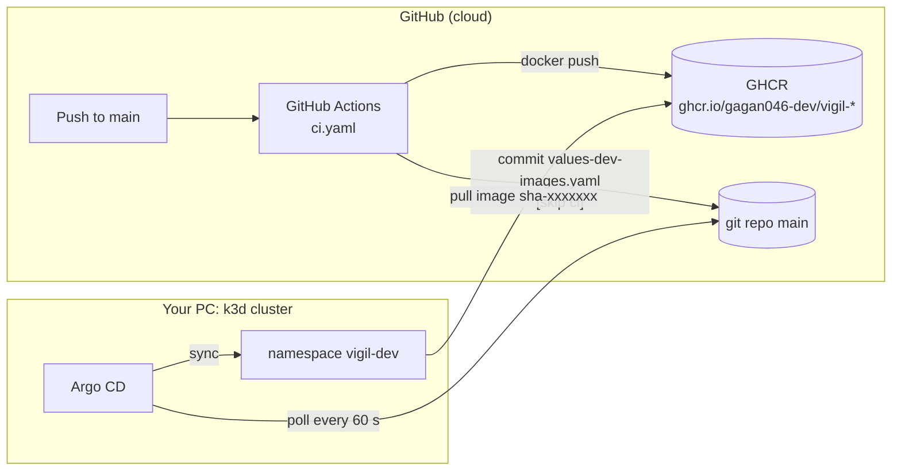
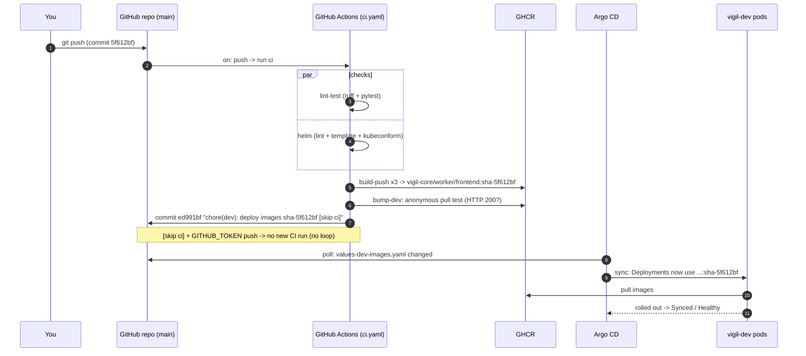
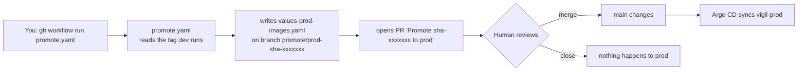
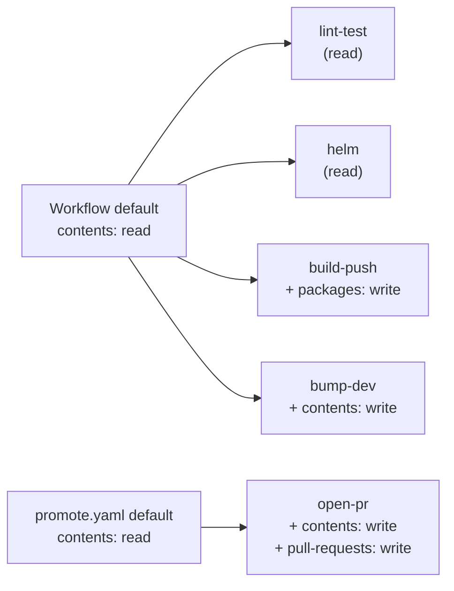
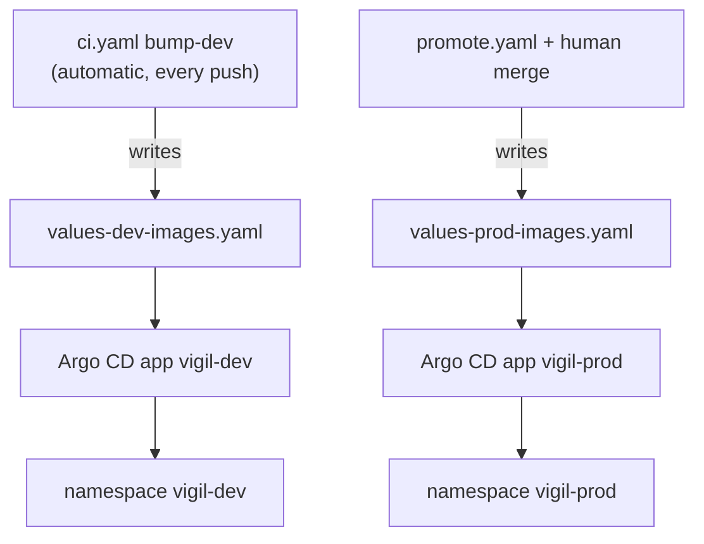

# Chapter 6 - Phase 4: From `git push` to a running pod (CI meets GitOps)

> **Where we are.** After Phase 3, Argo CD deploys whatever git says. But the images were
> still built on your PC and imported into the k3d nodes by hand (`vigil-core:dev`). In
> Phase 4 **GitHub Actions** builds the images, pushes them to **GHCR** (GitHub Container
> Registry), and writes the new image tag into git. Argo CD then deploys it. Dev updates
> itself on every push; prod updates only when a human merges a pull request.
>
> ```bash
> git diff --stat phase-3 phase-4     # .github/workflows/*, write-image-values.sh, values-*-images.yaml
> ```

---

## 6.1 CI and CD in plain words

- **CI - Continuous Integration**: every push is automatically *checked* (lint, tests) and
  *built* (container images). Like a factory's quality control: nothing leaves the
  building untested.
- **CD - Continuous Delivery / Deployment**: the checked build is automatically *delivered*
  to an environment.

Many tutorials let CI run `kubectl apply` or `helm upgrade` against the cluster
(**push-based CD**). That needs cluster admin credentials stored in GitHub. Vigil does
**not** do that. CI only **changes a file in git**; Argo CD (inside the cluster) does the
deploying. CI never touches the cluster.



Note the arrows: **everything flows out of the cluster** (Argo CD pulls git, nodes pull
images). Nothing on the internet needs to reach into your PC.

---

## 6.2 The full loop



And for prod:



---

## 6.3 GitHub Actions vocabulary

| Word | Meaning | In `ci.yaml` |
|---|---|---|
| **Workflow** | A YAML file in `.github/workflows/` | `ci.yaml`, `promote.yaml` |
| **Trigger (`on:`)** | Which events start it | push / pull_request to main; `workflow_dispatch` (by hand) |
| **Job** | A group of steps on one fresh VM (runner) | `lint-test`, `helm`, `build-push`, `bump-dev` |
| **Step** | One command (`run:`) or one reusable action (`uses:`) | `run: pytest`, `uses: actions/checkout@...` |
| **Runner** | The VM that runs a job | `runs-on: ubuntu-24.04` |
| **`needs:`** | "start after these jobs succeeded" | `build-push` needs `lint-test` and `helm` |
| **Matrix** | Run the same job with different inputs | three images in parallel |
| **`GITHUB_TOKEN`** | A short-lived token GitHub creates per run | used to push images and commits |
| **`permissions:`** | What that token may do | read-only by default, widened per job |

---

## 6.4 `ci.yaml` line by line

### Header: triggers, permissions, concurrency

```yaml
name: ci

on:
  push:
    branches: [main]
    paths-ignore: ["**.md", "docs/**"]
  pull_request:
    branches: [main]

permissions:
  contents: read

concurrency:
  group: ci-${{ github.ref }}
  cancel-in-progress: ${{ github.event_name == 'pull_request' }}

env:
  HELM_VERSION: v4.3.0
  KUBECONFORM_VERSION: v0.8.0
```

| Line | What it does | Why it matters / what breaks without it |
|---|---|---|
| `on.push.branches: [main]` | Run on pushes to main | Only main is deployed. |
| `paths-ignore: ["**.md", "docs/**"]` | Skip doc-only pushes | Writing these chapters does not rebuild images or redeploy dev. |
| `on.pull_request` | Run checks on PRs | A broken PR shows red before merge. (Build/push jobs are skipped for PRs - see `if:` below.) |
| `permissions: contents: read` | Default token = read-only | Least privilege: a compromised step in a check job cannot push code or images. |
| `concurrency.group: ci-<ref>` | One run per branch at a time | Two quick pushes do not build in parallel and race. |
| `cancel-in-progress: ...pull_request` | Cancel old runs only for PRs | On main every commit must finish so that dev gets every build. |
| `env.HELM_VERSION: v4.3.0` | Pinned tool version | `v4.3.1` was too new under the project's ">= 2 weeks old" rule. |

### Job 1 - `lint-test`

```yaml
  lint-test:
    name: lint + test
    runs-on: ubuntu-24.04
    timeout-minutes: 15
    defaults:
      run:
        working-directory: app
    steps:
      - uses: actions/checkout@3d3c42e5aac5ba805825da76410c181273ba90b1 # v7.0.1
        with:
          persist-credentials: false
      - uses: actions/setup-python@5fda3b95a4ea91299a34e894583c3862153e4b97 # v7.0.0
        with:
          python-version: "3.12"
          cache: pip
          cache-dependency-path: app/requirements*.txt
      - run: pip install -r requirements-dev.txt
      - run: ruff check .
      - run: ruff format --check .
      - run: pytest
```

| Line | What it does | Why it matters / what breaks without it |
|---|---|---|
| `runs-on: ubuntu-24.04` | Fixed runner image | `ubuntu-latest` can change under you. |
| `timeout-minutes: 15` | Kill a stuck job | Default is 6 hours of wasted minutes. |
| `working-directory: app` | All `run:` steps start in `app/` | The Python project lives there. |
| `checkout@<40-hex SHA> # v7.0.1` | Get the code; action pinned to a commit | See 6.6 - a tag can be moved, a SHA cannot. |
| `persist-credentials: false` | Do not leave the token in `.git/config` | Later steps (pip packages!) cannot steal it. |
| `python-version: "3.12"` | Same Python as the images (`python:3.12.14-slim-bookworm`) | Tests run on the version that ships. |
| `cache: pip` | Reuse downloaded wheels | Faster runs. |
| `ruff check .` | Linter | Catches bugs/unused imports. |
| `ruff format --check .` | Formatting check (does not change files) | Fails if code is not formatted. |
| `pytest` | Unit tests (190 passed in the pre-check) | No image is built if a test fails. |

### Job 2 - `helm`

```yaml
  helm:
    name: helm lint + template
    runs-on: ubuntu-24.04
    timeout-minutes: 10
    steps:
      - uses: actions/checkout@3d3c42e5aac5ba805825da76410c181273ba90b1 # v7.0.1
        with:
          persist-credentials: false
      - uses: azure/setup-helm@9bc31f4ebc9c6b171d7bfbaa5d006ae7abdb4310 # v5.0.1
        with:
          version: ${{ env.HELM_VERSION }}
      - name: Install kubeconform (checksum verified)
        run: |
          base=https://github.com/yannh/kubeconform/releases/download/${KUBECONFORM_VERSION}
          curl -fsSLO "$base/kubeconform-linux-amd64.tar.gz"
          curl -fsSLO "$base/CHECKSUMS"
          grep ' kubeconform-linux-amd64.tar.gz$' CHECKSUMS | sha256sum -c -
          tar xzf kubeconform-linux-amd64.tar.gz kubeconform
          sudo mv kubeconform /usr/local/bin/
      - name: helm lint
        run: |
          for env in dev prod; do
            helm lint charts/vigil --strict -f charts/vigil/values-$env.yaml -f charts/vigil/values-$env-images.yaml
          done
      - name: helm template + kubeconform
        run: |
          for env in dev prod; do
            echo "::group::$env"
            helm template vigil charts/vigil -n vigil-$env \
              -f charts/vigil/values-$env.yaml -f charts/vigil/values-$env-images.yaml > /tmp/$env.yaml
            # -ignore-missing-schemas: KEDA's ScaledObject is a CRD without a built-in schema
            kubeconform -strict -summary -ignore-missing-schemas /tmp/$env.yaml
            echo "::endgroup::"
          done
      - name: Validate the Argo CD manifests are well-formed YAML
        run: |
          for f in gitops/bootstrap/*.yaml gitops/apps/*.yaml gitops/envs/*/*.yaml; do
            python3 -c "import sys,yaml; list(yaml.safe_load_all(open(sys.argv[1])))" "$f"
          done
```

| Line | What it does | Why it matters / what breaks without it |
|---|---|---|
| `azure/setup-helm ... version: v4.3.0` | Installs the pinned Helm | Same major version as the PC (Helm 4). |
| `curl ... CHECKSUMS` + `sha256sum -c -` | Verifies the downloaded binary | A tampered download fails the job instead of running. |
| `helm lint --strict` for dev **and** prod | Chart checks with both value sets | A template that only breaks with prod values is caught before merge. |
| `-f values-$env-images.yaml` | Includes the image files | Exactly what Argo CD will render. |
| `helm template ... > /tmp/$env.yaml` | Render to plain YAML | Same as the repo-server does in Argo CD. |
| `kubeconform -strict` | Validates every object against Kubernetes schemas | Typos like `replica:` or a wrong `apiVersion` fail here, not in the cluster. |
| `-ignore-missing-schemas` | Skip kinds without a known schema | KEDA's `ScaledObject` is a CRD. |
| `::group::` / `::endgroup::` | Fold the log per environment | Easier to read. |
| `yaml.safe_load_all` on `gitops/**` | YAML syntax check of Argo CD files | A broken `gitops/apps/*.yaml` would break the root app. |

### Job 3 - `build-push` (matrix of 3 images)

```yaml
  build-push:
    name: build + push ${{ matrix.image }}
    if: github.event_name == 'push' && github.ref == 'refs/heads/main'
    needs: [lint-test, helm]
    runs-on: ubuntu-24.04
    timeout-minutes: 40
    permissions:
      contents: read
      packages: write                 # push to ghcr.io
    strategy:
      fail-fast: true
      matrix:
        include:
          - image: vigil-core
            context: app
            file: app/Dockerfile
          - image: vigil-worker
            context: app
            file: app/Dockerfile.worker
          - image: vigil-frontend
            context: frontend
            file: frontend/Dockerfile
    steps:
      - uses: actions/checkout@3d3c42e5aac5ba805825da76410c181273ba90b1 # v7.0.1
        with:
          persist-credentials: false
      - uses: docker/setup-buildx-action@f87e5991a6d7451dcb8d9637bfbc97413f497069 # v4.4.1
      - uses: docker/login-action@dbcb813823bdd20940b903addbd779551569679f # v4.6.0
        with:
          registry: ghcr.io
          username: ${{ github.actor }}
          password: ${{ secrets.GITHUB_TOKEN }}
      - id: meta
        uses: docker/metadata-action@dc802804100637a589fabce1cb79ff13a1411302 # v6.2.0
        with:
          images: ghcr.io/${{ github.repository_owner }}/${{ matrix.image }}
          # one immutable tag per commit: sha-<7 hex>
          tags: type=sha,prefix=sha-,format=short
          labels: |
            org.opencontainers.image.title=${{ matrix.image }}
      - uses: docker/build-push-action@c3c9e263c25d99ce0380d002d59b67737d91b0dc # v7.4.0
        with:
          context: ${{ matrix.context }}
          file: ${{ matrix.file }}
          platforms: linux/amd64
          push: true
          tags: ${{ steps.meta.outputs.tags }}
          labels: ${{ steps.meta.outputs.labels }}
          cache-from: type=gha,scope=${{ matrix.image }}
          cache-to: type=gha,scope=${{ matrix.image }},mode=max
          provenance: false
```

| Line | What it does | Why it matters / what breaks without it |
|---|---|---|
| `if: push && refs/heads/main` | Only build for main pushes | PRs (maybe from strangers) never get `packages: write`. |
| `needs: [lint-test, helm]` | Wait for both checks | A failing test = no image = nothing deployed. |
| `permissions: packages: write` | This job alone may push images | Least privilege per job. |
| `matrix.include` (3 entries) | Three parallel jobs | `vigil-core` (api, notifier, demo shop, migrate), `vigil-worker` (Playwright), `vigil-frontend` (nginx). |
| `fail-fast: true` | One build fails -> cancel the others | No half-published set of images. |
| `setup-buildx-action` | Enables BuildKit | Needed for the GitHub Actions cache. |
| `login-action` with `GITHUB_TOKEN` | Log in to ghcr.io | No personal access token stored anywhere. |
| `metadata-action ... type=sha,prefix=sha-,format=short` | Tag = `sha-` + 7 hex of the commit | **Immutable tags**: `sha-5f612bf` always means one exact build. A tag like `latest` changes meaning, so you can never tell what is running or roll back reliably. |
| `platforms: linux/amd64` | Build for x86-64 | The k3d nodes on this PC are amd64. |
| `cache-from/to: type=gha,scope=<image>` | Reuse layers between runs | Worker build went from 4m0s (first run) to 23 s (second run). |
| `provenance: false` | Do not attach an attestation manifest | Keeps a plain single image manifest. |

### Job 4 - `bump-dev` (CI writes to git)

```yaml
  bump-dev:
    name: bump dev image tag
    needs: [build-push]
    runs-on: ubuntu-24.04
    timeout-minutes: 10
    permissions:
      contents: write                 # the ONLY job allowed to push to the repo
    concurrency:
      group: bump-dev
      cancel-in-progress: false
    steps:
      - uses: actions/checkout@3d3c42e5aac5ba805825da76410c181273ba90b1 # v7.0.1
        with:
          ref: main
      - name: Work out the image tag
        id: tag
        run: echo "tag=sha-${GITHUB_SHA::7}" >> "$GITHUB_OUTPUT"
      - name: Are the images publicly pullable?
        id: public
        # The cluster pulls WITHOUT credentials. New ghcr.io packages start out private;
        # until they are made public, keep dev on the images it already runs.
        ...
          for img in vigil-core vigil-worker vigil-frontend; do
            token=$(curl -fsS "https://ghcr.io/token?scope=repository:$owner/$img:pull" | jq -r '.token // empty' || true)
            code=$(curl -s -o /dev/null -w '%{http_code}' -I \
              -H "Authorization: Bearer $token" \
              -H "Accept: application/vnd.oci.image.index.v1+json, ..." \
              "https://ghcr.io/v2/$owner/$img/manifests/$TAG")
            echo "$img:$TAG anonymous pull -> HTTP $code"
            [ "$code" = 200 ] || ok=false
          done
      - name: Write values-dev-images.yaml and push
        if: steps.public.outputs.ok == 'true'
        ...
        run: |
          bash .github/scripts/write-image-values.sh charts/vigil/values-dev-images.yaml "$TAG" dev
          git config user.name "github-actions[bot]"
          git config user.email "41898282+github-actions[bot]@users.noreply.github.com"
          git add charts/vigil/values-dev-images.yaml
          if git diff --cached --quiet; then echo "already up to date"; exit 0; fi
          # "[skip ci]" + pushes made with GITHUB_TOKEN never start a new workflow run -> no loop.
          git commit -m "chore(dev): deploy images $TAG [skip ci]"
          for i in 1 2 3; do
            git pull --rebase origin main && git push origin HEAD:main && exit 0
            sleep 5
          done
          exit 1
```

| Line | What it does | Why it matters / what breaks without it |
|---|---|---|
| `needs: [build-push]` | After all 3 images exist | Never point dev at an image that is not pushed yet. |
| `permissions: contents: write` | The ONLY job that may push to the repo | Narrowest possible blast radius. |
| `concurrency: bump-dev`, no cancel | Bumps run one at a time, all complete | Two bumps cannot clash on `git push`. |
| `checkout ... ref: main` | Check out the latest main, not the triggering commit | Lets it commit on top of whatever main is now. (Credentials are kept here because this job must push.) |
| `tag=sha-${GITHUB_SHA::7}` | Same tag the metadata action produced | First 7 characters of the commit SHA. |
| Anonymous pull test (`ghcr.io/token` + `HEAD /v2/.../manifests/<tag>`) | Asks GHCR as an anonymous client | The cluster pulls **without credentials**. New GHCR packages start private; bumping before they are public would put dev in `ImagePullBackOff`. On failure it only warns and keeps dev as is. |
| `write-image-values.sh ... dev` | Regenerates `values-dev-images.yaml` | See 6.5. |
| `github-actions[bot]` identity | The commit author | Clear in `git log` that a robot made it. |
| `git diff --cached --quiet` -> exit 0 | Nothing changed -> no empty commit | Re-runs are harmless. |
| `[skip ci]` in the message | GitHub skips workflows for this commit | Otherwise: commit -> CI -> commit -> CI ... forever. Also, pushes made with `GITHUB_TOKEN` never trigger new workflow runs - two locks on the same door. |
| `pull --rebase` + retry 3 times | Handles someone pushing meanwhile | Avoids a "non-fast-forward" failure. |

What it produced (real file, `charts/vigil/values-dev-images.yaml`):

```yaml
# values-dev-images.yaml - which IMAGES the dev environment runs.
# GENERATED by .github/scripts/write-image-values.sh - do not edit by hand.
# Images built by CI from commit 5f612bf.
api:
  image:
    registry: ghcr.io
    repository: gagan046-dev/vigil-core
    tag: "sha-5f612bf"
    pullPolicy: IfNotPresent
...
worker:
  image:
    registry: ghcr.io
    repository: gagan046-dev/vigil-worker
    tag: "sha-5f612bf"
...
```

Through the `vigil.image` helper (Chapter 4) this renders as
`ghcr.io/gagan046-dev/vigil-core:sha-5f612bf`.

---

## 6.5 `write-image-values.sh` - the one place that writes image tags

```bash
set -euo pipefail

out="$1"
tag="$2"
env="$3"
owner="$(echo "${OWNER:-${GITHUB_REPOSITORY_OWNER:?}}" | tr '[:upper:]' '[:lower:]')"

# Only allow tags that look like "sha-<hex>" so nothing odd can be written into YAML.
if ! [[ "$tag" =~ ^sha-[0-9a-f]{7,40}$ ]]; then
  echo "refusing unexpected image tag: $tag" >&2
  exit 1
fi

img() { # $1 = repository name
  printf '  image:\n    registry: ghcr.io\n    repository: %s/%s\n    tag: "%s"\n    pullPolicy: IfNotPresent\n' \
    "$owner" "$1" "$tag"
}

{
  ...
  echo "api:";      img vigil-core
  echo "notifier:"; img vigil-core
  echo "demoShop:"; img vigil-core
  echo "worker:";   img vigil-worker
  echo "frontend:"; img vigil-frontend
} > "$out"
```

| Line | What it does | Why it matters / what breaks without it |
|---|---|---|
| `set -euo pipefail` | Stop on any error / unset variable | No half-written file. |
| `tr '[:upper:]' '[:lower:]'` | Lower-case owner | Registry names must be lower case. |
| `${GITHUB_REPOSITORY_OWNER:?}` | Fail if unset | Never writes `repository: /vigil-core`. |
| tag regex `^sha-[0-9a-f]{7,40}$` | Allow-list the tag format | `promote.yaml` takes a **user input**; this blocks YAML injection like `x"\nsecrets: ...`. |
| `img vigil-core` for api, notifier, demoShop | Three components share one image | Same Python package, different start commands. |
| `pullPolicy: IfNotPresent` | Immutable tags never change | No need to re-pull a tag the node already has. |

---

## 6.6 Supply-chain hygiene: pinned SHAs and least privilege

A GitHub Action is someone else's code that runs with your token. `uses: actions/checkout@v7`
points at a **tag**, and a tag can be moved to a different commit by whoever controls the
repo (or by an attacker who stole their account). A **full commit SHA** cannot be changed.

```yaml
- uses: actions/checkout@3d3c42e5aac5ba805825da76410c181273ba90b1 # v7.0.1
```

The comment keeps it readable; the SHA is what runs. The pins were looked up with the
GitHub API (`gh api repos/<owner>/<action>/git/ref/tags/<tag>`, annotated tags dereferenced)
and chosen to be at least two weeks old on 2026-10-21:

| Action | Version | Released |
|---|---|---|
| `actions/checkout` | v7.0.1 | 2026-07-20 |
| `actions/setup-python` | v7.0.0 | 2026-07-20 |
| `azure/setup-helm` | v5.0.1 | 2026-06-23 |
| `docker/setup-buildx-action` | v4.4.1 | 2026-09-16 |
| `docker/login-action` | v4.6.0 | 2026-07-29 |
| `docker/metadata-action` | v6.2.0 | 2026-07-02 |
| `docker/build-push-action` | v7.4.0 | 2026-09-15 |

### Permissions map



Repository setting used (the default token stays read-only; this only allows a workflow that
*asks* for `pull-requests: write` to open a PR):

```bash
gh api -X PUT repos/gagan046-dev/vigil/actions/permissions/workflow \
  -f default_workflow_permissions=read -F can_approve_pull_request_reviews=true
```

---

## 6.7 `promote.yaml` - promotion to prod by pull request

```yaml
name: promote

on:
  workflow_dispatch:
    inputs:
      tag:
        description: "Image tag to promote (sha-xxxxxxx). Empty = the tag dev runs now."
        required: false
        default: ""

permissions:
  contents: read

jobs:
  open-pr:
    runs-on: ubuntu-24.04
    timeout-minutes: 10
    permissions:
      contents: write                 # push the promotion branch
      pull-requests: write            # open the PR
    steps:
      - uses: actions/checkout@3d3c42e5aac5ba805825da76410c181273ba90b1 # v7.0.1
        with:
          ref: main
      - name: Pick the tag
        id: tag
        env:
          INPUT_TAG: ${{ inputs.tag }}
        run: |
          tag="$INPUT_TAG"
          if [ -z "$tag" ]; then
            tag=$(grep -m1 -oE 'sha-[0-9a-f]{7,40}' charts/vigil/values-dev-images.yaml || true)
          fi
          ...
      - name: Write values-prod-images.yaml and open the PR
        env:
          TAG: ${{ steps.tag.outputs.tag }}
          GH_TOKEN: ${{ secrets.GITHUB_TOKEN }}
        run: |
          bash .github/scripts/write-image-values.sh charts/vigil/values-prod-images.yaml "$TAG" prod
          if git diff --quiet; then echo "prod already runs $TAG"; exit 0; fi
          branch="promote/prod-$TAG"
          ...
          git switch -c "$branch"
          git commit -am "chore(prod): promote images $TAG"
          git push --force origin "$branch"
          gh pr create --base main --head "$branch" \
            --title "Promote $TAG to prod" \
            --body "Copies image tag \`$TAG\` (running in vigil-dev) to ..."
```

| Line | What it does | Why it matters / what breaks without it |
|---|---|---|
| `workflow_dispatch` | Started only by a human (button or `gh workflow run`) | Prod never moves by itself. |
| `inputs.tag` (optional) | Promote a specific tag | Empty = "what dev runs right now" - the tested build. |
| `env: INPUT_TAG: ${{ inputs.tag }}` then `"$INPUT_TAG"` | Pass input through an env var | Writing `${{ inputs.tag }}` directly inside `run:` would paste user text into the shell script (script injection). |
| `grep -m1 -oE 'sha-...' values-dev-images.yaml` | Read dev's current tag from git | Promotion = "copy what dev proved". |
| `write-image-values.sh ... prod` | Writes `values-prod-images.yaml` | Same validated generator as dev. |
| `branch="promote/prod-$TAG"` + `git push --force` | One branch per tag | Re-running for the same tag updates the same PR branch. |
| `gh pr create` | Opens the PR | **Merging = deploying.** Review is the approval gate. |

Real run:

```text
gh workflow run promote.yaml          # no tag given -> takes the tag dev runs (sha-e4cf0da)
gh run watch 39571639300 --exit-status   -> success
gh pr list -> #1 "Promote sha-e4cf0da to prod"  promote/prod-sha-e4cf0da  OPEN
  diff: charts/vigil/values-prod-images.yaml {} -> ghcr.io/gagan046-dev/*:sha-e4cf0da
```

The PR is left open on purpose: merging it is the human approval. Until then
`values-prod-images.yaml` is `{}` (empty = use the defaults from `values.yaml`, the locally
imported `:dev` images). One more thing seen: the CI run for this bot-opened PR showed
`action_required` - GitHub waits for a human to click "Approve and run workflows" on PRs
created by `GITHUB_TOKEN`.

### Environments: two files, two speeds



Splitting image tags into their own files means robots only ever edit a tiny generated file,
never the hand-written `values-dev.yaml` / `values-prod.yaml`.

---

## 6.8 What happened on the real runs

```text
# First CI run (push of e4cf0da) - green on the first attempt
  ✓ helm lint + template        7s
  ✓ lint + test                26s
  ✓ build + push vigil-worker  4m0s
  ✓ build + push vigil-core     50s
  ✓ build + push vigil-frontend 20s
  ✓ bump dev image tag           7s
bump-dev log:
  vigil-core:sha-e4cf0da anonymous pull -> HTTP 200   (same for worker, frontend)
  [main 1ddfd37] chore(dev): deploy images sha-e4cf0da [skip ci]
gh run list  -> no run was started for 1ddfd37 (GITHUB_TOKEN push + [skip ci]: no loop)
```

Then Argo CD synced, and every new pod went to `ImagePullBackOff` with
`dial tcp: lookup ghcr.io: Try again`. The cause was DNS inside the k3d nodes (AAAA
queries to Docker Desktop's resolver time out). The fix - an extra `nameserver 1.1.1.1` in
each node - is now in `scripts/phase3-up.ps1`; full story in Chapter 8.

```text
# Second push, fully automatic (after the DNS fix)
push 5f612bf -> CI run 39571768562: all 6 jobs green (worker build 23 s thanks to the GHA cache)
bump-dev -> ed991bf "chore(dev): deploy images sha-5f612bf [skip ci]"
Argo CD -> every vigil-dev Deployment on ghcr.io/gagan046-dev/*:sha-5f612bf, Synced/Healthy,
           no manual step
```

You can see the robot's commits in history:

```bash
git log --oneline --author=github-actions phase-3..phase-4
#   ed991bf chore(dev): deploy images sha-5f612bf [skip ci]
#   1ddfd37 chore(dev): deploy images sha-e4cf0da [skip ci]
```

---

## Try it yourself

```bash
# Watch a CI run
gh run list --limit 5
gh run watch <run-id> --exit-status

# What image does dev run?
kubectl get deploy -n vigil-dev -o wide
cat charts/vigil/values-dev-images.yaml

# Are the packages public? (the cluster pulls anonymously)
gh api "/users/gagan046-dev/packages?package_type=container" --jq '.[]|[.name,.visibility]|@tsv'

# Render exactly what Argo CD renders for dev
helm template vigil charts/vigil -n vigil-dev \
  -f charts/vigil/values-dev.yaml -f charts/vigil/values-dev-images.yaml | grep "image:"

# Promote dev's tag to prod (opens a PR; nothing deploys until you merge)
gh workflow run promote.yaml
gh pr list

# Confirm no CI loop: bot commits have no run
gh run list --limit 10

# What Phase 4 added
git diff phase-3 phase-4 -- .github charts
```

## Common mistakes

| Mistake | What you see | Fix |
|---|---|---|
| Using `latest` or a branch name as image tag | Can't tell what runs; rollback unreliable; nodes keep an old cached `latest` | Immutable `sha-<commit>` tags (metadata-action `type=sha`). |
| CI commits without `[skip ci]` | Endless CI runs | `[skip ci]` in the message (and pushing with `GITHUB_TOKEN`). |
| GHCR package still private | `ImagePullBackOff` / `401` on pull | Package settings -> visibility public (or add `imagePullSecrets`). `bump-dev` checks this first. |
| Giving every job `contents: write` | A compromised test dependency could push code | Default read; widen per job. |
| Pinning actions to `@v7` | The tag can be moved to malicious code | Full 40-char SHA + version comment. |
| `${{ inputs.x }}` directly in `run:` | Script injection | Pass through `env:` and quote `"$VAR"`; validate (regex in `write-image-values.sh`). |
| Hand-editing `values-dev-images.yaml` | Next CI run overwrites it | It is generated; change code and push instead. |
| Expecting prod to update after a push | Prod stays on the old tag | By design: run `promote.yaml` and merge the PR. |
| Bot PR shows no checks | CI status `action_required` | Click "Approve and run workflows" on the PR. |

## Key words

- **CI (Continuous Integration)** - test and build every change automatically.
- **CD (Continuous Delivery/Deployment)** - deliver every good build to an environment.
- **GitHub Actions** - GitHub's CI service; workflows in `.github/workflows/`.
- **Workflow / job / step / runner** - file / group of steps on one VM / one command / the VM.
- **Matrix** - run a job once per set of inputs.
- **`GITHUB_TOKEN`** - per-run token; its rights are set by `permissions:`.
- **GHCR** - GitHub Container Registry, `ghcr.io`.
- **Immutable tag** - a tag that always names the same build (`sha-5f612bf`).
- **Tag bump** - CI commit that changes which image tag an environment runs.
- **`[skip ci]`** - commit-message marker that stops workflows from running.
- **Promotion** - moving an already-tested build to the next environment.
- **Pinned SHA** - referencing an action by full commit hash instead of a movable tag.
- **Least privilege** - every job gets only the permissions it needs.
- **kubeconform** - validates Kubernetes YAML against schemas.
- **Supply chain** - everything your build depends on (actions, base images, packages).
- **`workflow_dispatch`** - a manual trigger for a workflow.

---

Previous: [Chapter 5 - Argo CD and GitOps](05-phase3-argocd-gitops.md) | Next: [Chapter 7 - How Vigil works](07-how-vigil-works.md) | [Start here](00-start-here.md)
