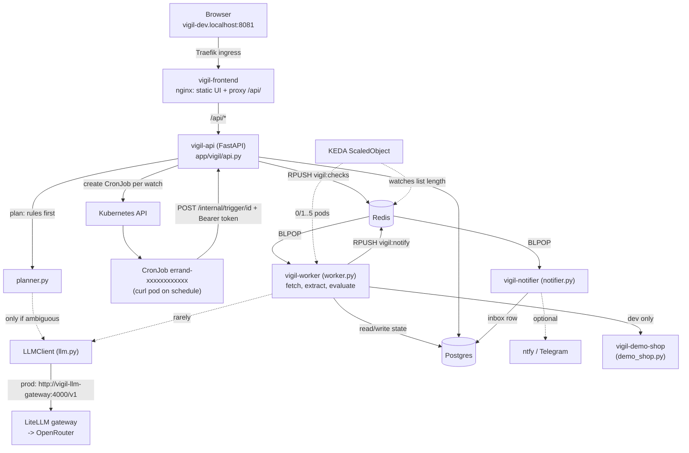
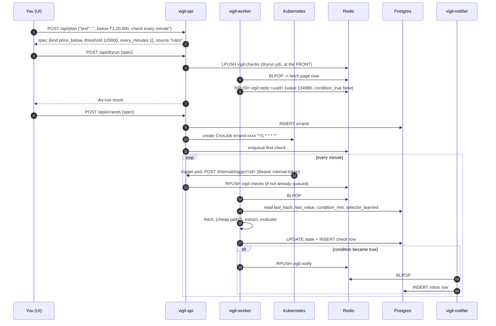
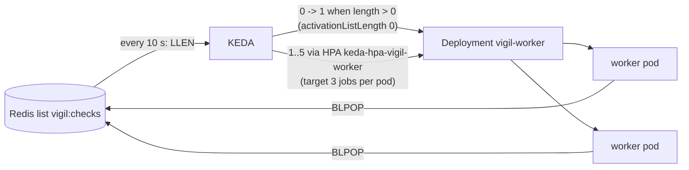
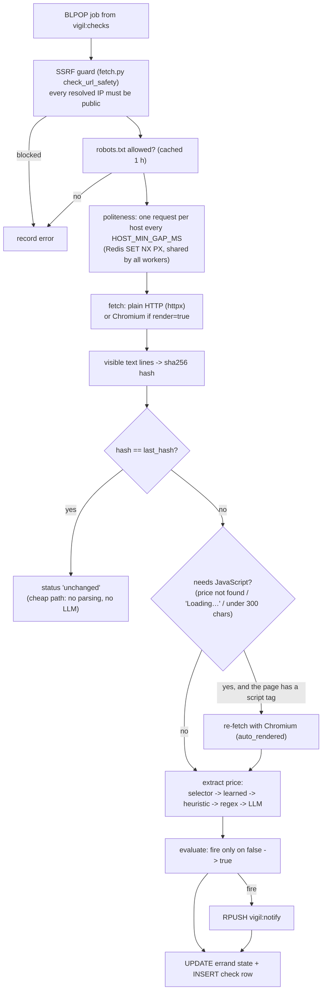
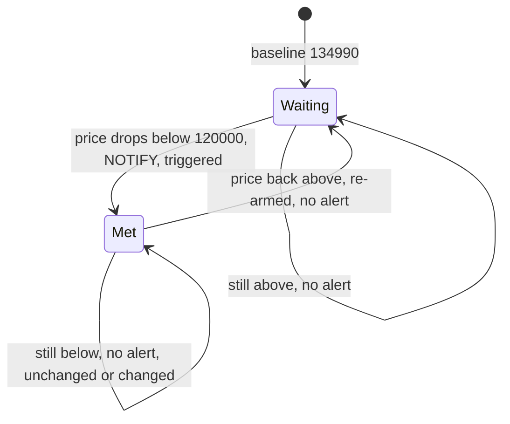
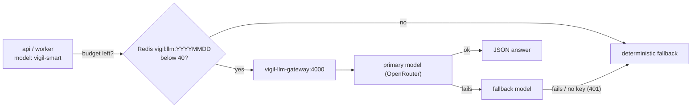

# Chapter 7 - How Vigil itself works

> The earlier chapters were about *running* Vigil. This one opens the box: what happens
> between "Tell me when this laptop drops below ₹1,20,000" and the notification in your
> inbox. All code is in `app/vigil/` (Python 3.12, FastAPI) and `frontend/` (static files
> served by nginx).

---

## 7.1 The big picture



| Component | Code | Image | One-line job |
|---|---|---|---|
| api | `api.py`, `planner.py`, `scheduler.py` | `vigil-core` | Plans watches, stores them, creates CronJobs, serves `/api/*` |
| worker | `worker.py`, `fetch.py`, `extract.py`, `evaluate.py` | `vigil-worker` (Playwright + Chromium) | Runs checks from the Redis queue |
| notifier | `notifier.py` | `vigil-core` | Turns queued notifications into inbox rows (+ ntfy/Telegram) |
| demo shop | `demo_shop.py` | `vigil-core` | A safe fake shop to watch (dev only) |
| migrate | `migrate.py` | `vigil-core` | initContainer of the api: creates tables |
| frontend | `frontend/` | `vigil-frontend` (nginx) | The UI; proxies `/api/` to `vigil-api:8000` |
| Postgres | - | `postgres:17.11-alpine` | Watches ("errands"), check log, inbox |
| Redis | `queue.py` | `redis:8.2.10-alpine` | Check queue, notify queue, dry-run replies, LLM budget, politeness locks |

> **Word note.** In the code a watch is called an **errand** (the project's earlier name).
> `errands` table, `ErrandSpec`, CronJob `errand-<id>` - all mean "one watch".

---

## 7.2 The life of one watch (request journey)



The real run from the notes (dev):

```text
POST /api/plan   "...http://vigil-demo-shop:8000/static drops below ₹1,20,000, check every 1 minute"
     -> price_below, threshold 120000, every_minutes 1, source rules
POST /api/dryrun -> ok, value 134990, condition_true false, selector span.price-now
POST /api/errands -> 201, CronJob errand-c6660d3c02d4  */1 * * * *  Asia/Kolkata
POST http://demo.localhost:8081/admin/price {"value":114990}
GET  /api/inbox  -> "Price drop: Aurora 15 (RTX 5070) is ₹1,14,990 (target < ₹1,20,000, was ₹1,34,990)"
GET  /api/log    -> baseline 134990 -> unchanged (cheap path) -> triggered 114990 (via learned selector)
```

---

## 7.3 The planner: rules first, LLM only when unsure

Turning English into a structured **ErrandSpec** is the "AI" part. The obvious approach -
send every request to an LLM - is slow, costs money, and can invent things. Vigil does the
opposite: a **rule-based parser** (regular expressions) handles the common phrasings, and
the LLM is asked only when the rules had to **guess**.

`app/vigil/planner.py`:

```python
def plan(text: str, llm=None) -> PlanResult:
    text = (text or "").strip()
    if not text:
        raise PlanError("Tell me what to watch, including the page's web address.")
    draft = _rules(text)
    if draft.ambiguous and llm is not None and llm.available():
        result = _llm_plan(text, draft, llm)
        if result:
            return result
        draft.notes.append("The AI planner was unavailable; used the rule-based parser.")
    try:
        spec = ErrandSpec(**draft.data)
    except ValidationError as exc:
        raise PlanError(exc.errors()[0].get("msg", "invalid request")) from exc
    return PlanResult(spec, "rules", draft.notes)
```

| Line | What it does | Why it matters / what breaks without it |
|---|---|---|
| `draft = _rules(text)` | Always run the regex parser first | Fast, free, deterministic; works with no LLM at all (dev's `llmMode: fake`). |
| `if draft.ambiguous and ... llm.available()` | Ask the LLM only when rules guessed AND the LLM is usable | **Attention routing**: spend the expensive brain only on hard cases. |
| `_llm_plan(text, draft, llm)` | Sends the request + the rule-based guess | The model refines a draft instead of starting from nothing. |
| `"The AI planner was unavailable; ..."` | Fallback note | Seen for real in prod without an OpenRouter key. |
| `ErrandSpec(**draft.data)` | Pydantic validation | Whatever the source, the spec must be valid (URL, kind, threshold, interval). |

What makes a draft **ambiguous**? Inside `_rules`:

- no price, no quoted text, no known phrase, only a vague "when X appears/opens"
  (`_WHEN_APPEARS`, `_OPENS`) -> `ambiguous = True`
- nothing recognisable at all -> fall back to `page_changed` and `ambiguous = True`

Clear requests ("drops below ₹1,20,000", `"In stock"` in quotes, "every 30 minutes") are
never ambiguous, so they never touch the model. In prod the notes confirm: *"A clear request
such as '... drops below ₹1,20,000, check every 30 minutes' is planned by the rules directly
and never calls the model."*

The LLM's answer is not trusted blindly either:

```python
    # Never trust a URL the model invented: it must appear in the user's text.
    if not isinstance(data.get("url"), str) or data["url"] not in text:
        data["url"] = draft.data["url"]
```

| Line | Why it matters |
|---|---|
| `data["url"] not in text` -> use the rule URL | A model could hallucinate or be tricked into a different URL (for example an internal address). The URL must literally be in what the user typed. |

The ErrandSpec (`models.py`) the planner must produce:

```python
ALLOWED_INTERVALS: tuple[int, ...] = (1, 2, 5, 10, 15, 30, 60, 120, 180, 360, 720, 1440)

Kind = Literal["price_below", "price_above", "text_appears", "text_disappears", "page_changed"]

class ErrandSpec(BaseModel):
    name: str = Field(min_length=1, max_length=80)
    url: str = Field(max_length=2000)
    kind: Kind
    threshold: float | None = None
    keyword: str | None = Field(default=None, max_length=120)
    selector: str | None = Field(default=None, max_length=300)
    render: bool = False
    every_minutes: int = 60
```

| Field | Meaning |
|---|---|
| `kind` | One of five condition types |
| `threshold` | Price limit (price kinds only, must be > 0) |
| `keyword` | Text to look for (text kinds only) |
| `selector` | Optional CSS selector to narrow the page |
| `render` | Page needs JavaScript -> use headless Chromium |
| `every_minutes` | Snapped to `ALLOWED_INTERVALS` and at least `MIN_INTERVAL_MINUTES` (dev 1, prod 5) |

`cron_for()` turns the interval into a CronJob schedule: `1` -> `*/1 * * * *`,
`60` -> `0 * * * *`, `1440` -> `0 8 * * *` (daily at 08:00 in `Asia/Kolkata`).

---

## 7.4 Scheduling: one Kubernetes CronJob per watch

Instead of a timer loop inside the app, Vigil lets **Kubernetes** do the scheduling.
`scheduler.py` builds one CronJob per errand; each run starts a tiny `curl` pod:

```python
        "args": [
            "-fsS", "-m", "10",
            # A brand-new pod can start before the NetworkPolicy controller has
            # allowed its IP (k3s/kube-router), so the first connect may be refused.
            # Retry briefly; the check queue de-duplicates, so a retry is harmless.
            "--retry", "5", "--retry-delay", "2", "--retry-connrefused",
            "-X", "POST",
            "-H", "Authorization: Bearer $(VIGIL_INTERNAL_TOKEN)",
            f"$(VIGIL_API_URL)/internal/trigger/{eid}",
        ],
        ...
        "spec": {
            "schedule": schedule_for(errand),
            "timeZone": settings.schedule_tz,
            "concurrencyPolicy": "Forbid",
            "startingDeadlineSeconds": 120,
            "successfulJobsHistoryLimit": 1,
            "failedJobsHistoryLimit": 1,
            "suspend": not errand.get("active", True),
```

| Line | What it does | Why it matters / what breaks without it |
|---|---|---|
| `--retry-connrefused` | Retry if the first connection is refused | New pods can start before kube-router allows their IP through the NetworkPolicy. |
| `Authorization: Bearer $(VIGIL_INTERNAL_TOKEN)` | Kubernetes substitutes the env var from the Secret | Only pods with the token can trigger checks; the api compares it with `hmac.compare_digest`. |
| `"app.kubernetes.io/component": "errand-trigger"` (pod label) | Identity for the NetworkPolicy | `allow-api` admits `errand-trigger` pods. |
| `timeZone` | `Asia/Kolkata` from the ConfigMap | Daily checks run at 08:00 local time. |
| `concurrencyPolicy: Forbid` | Skip a run if the previous one is still going | No pile-up when the api is slow. |
| `suspend` | Paused watch = suspended CronJob | Pausing in the UI stops the pods, not just ignores them. |

The api is the only pod with a ServiceAccount allowed to manage CronJobs (Role
`vigil-api-cronjobs`, Chapter 4). At startup it **reconciles**: creates missing CronJobs,
deletes ones whose errand is gone - the same "desired vs actual" idea as Argo CD, in
miniature.

---

## 7.5 The queue and de-duplication (`queue.py`)

```python
CHECKS = "vigil:checks"
QUEUED = "vigil:queued"
NOTIFY = "vigil:notify"

def enqueue_check(r: redis.Redis, errand_id: str) -> bool:
    """Queue a check unless one is already waiting. Returns True if queued."""
    added = r.sadd(QUEUED, errand_id)
    if not added and r.llen(CHECKS) > 0:
        return False
    r.rpush(CHECKS, json.dumps({"type": "check", "errand_id": errand_id}))
    return True

def push_dryrun(r: redis.Redis, spec: dict, timeout_s: int = 60) -> str:
    """Queue a dry run at the FRONT of the list (a person is waiting for it)."""
    reply = f"{REPLY_PREFIX}{uuid.uuid4()}"
    job = {"type": "dryrun", "spec": spec, "reply": reply, "expires_at": time.time() + timeout_s}
    r.lpush(CHECKS, json.dumps(job))
    return reply
```

| Line | What it does | Why it matters |
|---|---|---|
| `SADD vigil:queued <id>` | A set of "already waiting" ids | A slow site + a 1-minute schedule would otherwise queue the same check again and again. |
| `RPUSH vigil:checks` | Scheduled checks go to the BACK | First come, first served. |
| `LPUSH` for dry runs | Dry runs jump to the FRONT | A human is staring at the screen; background checks can wait. |
| `expires_at` | Worker skips dry runs nobody waits for | No wasted browser launches. |

`vigil:checks` is also what **KEDA** watches (`listName: "vigil:checks"`, `listLength: 3`):
about one worker per 3 queued jobs, from 0 (dev) or 1 (prod) up to 5 pods.



---

## 7.6 The worker pipeline

From the docstring of `worker.py`:

> safety -> robots -> politeness -> fetch (auto-render fallback) -> text + hash
> -> cheap path (unchanged) -> extract (selector / learned / heuristic / LLM / regex,
> with self-healing selectors) -> evaluate (fire on transition) -> notify.



### The cheap path

```python
    def observe(self, spec, *, last_hash=None, learned=None, cheap_path=True):
        fr = self.fetcher.fetch(spec.url, render=spec.render)
        obs = self._analyse(fr, spec)
        if cheap_path and last_hash and obs.hash == last_hash:
            return obs, True
```

| Line | Why it matters |
|---|---|
| `obs.hash == last_hash` -> return early | Most checks find nothing new. If the visible text is byte-for-byte the same as last time, nothing can have changed: skip price parsing, browser re-render and LLM entirely. The log then says `unchanged ... "no change (cheap path)"`. |

This is the second half of **attention routing**: cheap work for the common case, expensive
work (browser, LLM) only when something actually changed.

---

## 7.7 Self-healing selectors

Websites redesign. A watch that relies on `span.price-now` breaks when the shop renames it.
Vigil tries a ladder of methods and **remembers** what worked:

```python
    def _deterministic_price(self, obs, spec, learned):
        broken: str | None = None
        if spec.selector:
            hit = select_price(obs.soup, spec.selector)
            if hit:
                return PriceResult(hit[0].value, hit[0].currency, "selector")
            broken = spec.selector
        if learned:
            hit = select_price(obs.soup, learned)
            if hit:
                return PriceResult(hit[0].value, hit[0].currency, "learned", learned=learned)
            broken = learned
        hit = heuristic_price(obs.soup)
        if hit:
            return self._learn(PriceResult(hit[0].value, hit[0].currency, "heuristic"), hit[1], obs, broken)
        pm = find_price(" ".join(obs.lines), require_currency=True)
        if pm:
            el = find_element_containing(obs.soup, pm.text)
            return self._learn(PriceResult(pm.value, pm.currency, "regex"), el, obs, broken)
        return None
```

| Step | What it tries | Notes |
|---|---|---|
| 1. `selector` | The user's own CSS selector | If it finds nothing, remember it as `broken`. |
| 2. `learned` | The selector Vigil learned on an earlier check (stored in `selector_learned`) | Fast and precise once learned. |
| 3. `heuristic` | Elements whose `class`/`id`/`itemprop` mention `price`/`amount`, skipping `old`, `was`, `mrp`, `strike`, `discount`... | Picks the most specific element; prefers one with a currency. |
| 4. `regex` | First money-looking text with a currency in the page | Last deterministic resort. |
| 5. `llm` (in `_llm_price`) | Ask the model for the price + the exact snippet | Only if 1-4 failed and the LLM is available. |

`_learn` turns the element that worked into a new unique CSS selector
(`css_selector_for`: tag + id/classes, up to 3 ancestors), **verifies** it selects the same
value, and stores it. If an earlier selector had broken, it records the healing:

```python
            if hit and abs(hit[0].value - res.value) < 0.005:
                res.learned = sel
                if broken and broken != sel:
                    res.healed_from = broken
```

and the check log says `selector healed: span.price-now -> div.pdp-amount > b` (for example).

The demo shop has a button for exactly this: **Layout 2** (`/admin/layout`) moves the price
from `<span class='price-now'>` to `<section class='buy-box'><div class='pdp-amount'><b>`.
The learned selector breaks, the heuristic finds `pdp-amount`, and a new selector is learned.

---

## 7.8 Transition-based alerts (no spam)

A naive watcher notifies on **every** check while the price is low - every minute, forever.
Vigil notifies only when the condition **changes from false to true**, and re-arms when it
becomes false again.

`app/vigil/evaluate.py`:

```python
    fire = cond and not prev_condition_met
    if fire:
        status = "triggered"
    elif prev_hash is None:
        status = "baseline"
    elif prev_hash == new_hash:
        status = "unchanged"
    else:
        status = "changed"
    return Evaluation(cond, fire, status, cond)
```

| Line | What it does | Why it matters / what breaks without it |
|---|---|---|
| `fire = cond and not prev_condition_met` | Notify on the edge, not the level | Without it: one alert per check while the price stays low. |
| `status = "baseline"` | First ever check | Records the starting value; never alerts. |
| last field `cond` -> stored as `condition_met` | Memory for the next check | When the price goes back up, `condition_met` becomes false = **re-armed** for the next drop. |



Real evidence (Phase 2 demo, two minutes after the alert - still exactly ONE notification):

```text
GET /api/inbox -> 1 item: 07:49:03 Price drop: Aurora 15 (RTX 5070) is ₹1,14,990 (...)
GET /api/log   -> 07:51:02 unchanged 114990 | 07:50:07 unchanged 114990 | 07:49:03 triggered 114990 | 07:48:24 baseline 134990
```

`page_changed` is the exception: every change after the baseline fires (that is what
the user asked for). Its message summary comes from the LLM if available, otherwise from a
deterministic diff (`diff_summary`: `+N/-M lines; new: ...`).

Failures also alert, once: after `FAILURE_ALERT_AT = 3` failed checks in a row the worker
queues `"Errand failing: <reason>"`.

---

## 7.9 The LLM gateway and the daily budget

### Client side (`llm.py`)

```python
    def available(self) -> bool:
        if self.mode != "gateway":
            return False
        ...
        return queue.llm_budget_used(self.r) < self.settings.llm_daily_budget

    def chat_json(self, system: str, user: str, purpose: str = "other") -> dict | None:
        if self.mode != "gateway":
            return None
        try:
            if self.r is not None and not queue.llm_budget_take(self.r, self.settings.llm_daily_budget):
                log.info("LLM daily budget exhausted; using deterministic fallback")
                return None
        ...
        body = {
            "model": self.settings.llm_model,
            "temperature": 0,
            ...
        }
        try:
            resp = self._client().post(f"{self.settings.llm_base_url}/chat/completions", json=body, headers=headers)
            ...
        except Exception as exc:
            log.warning("LLM call failed (%s): %s", purpose, type(exc).__name__)
            return None
        return first_json_object(content if isinstance(content, str) else "")
```

| Line | What it does | Why it matters / what breaks without it |
|---|---|---|
| `mode != "gateway"` -> `None` | Fake mode never calls out | Dev (`LLM_MODE=fake`) works fully offline. |
| `llm_budget_take` | `INCR vigil:llm:YYYYMMDD` in Redis (expires after 2 days) | A hard cap (`LLM_DAILY_BUDGET`, default 40/day) shared by all pods. A bug or a busy day cannot run up a bill. |
| `temperature: 0` | Most deterministic answers | Same input -> same plan. |
| `/chat/completions` on `LLM_BASE_URL` | OpenAI-compatible API | The app does not care which model is behind the gateway. |
| every error -> `return None` | One contract: "None means use the fallback" | Callers never need special error handling; Vigil never breaks because an AI is down. |
| `first_json_object` | Pull the first `{...}` out of the reply | Models sometimes wrap JSON in prose or code fences. |

The three places that may call the LLM (`purpose` label in the `vigil_llm_calls_total`
metric):

| Purpose | Where | When |
|---|---|---|
| `plan` | `planner._llm_plan` | the rules marked the request ambiguous |
| `extract` | `worker._llm_price` | no deterministic method found a price |
| `summary` | `worker._summary` | a `page_changed` watch fired |

### Gateway side (`charts/vigil/templates/llm-gateway.yaml`, prod only)

```yaml
    model_list:
      - model_name: {{ .Values.config.llmModel }}
        litellm_params:
          model: {{ .Values.llmGateway.primaryModel }}
          api_key: os.environ/OPENROUTER_API_KEY
      - model_name: {{ .Values.config.llmModel }}-fallback
        litellm_params:
          model: {{ .Values.llmGateway.fallbackModel }}
          api_key: os.environ/OPENROUTER_API_KEY
    litellm_settings:
      drop_params: true
      fallbacks: [{"{{ .Values.config.llmModel }}": ["{{ .Values.config.llmModel }}-fallback"]}]
      num_retries: 1
      request_timeout: 50                   # below the app's 60 s client timeout
```

| Line | What it does | Why it matters |
|---|---|---|
| `model_name: vigil-smart` | The alias the app asks for | Swap models in values, not in code. |
| `primaryModel` / `fallbackModel` | Two free OpenRouter models | If the first fails, LiteLLM tries the second. |
| `api_key: os.environ/OPENROUTER_API_KEY` | Read from env at runtime | Env comes from the Secret with `optional: true`: the gateway starts even before you add the key. |
| `request_timeout: 50` | Give up before the app's 60 s timeout | The app gets a clean error and falls back instead of hanging. |



What really happened in prod without a key: the gateway logged
`OpenrouterException ... "code":401`, the planner returned `source "rules"` with the note
*"The AI planner was unavailable; used the rule-based parser."*, and `/api/system` showed
`"llm_budget_used":1`. The app worked normally.

---

## 7.10 Safety: the SSRF guard (and its network backup)

**SSRF** (server-side request forgery) = tricking a server into fetching something only *it*
can reach, like `http://169.254.169.254/` (cloud metadata) or `http://vigil-postgres:5432`.
A web watcher fetches URLs that users type, so it is a natural SSRF target.

```python
def check_url_safety(url: str, allowed_hosts: Iterable[str] = (), resolver: Callable = socket.getaddrinfo) -> None:
    """Raise UnsafeURLError unless url is http(s) and every resolved IP is public.

    Hosts in allowed_hosts (e.g. the in-cluster demo shop) skip the IP check.
    """
    ...
    if parts.username or parts.password:
        raise UnsafeURLError("URLs with embedded credentials are not allowed")
    if host in {h.lower() for h in allowed_hosts}:
        return
    ...
    for ip in ips:
        if not _ip_is_public(ip):
            raise UnsafeURLError(f"blocked: {host} resolves to a non-public address")
```

- It runs before the fetch **and on every redirect hop** (an httpx request event hook).
- `ALLOWED_INTERNAL_HOSTS` (ConfigMap) is `vigil-demo-shop` in dev and empty in prod.
- Defense in depth: the `worker-egress` NetworkPolicy blocks `10.0.0.0/8`, `172.16.0.0/12`,
  `192.168.0.0/16`, `169.254.0.0/16`, `100.64.0.0/10`, `127.0.0.0/8` at the network level,
  even if DNS changes between the check and the connection.

Politeness is built in too: `robots.txt` is respected (cached 1 h, user agent
`VigilBot/0.1`), pages over 3 MB are refused, and each host gets at most one request every
`HOST_MIN_GAP_MS` (5000 ms) across all workers.

---

## 7.11 The notifier

```python
    def process(self, msg: dict) -> dict:
        ...
        # A message re-queued after a database outage was already pushed to ntfy/Telegram:
        # don't page the user twice, only store it in the inbox.
        external = msg.get("delivered")
        if not isinstance(external, list):
            external = self.deliver(title, body)
            msg["delivered"] = external
        delivered = ["inbox", *[str(c) for c in external]]
        row = self.store.add_notification(msg.get("errand_id"), title, body, ",".join(delivered))
```

| Line | Why it matters |
|---|---|
| `msg["delivered"]` remembered | If Postgres is down, the message is re-queued with this list, so you are not pinged twice on your phone. |
| `"inbox"` always | The in-app inbox is the reliable channel; ntfy (`NTFY_URL`) and Telegram are optional extras. |
| (elsewhere) "never log URLs" | The Telegram URL contains the bot token. |

---

## 7.12 The demo shop

`demo_shop.py` is a tiny FastAPI app that pretends to be a laptop store, so demos and tests
never scrape real websites. Product: **Aurora 15 (RTX 5070)**, default price **₹1,34,990**.

| Page | What it shows | What it is for |
|---|---|---|
| `/static` | Price in plain HTML (layout 1: `span.price-now`; layout 2: `div.pdp-amount > b`) | Plain HTTP checks; selector healing |
| `/` | Price filled in by JavaScript (`Loading…` without a browser) | The auto-render fallback to Chromium |
| `/notices` | A list of notices | `text_appears` / `page_changed` watches |
| `/admin` | Buttons: set price, stock, layout, post notice, reset | Make something happen during a demo |
| `/robots.txt` | `Allow: /` | Robots handling |

Admin API used by `scripts/demo.ps1`: `POST /admin/reset`, `POST /admin/price {"value":114990}`,
`/admin/stock`, `/admin/layout`, `/admin/notice`.

---

## 7.12b Price compare (pointer)

Besides single-page watches, Vigil can search several shops for one product, check that each
listing is the same product, and rank the prices. That is a pipeline of its own (search,
polite fetch, JSON-LD extraction, matching) plus a new `vigil-searxng` pod in prod: see
[Chapter 9 - Price compare](09-price-compare.md). The UI that shows it is in
[Chapter 10 - The frontend](10-frontend.md).

---

## 7.13 Where things live (code map)

| Concept | File | Look for |
|---|---|---|
| HTTP endpoints, health, trigger auth | `app/vigil/api.py` | `/readyz`, `/api/plan`, `/internal/trigger/{errand_id}` |
| Settings from env (ConfigMap) | `app/vigil/config.py` | `VERSION = "0.1.0"`, `llm_daily_budget` |
| Plain English -> spec | `app/vigil/planner.py` | `_rules`, `ambiguous`, `_llm_plan` |
| Spec, intervals, cron | `app/vigil/models.py` | `ErrandSpec`, `ALLOWED_INTERVALS`, `cron_for` |
| CronJob per watch | `app/vigil/scheduler.py` | `build_cronjob`, `reconcile` |
| Queues, budget, politeness | `app/vigil/queue.py` | `enqueue_check`, `llm_budget_take`, `wait_host_slot` |
| Check pipeline | `app/vigil/worker.py` | `observe`, `_deterministic_price`, `_learn`, `run_check` |
| SSRF guard, robots, browser | `app/vigil/fetch.py` | `check_url_safety`, `RobotsCache`, `_fetch_browser` |
| Price parsing, selectors | `app/vigil/extract.py` | `PRICE_RE`, `heuristic_price`, `css_selector_for` |
| Fire-on-transition | `app/vigil/evaluate.py` | `evaluate`, `diff_summary` |
| LLM client | `app/vigil/llm.py` | `available`, `chat_json` |
| Notifications | `app/vigil/notifier.py` | `process`, `deliver` |
| Tables | `app/vigil/migrate.py`, `db.py` | advisory lock, `selector_learned` |
| Metrics | `app/vigil/metrics.py` | `vigil_checks_total`, `vigil_llm_calls_total` |
| Demo target | `app/vigil/demo_shop.py` | `/admin/*` |
| Tests | `app/tests/` | `test_planner.py`, `test_evaluate.py`, `test_worker.py`, ... |

---

## Try it yourself

From the verification notes (dev environment, after Phase 3/4):

```powershell
# End-to-end demo (plan -> dry run -> watch -> price drop -> notification)
powershell -ExecutionPolicy Bypass -File scripts\demo.ps1 -Vigil http://vigil-dev.localhost:8081 -Namespace vigil-dev
```

```bash
# What the app reports about itself
curl -s http://vigil-dev.localhost:8081/api/system

# Plan a watch. Put non-ASCII text (₹) in a UTF-8 FILE: typed on a Windows command
# line it can be mangled, and the planner then falls back to page_changed.
echo '{"text":"Tell me when http://vigil-demo-shop:8000/static drops below ₹1,20,000, check every minute"}' > plan.json
curl -sS -X POST -H 'Content-Type: application/json' --data-binary @plan.json http://vigil-dev.localhost:8081/api/plan

# One CronJob per watch, created by the api (not by Argo CD)
kubectl get cronjobs -n vigil-dev -l app.kubernetes.io/managed-by=vigil-api

# Drop the price, then read the inbox and the check log
curl -sS -X POST -H 'Content-Type: application/json' -d '{"value":114990}' http://demo.localhost:8081/admin/price
curl -s http://vigil-dev.localhost:8081/api/inbox
curl -s http://vigil-dev.localhost:8081/api/log

# Selector healing: switch the shop layout and watch the log
curl -sS -X POST -H 'Content-Type: application/json' -d '{"layout":2}' http://demo.localhost:8081/admin/layout

# KEDA waking a worker for queued checks
kubectl get scaledobject,hpa -n vigil-dev

# Run the unit tests locally (Python 3.12 venv)
cd app && pip install -r requirements-dev.txt && pytest
```

(Delete `plan.json` afterwards; it is just a scratch file.)

## Common mistakes

| Mistake | What you see | Fix |
|---|---|---|
| Sending `₹` on a Windows command line | Plan comes back as `page_changed` | Send JSON from a UTF-8 file (`--data-binary @file`); `demo.ps1` does this. |
| Watching `http://localhost/...` or an internal IP | `blocked: ... resolves to a non-public address` | Intended (SSRF guard). Only `ALLOWED_INTERNAL_HOSTS` may be internal. |
| Asking for "every minute" in prod | `Checking every 5 minutes — the minimum allowed here.` | `MIN_INTERVAL_MINUTES` is 5 in prod. |
| Expecting repeated alerts while the price stays low | Only one notification | Transition logic; it re-arms when the price goes back up. |
| Dry run returns 504 | "No worker answered in time. Is a worker running?" | Dev scales workers to 0; the first job wakes one (KEDA), which can take a while the first time (Chromium image). Retry. |
| Thinking the LLM is required | - | It is optional everywhere; fake mode and missing keys fall back to rules. |
| Using `curl` in Windows PowerShell 5.1 | Weird `Invoke-WebRequest` errors | Use `curl.exe`. |

## Key words

- **Errand / watch** - one thing Vigil keeps an eye on (an `ErrandSpec` + its state).
- **ErrandSpec** - the validated structure: url, kind, threshold/keyword, selector, render, interval.
- **Planner** - turns English into an ErrandSpec (rules first, LLM if ambiguous).
- **Attention routing** - do cheap deterministic work first; call the LLM only when needed.
- **Cheap path** - unchanged page hash -> skip all further work.
- **Dry run** - a one-off check right now, before saving the watch.
- **Baseline** - the first value recorded for a watch; never alerts.
- **Fire on transition** - alert only when the condition goes from false to true.
- **Re-arm** - after the condition becomes false again, the next true fires again.
- **Self-healing selector** - Vigil learns a new CSS selector when the old one breaks.
- **Heuristic** - a rule of thumb (here: class/id containing "price").
- **Headless browser / auto-render** - Chromium without a window, used when a page needs JavaScript.
- **SSRF** - server-side request forgery; blocked by the URL guard + egress NetworkPolicy.
- **robots.txt** - a site's rules for bots; Vigil obeys it.
- **LLM gateway (LiteLLM)** - an OpenAI-compatible proxy that routes `vigil-smart` to real models with a fallback.
- **Daily budget** - max LLM calls per day, counted in Redis.
- **Fake mode** - `LLM_MODE=fake`: never call a model.

---

Previous: [Chapter 6 - CI to GitOps](06-phase4-ci-to-gitops.md) | Next: [Chapter 8 - Troubleshooting](08-troubleshooting.md) | See also [Chapter 9 - Price compare](09-price-compare.md) | [Start here](00-start-here.md)
