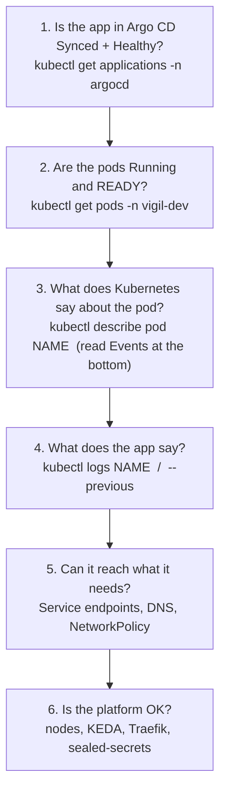
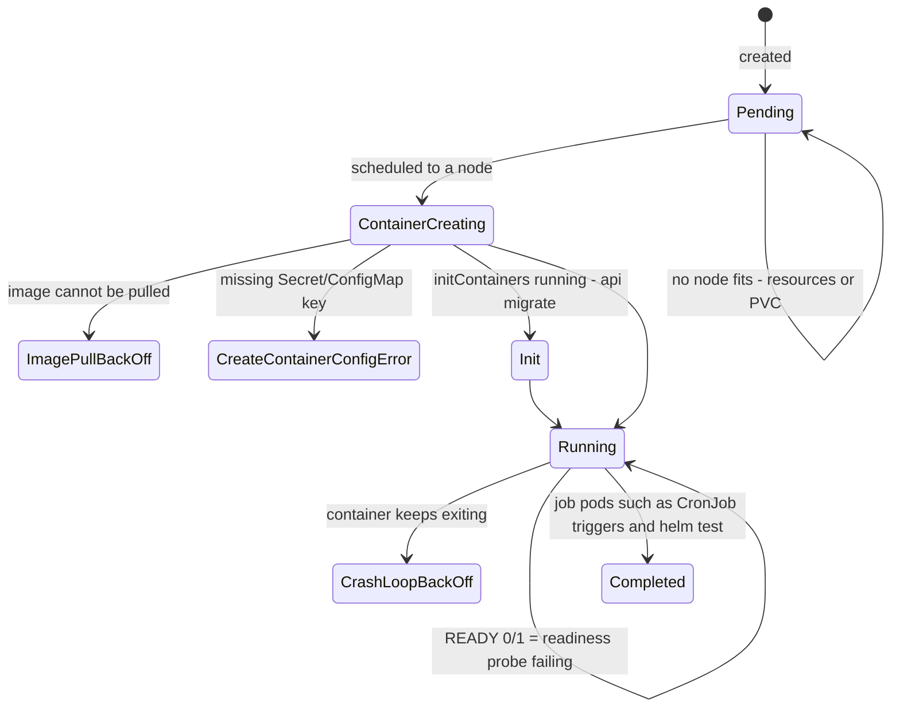
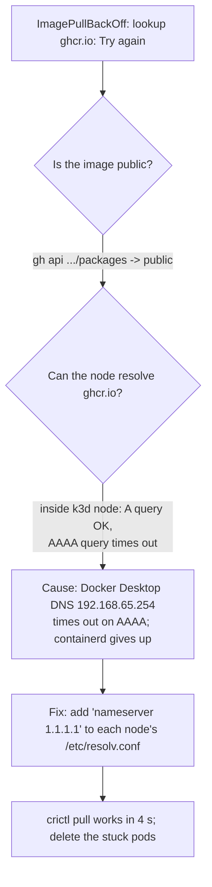
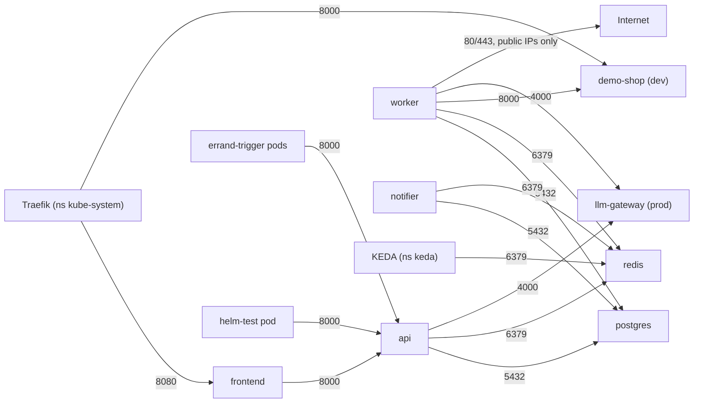
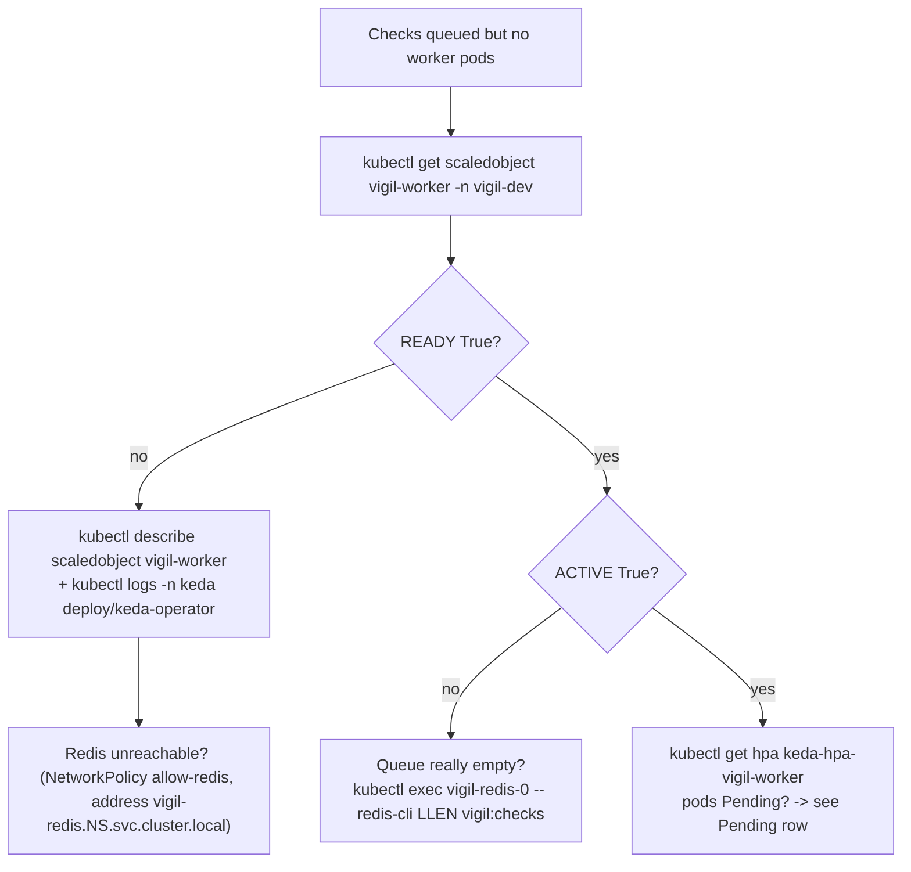

# Chapter 8 - Troubleshooting Vigil on Kubernetes

> Things break. This chapter is a field guide: **symptom -> command -> fix**. Several entries
> are problems that really happened while building this project (they are marked
> **[seen in this project]** and come from `docs/notes/`).
>
> Namespaces: `vigil-dev`, `vigil-prod` (Argo CD), `vigil` (Phases 1-2), `argocd`, `keda`,
> `kube-system`. Replace `-n vigil-dev` as needed.

---

## 8.1 How to think: the debugging ladder

Always walk from the outside in. Each step tells you which step to look at next.



### Reading pod STATUS



### Your five most-used commands

```bash
kubectl get pods -n vigil-dev -o wide                 # status, restarts, node, IP
kubectl describe pod <pod> -n vigil-dev               # Events: scheduling, pulls, probes, kills
kubectl logs <pod> -n vigil-dev [-c <container>]      # app output (-c migrate for the initContainer)
kubectl logs <pod> -n vigil-dev --previous            # output of the LAST crashed run
kubectl get events -n vigil-dev --sort-by=.lastTimestamp | tail -20
```

---

## 8.2 The big table

| Symptom | Command to investigate | Likely cause -> fix |
|---|---|---|
| Pod `Pending` for minutes | `kubectl describe pod <pod>` -> Events | `0/3 nodes are available: Insufficient memory` -> lower `resources.requests` or free RAM in the Docker Desktop VM. `pod has unbound immediate PersistentVolumeClaims` -> check `kubectl get pvc`, `storageClassName: local-path` exists (`kubectl get sc`). |
| `ImagePullBackOff` / `ErrImagePull` | `kubectl describe pod` -> "Failed to pull image" | Wrong name/tag; GHCR package private; `pullPolicy: Always` for an imported image; node DNS (see 8.3). |
| `CrashLoopBackOff` | `kubectl logs <pod> --previous` | App exits at start: bad env value, cannot reach Postgres, read-only filesystem write. Fix the config, not the restart count. |
| `CreateContainerConfigError` | `kubectl describe pod` -> "secret ... not found" / "couldn't find key" | `vigil-secrets` missing or lacks `postgres-password`/`internal-token`. Prod: is the SealedSecret decrypted? (8.7) |
| `Init:0/1` or `Init:CrashLoopBackOff` (api) | `kubectl logs <api-pod> -c migrate` | Migration cannot reach Postgres yet, or wrong password. Check `vigil-postgres-0` is Ready. |
| `Running` but `READY 0/1` | `kubectl describe pod` -> "Readiness probe failed: HTTP probe failed with statuscode: 503" | api `/readyz` = db + schema + redis. `curl` it from inside (8.4) to see which is `false`. |
| `OOMKilled` in `describe` (Last State) | `kubectl top pod` (if metrics available), `describe` | Memory limit too low (worker runs Chromium: limit 1536Mi). Raise `limits.memory` in values. |
| Argo CD app `OutOfSync` | `kubectl get application vigil-dev -n argocd -o yaml` (status), UI diff | Git changed and sync failed, or someone edited the cluster and selfHeal is off, or a field the cluster rewrites (needs `ignoreDifferences`). |
| Argo CD app `Degraded` | UI resource tree -> red object | One object is unhealthy: debug that pod as above. |
| Argo CD `ComparisonError` / repo error | `kubectl logs -n argocd deploy/argocd-repo-server` | Helm render failed (bad template/values) or repo unreachable. Run the same `helm template` locally. |
| Request times out between pods | `kubectl get networkpolicy -n vigil-dev`, check pod labels | NetworkPolicy does not allow it (8.5). |
| Workers never start (dev) | `kubectl get scaledobject,hpa -n vigil-dev`, `kubectl logs -n keda deploy/keda-operator` | KEDA cannot reach Redis, or the queue is empty (0 workers is correct then). (8.6) |
| `Error creating: pods ... is forbidden: violates PodSecurity "restricted:latest"` | `kubectl get events -n vigil-dev`, `kubectl describe rs <rs>` | A securityContext field missing (8.8). |
| `lookup ... no such host` / `Try again` | DNS test pod (8.9) | Service name typo, wrong namespace, CoreDNS or node DNS problem. |
| UI `http://vigil-dev.localhost:8081` 404 | `kubectl get ingress -A` | Host not in an Ingress; wrong port (8081, not 8080); cluster not started (`k3d cluster list`). |
| `helm upgrade`: `field is immutable` | `helm template ... \| kubectl apply --dry-run=server -f -` | Selector labels changed. Delete and recreate the Deployment/StatefulSet (or the namespace). **[seen in this project]** |
| Dry run `504 No worker answered in time` | `kubectl get pods -n vigil-dev -l app.kubernetes.io/component=worker` | Worker scaled to 0 and still starting; retry. |
| Plan returns `page_changed` for a price request | - | `₹` mangled by the Windows console. Send JSON from a UTF-8 file. **[seen in this project]** |
| One CronJob trigger pod `Error` after a restart | `kubectl logs <errand-...-pod>` | It fired while the api was still starting; the next minute's Job completes. Harmless. **[seen in this project]** |

---

## 8.3 ImagePullBackOff - the DNS story **[seen in this project]**

After CI switched dev to GHCR images, every new pod went to `ImagePullBackOff`:

```text
dial tcp: lookup ghcr.io: Try again
```

How it was diagnosed (from `docs/notes/gitops-verification.md`):



The fix (also in `scripts/phase3-up.ps1`; re-run it after the k3d nodes are *recreated*):

```bash
for n in k3d-vigil-server-0 k3d-vigil-agent-0 k3d-vigil-agent-1; do
  docker exec $n sh -c 'grep -q "^nameserver 1.1.1.1" /etc/resolv.conf || echo "nameserver 1.1.1.1" >> /etc/resolv.conf'
done
docker exec k3d-vigil-agent-0 crictl pull ghcr.io/gagan046-dev/vigil-frontend:sha-e4cf0da   # ok in 4 s
kubectl delete pod -n vigil-dev <the ImagePullBackOff pods>
```

| Line | What it does | Why it matters |
|---|---|---|
| `docker exec <node> ...` | Runs inside the k3d node container | The **node** (containerd) pulls images, not your PC. |
| `grep -q ... \|\| echo ... >>` | Add the line only once | Safe to re-run. |
| `crictl pull` | Pull with the node's own runtime | Proves the fix before touching pods. |
| `kubectl delete pod` | The Deployment recreates them | Back-off can wait minutes; a fresh pod retries now. |

Other ImagePullBackOff causes checklist:

| Check | Command |
|---|---|
| Exact image the pod wants | `kubectl get pod <pod> -n vigil-dev -o jsonpath='{.spec.containers[*].image}'` |
| Package is public | `gh api "/users/gagan046-dev/packages?package_type=container" --jq '.[]\|[.name,.visibility]\|@tsv'` |
| Local image present on the node (Phases 1-3) | `docker exec k3d-vigil-agent-0 crictl images \| grep vigil` |
| Re-import local images | `powershell -ExecutionPolicy Bypass -File scripts\import-images.ps1` |
| Big third-party image (LiteLLM, 1.66 GB) | `scripts\import-images.ps1 -Images ghcr.io/berriai/litellm:v1.103.2` **[seen in this project]** |

---

## 8.4 Readiness failing - ask the probe yourself

The api's readiness probe calls `/readyz`, which returns a JSON with each dependency:

```python
        for name, fn in (("db", deps.store.ping), ("schema", deps.store.schema_present), ("redis", deps.r.ping)):
            ...
        return JSONResponse({"ok": ok, **checks}, status_code=200 if ok else 503)
```

```bash
# From a throw-away pod that the NetworkPolicy allows (label component=helm-test)
kubectl run probe -n vigil-dev --rm -it --restart=Never --image=curlimages/curl:8.22.0 \
  --labels=app.kubernetes.io/component=helm-test \
  --overrides='{"spec":{"securityContext":{"runAsNonRoot":true,"runAsUser":100,"seccompProfile":{"type":"RuntimeDefault"}},"containers":[{"name":"probe","image":"curlimages/curl:8.22.0","args":["-sS","http://vigil-api:8000/readyz"],"securityContext":{"allowPrivilegeEscalation":false,"capabilities":{"drop":["ALL"]}}}]}}'
#   {"ok":false,"db":true,"schema":false,"redis":true}   <- example: migration has not run
```

(The long `--overrides` is needed because the namespace enforces Pod Security "restricted" and
the NetworkPolicy only lets certain labels reach the api. In the Phase-2 namespace you can
simply run `helm test vigil -n vigil`.)

| `/readyz` says | Look at |
|---|---|
| `"db": false` | `kubectl get pod vigil-postgres-0`, `kubectl logs vigil-postgres-0`, password in `vigil-secrets` |
| `"schema": false` | `kubectl logs <api-pod> -c migrate` |
| `"redis": false` | `kubectl get pod vigil-redis-0`, `kubectl logs vigil-redis-0` |

Worker readiness uses `/metrics` on port 9100; LiteLLM uses `/health/readiness` (and a
startup probe allowing up to 3 minutes, because it imports slowly).

---

## 8.5 NetworkPolicy blocks

The chart starts from **deny all incoming traffic** and opens only these paths
(`templates/networkpolicies.yaml`):



Symptoms: connections **time out** (not "refused") - packets are silently dropped.

```bash
kubectl get networkpolicy -n vigil-dev
kubectl describe networkpolicy allow-api -n vigil-dev
kubectl get pods -n vigil-dev --show-labels | grep component    # does the client have the right label?
kubectl get ns --show-labels | grep kubernetes.io/metadata.name  # namespace selectors use this label
```

| Situation | Cause | Fix |
|---|---|---|
| A new pod type cannot reach the api | Its `app.kubernetes.io/component` is not in `allow-api` | Add it to the policy's `values: [frontend, errand-trigger, helm-test]` list. |
| KEDA cannot read the queue | Redis policy allows namespace `keda` only | KEDA must be in `networkPolicies.kedaNamespace` (default `keda`). |
| Worker cannot fetch a website on port 8443 | Egress allows only ports 80, 443 | `worker.egressPolicy.allowedPorts`. |
| Worker cannot reach an internal site | Egress blocks private ranges on purpose (SSRF backup) | Intended. |
| Worker DNS fails | Egress must allow UDP/TCP 53 to `kube-dns` | Already in `worker-egress`; keep it if you edit. |
| First request of a brand-new pod is refused | The NetworkPolicy controller has not allowed the new IP yet (k3s/kube-router) | Retry briefly - the CronJob trigger uses `--retry-connrefused`. **[seen in this project]** |

---

## 8.6 KEDA not scaling



```bash
kubectl get scaledobject,hpa -n vigil-dev
#   scaledobject.keda.sh/vigil-worker ... MIN 0  MAX 5  READY True  ACTIVE False   (worker scaled to 0)
kubectl exec -n vigil-dev vigil-redis-0 -- redis-cli LLEN vigil:checks
kubectl get pods -n keda
kubectl get application keda -n argocd
```

| Symptom | Cause / fix |
|---|---|
| `READY False` | KEDA cannot connect to Redis: NetworkPolicy, wrong address, Redis not ready. |
| `ACTIVE False` and 0 workers | Normal in dev when nothing is queued (`minReplicas: 0`). |
| Workers scale up but never down | `cooldownPeriod` (60 s, only for 0<->1) and `scaleDownStabilizationSeconds` (30 s). Wait. |
| Replica count jumps after `helm upgrade` | Someone set `worker.autoscaling.enabled: false` while KEDA was installed - the chart then writes `replicas:`. |
| KEDA app always `OutOfSync` | KEDA rewrites its `caBundle`; needs the `ignoreDifferences` block in `gitops/apps/keda.yaml`. |

---

## 8.7 Secrets: missing or not decrypted

```bash
kubectl get secret vigil-secrets -n vigil-prod                       # exists?
kubectl get secret vigil-secrets -n vigil-prod -o jsonpath='{.data}' | grep -o '"[a-z-]*":' # key NAMES only
kubectl get sealedsecret vigil-secrets -n vigil-prod -o yaml | grep -A5 status
kubectl logs -n kube-system deploy/sealed-secrets-controller | tail -20
```

> Never print the values. The `grep -o` above shows only key names.

| Symptom | Cause | Fix |
|---|---|---|
| `CreateContainerConfigError: secret "vigil-secrets" not found` | SealedSecret not applied / not decrypted | Check wave -3 synced; controller logs. |
| Controller log `no key could decrypt secret` | Cluster recreated (new key pair) or sealed for another namespace/name | Re-seal with `kubeseal` (Chapter 5) and push. |
| LLM calls 401 in prod | `openrouter-api-key` not in the Secret yet | Expected until you add it (Chapter 5, "Adding the OpenRouter key"). |
| Changed a Secret, pods still use the old value | Env vars are read at container start | `kubectl rollout restart deploy/<name> -n vigil-prod`. |

---

## 8.8 Pod Security Standard violations

The Vigil namespaces enforce **restricted**. A pod is rejected unless it has:

```yaml
securityContext:              # pod level
  runAsNonRoot: true
  seccompProfile: {type: RuntimeDefault}
containers:
  - securityContext:          # container level
      allowPrivilegeEscalation: false
      capabilities: {drop: ["ALL"]}
```

Symptom: the Deployment exists but **no pods appear**. The rejection is on the ReplicaSet:

```bash
kubectl get deploy,rs -n vigil-dev
kubectl describe rs <replicaset> -n vigil-dev | grep -i forbidden
#   pods "..." is forbidden: violates PodSecurity "restricted:latest": allowPrivilegeEscalation != false ...
kubectl get ns vigil-dev --show-labels      # pod-security.kubernetes.io/enforce=restricted
```

| Cause | Fix |
|---|---|
| A new template forgot the helpers | Use `vigil.podSecurity` and `vigil.containerSecurity` from `_helpers.tpl`. |
| Image wants to run as root (LiteLLM defaults to root) | Set `runAsUser` (10001) and a writable `/tmp` emptyDir; it was tested with `docker run --user 10001:10001 --read-only --tmpfs /tmp` first. **[seen in this project]** |
| App writes to its filesystem | `readOnlyRootFilesystem: true` -> mount an `emptyDir` at the path (`/tmp`, Chromium's `/dev/shm`). |
| `kubectl run` debug pod rejected | Pass a restricted securityContext with `--overrides` (see 8.4). |
| Namespace has no PSS labels | `helm install --create-namespace` does not add them; use `phase2-up.ps1` or Argo CD's `managedNamespaceMetadata`. |

Server-side dry run catches these before deploying:
`helm template ... | kubectl apply --dry-run=server -f -` (Chapter 4).

---

## 8.9 DNS inside the cluster

Service names like `vigil-api` resolve only **inside the same namespace**; from elsewhere use
`vigil-api.vigil-dev.svc.cluster.local`.

```bash
kubectl run dns -n vigil-dev --rm -it --restart=Never --image=curlimages/curl:8.22.0 \
  --overrides='{"spec":{"securityContext":{"runAsNonRoot":true,"runAsUser":100,"seccompProfile":{"type":"RuntimeDefault"}},"containers":[{"name":"dns","image":"curlimages/curl:8.22.0","command":["nslookup","vigil-redis"],"securityContext":{"allowPrivilegeEscalation":false,"capabilities":{"drop":["ALL"]}}}]}}'
kubectl get svc,endpoints -n vigil-dev                 # does the Service have endpoints (pod IPs)?
kubectl get pods -n kube-system -l k8s-app=kube-dns    # CoreDNS running?
```

| Symptom | Cause | Fix |
|---|---|---|
| `no such host vigil-api` from another namespace | Short names are per-namespace | Use the full `...svc.cluster.local` name. |
| Name resolves, connection fails | Service has no endpoints (selector does not match pod labels, or pods not Ready) | `kubectl get endpoints`; compare `selector` with pod labels. |
| Postgres name returns a pod IP, not a service IP | Headless Service (`clusterIP: None`) | Intended for the StatefulSet. |
| Nodes cannot resolve `ghcr.io` (`Try again`) | Docker Desktop DNS + AAAA timeout | Section 8.3. |

---

## 8.10 Argo CD OutOfSync - a closer look

```bash
kubectl get applications -n argocd
kubectl get application vigil-dev -n argocd -o jsonpath='{.status.sync.status} {.status.health.status}{"\n"}'
kubectl get application vigil-dev -n argocd -o jsonpath='{.status.operationState.message}{"\n"}'
kubectl logs -n argocd statefulset/argocd-application-controller | tail -30
```

| Message / situation | Meaning | Fix |
|---|---|---|
| OutOfSync right after a push | Not polled yet (60 s) | Wait or press Refresh in the UI. |
| `one or more objects failed to apply` | A manifest is invalid for the API | `helm template` + `kubectl apply --dry-run=server` locally. |
| Prod: resource "requires pruning" | Object removed from git, `prune: false` | Intended. Sync with "Prune" ticked after checking. |
| Flips between Synced/OutOfSync | Something else writes the same field (KEDA caBundle, an HPA and `replicas`) | `ignoreDifferences`, or do not render the field (the worker chart omits `replicas` under KEDA). |
| Manual change keeps coming back | selfHeal | Change git instead. |
| `helm` and Argo CD both manage something | Two owners | Remove one (for KEDA: `kubectl delete secret -n keda -l owner=helm,name=keda`). **[seen in this project]** |

---

## Try it yourself

A safe break-and-fix exercise in **dev** (Argo CD will heal some of it for you):

```bash
# 1. Pod status overview
kubectl get pods -n vigil-dev -o wide

# 2. Break an image on purpose (Argo CD's selfHeal will revert it within seconds)
kubectl set image deploy/vigil-frontend -n vigil-dev frontend=ghcr.io/gagan046-dev/vigil-frontend:does-not-exist
kubectl get pods -n vigil-dev -l app.kubernetes.io/component=frontend -w   # ErrImagePull, then healed

# 3. Watch KEDA wake a worker
kubectl get scaledobject,hpa -n vigil-dev
kubectl exec -n vigil-dev vigil-redis-0 -- redis-cli LLEN vigil:checks

# 4. Events, newest last
kubectl get events -n vigil-dev --sort-by=.lastTimestamp | tail -20

# 5. Argo CD health of everything
kubectl get applications -n argocd
```

(If the container name differs, `kubectl get deploy vigil-frontend -n vigil-dev -o jsonpath='{.spec.template.spec.containers[*].name}'` shows it.)

## Common mistakes (while debugging)

| Mistake | Better |
|---|---|
| Reading only `kubectl get pods` | `describe` (Events) tells you *why*. |
| `kubectl logs` on a crash-looping pod shows nothing useful | Use `--previous` for the crashed run. |
| Forgetting `-n <namespace>` | You are looking at `default`, which is empty. |
| Forgetting `-c migrate` | The api's initContainer has its own logs. |
| Fixing things with `kubectl edit` under Argo CD | selfHeal reverts it; fix git. |
| Deleting the namespace to "reset" prod | Deletes the Postgres PVC = all data. Delete single pods instead. |
| Printing Secrets to "check" them | Check key names only; values may land in your terminal history. |
| Debug pods rejected by Pod Security | Add a restricted securityContext (`--overrides`). |

## Key words

- **Pending** - pod accepted but not yet placed on a node.
- **ImagePullBackOff / ErrImagePull** - the node cannot fetch the image; it retries with growing delays.
- **CrashLoopBackOff** - the container keeps exiting; Kubernetes waits longer between restarts.
- **CreateContainerConfigError** - a referenced Secret/ConfigMap/key is missing.
- **OOMKilled** - the container used more memory than its limit.
- **Readiness probe** - "can this pod take traffic now?" (fails -> removed from the Service).
- **Liveness probe** - "is this process stuck?" (fails -> container restarted).
- **Startup probe** - gives slow starters time before liveness kicks in.
- **Events** - Kubernetes' log of what happened to an object (`kubectl describe`).
- **Endpoints** - the pod IPs behind a Service.
- **NetworkPolicy** - pod-level firewall rules (here: default deny + explicit allows).
- **Pod Security Standard (restricted)** - namespace-level rules that reject unsafe pods.
- **CoreDNS / kube-dns** - the cluster's DNS server.
- **Headless Service** - `clusterIP: None`; DNS returns pod IPs directly.
- **ScaledObject** - KEDA's resource that drives an HPA from an external metric.
- **OutOfSync / Degraded** - Argo CD: git differs from cluster / something is unhealthy.

---

Previous: [Chapter 7 - How Vigil works](07-how-vigil-works.md) | Next: [Chapter 9 - Price compare](09-price-compare.md) | [Glossary](GLOSSARY.md) | [Start here](00-start-here.md)
