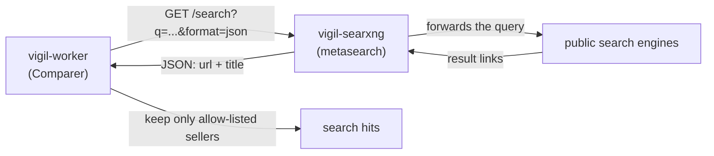
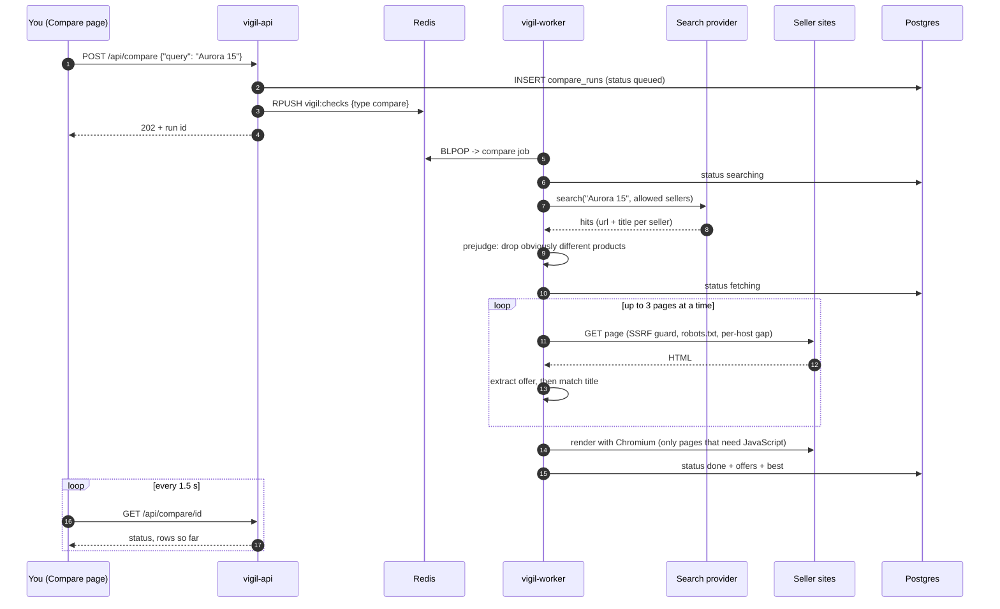
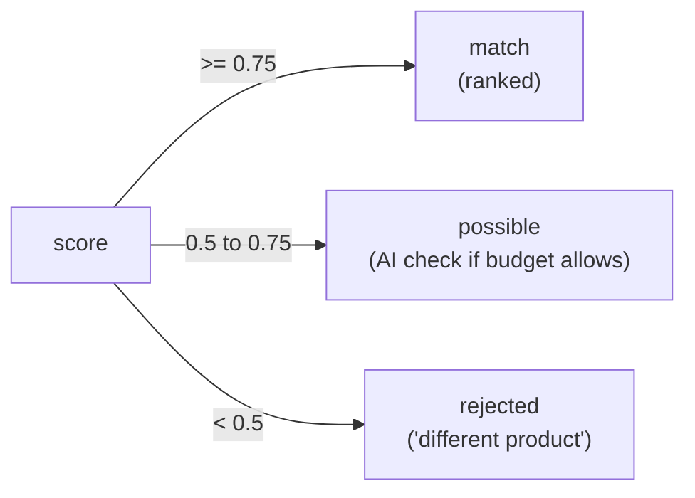
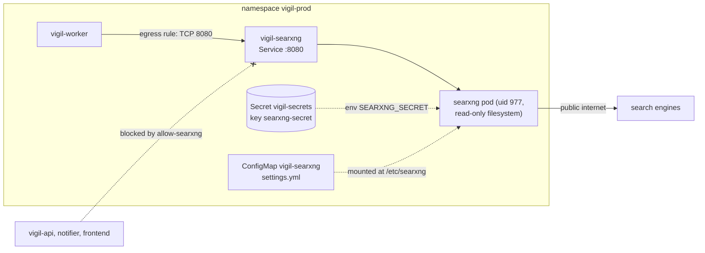

# Chapter 9 - Price compare: searching the web for the best price

> Chapter 7 followed one *watch* from a sentence to a notification. This chapter follows a
> different question: **"Who sells this product, and who sells it cheapest?"** You type a
> product name (or paste a product link) on the **Compare** page; Vigil searches the web,
> opens the seller pages one by one, reads each price, checks that it is really the same
> product, and gives you a ranked list. You can then ask Vigil to keep watching the best
> price and tell you when it drops below a target.
>
> Code: `app/vigil/search.py`, `compare.py`, `offers.py`, `matching.py`, `fetch.py`.
> Kubernetes: `charts/vigil/templates/searxng.yaml` and `networkpolicies.yaml`.

---

## 9.1 The idea in plain words

> **Analogy.** You want a laptop. A friend (the *search engine*) gives you a list of shops
> that mention it. You walk to each shop (the *fetcher*), read the price tag (the
> *extractor*), and check the box says the same model as the one you want (the *matcher*).
> At the end you write the prices on a sheet, cheapest first. Vigil is the friend who does
> the walking, politely, and never picks a lock on a shop door.

Four jobs, four pieces of code:

| Job | Question it answers | Code |
|---|---|---|
| Search | Which pages on which sellers might sell this? | `search.py` |
| Fetch | Can I (politely and safely) download that page? | `fetch.py` |
| Extract | What is the price, the MRP (printed list price), is it in stock? | `offers.py` |
| Match | Is this really the same product? | `matching.py` |

`compare.py` is the conductor that runs them in order.

---

## 9.2 Search engines from zero, and SearXNG

A **search engine** keeps a huge index of web pages and returns links for your words.
Google and Bing run their own index. A **metasearch engine** has no index of its own: it
forwards your query to many engines and merges the answers.

**SearXNG** is an open-source metasearch engine you can run yourself. Vigil uses it because:

- it is **self-hosted**: no account, no API key, no per-search bill;
- it has a **JSON API**: `GET /search?q=...&format=json` returns results as data instead
  of a web page;
- it sits **inside your cluster**, so you decide who can talk to it (section 9.9).



Vigil has two **search providers**, chosen by the setting `SEARCH_PROVIDER`:

| Provider | Used in | What it does |
|---|---|---|
| `demo` | dev and tests | Offline. Returns the fictional shops of the demo shop (`/sellers/<key>/...`). No internet needed. |
| `searxng` | prod | Calls the real SearXNG pod and keeps only real sellers. |

The code that picks one:

```python
def make_search(settings: Settings):
    if settings.search_provider == "searxng":
        return SearxngSearch(settings)
    return DemoSearch(settings)
```

| Line | What it does | Why it matters |
|---|---|---|
| `if settings.search_provider == "searxng":` | Reads the `SEARCH_PROVIDER` setting (from the ConfigMap). | Dev and prod run the same image; only the setting differs. |
| `return SearxngSearch(settings)` | Real web search through the SearXNG pod. | The only provider that touches the internet. |
| `return DemoSearch(settings)` | Anything else (including a typo) falls back to the offline provider. | A wrong value can never make dev call the real web by accident. |

### The seller allow-list

Search results come from anywhere. Vigil keeps only sellers on an **allow-list**
(`COMPARE_SELLERS`, a comma-separated list of domains). In `app/vigil/config.py`:

```python
DEFAULT_COMPARE_SELLERS = (
    "flipkart.com,amazon.in,myntra.com,croma.com,reliancedigital.in,vijaysales.com,tatacliq.com,ajio.com"
)
```

And how a hit is matched to a seller (`search.py`):

```python
    def owns(self, url: str) -> bool:
        parts = urlsplit(url)
        host = (parts.hostname or "").lower()
        if not (host == self.domain or host.endswith("." + self.domain)):
            return False
        return not self.path_prefix or parts.path.startswith(self.path_prefix)
```

| Line | What it does | Why it matters |
|---|---|---|
| `host = (parts.hostname or "").lower()` | Takes the host part of the URL, lower-cased. | `Amazon.IN` and `amazon.in` are the same shop. |
| `host == self.domain or host.endswith("." + self.domain)` | Accepts `amazon.in` and `www.amazon.in`, but not `notamazon.in`. | The leading dot is what stops look-alike domains sneaking in. |
| `not self.path_prefix or parts.path.startswith(...)` | Optionally requires a path prefix. | The demo sellers share one host and are told apart by path (`/sellers/bazaar99/`). |

Search also skips **listing pages** (home pages, `/search`, `/category` ...), because those
show many products and no single price. And it asks twice: one broad query first, then
`site:<domain> <query>` for each seller the broad query missed (`SearxngSearch.search`).

---

## 9.3 The compare pipeline



Steps in words:

1. **Queue it.** The api stores a `compare_runs` row and pushes a job on the same Redis
   list the watch checks use. KEDA wakes a worker just like for a watch.
2. **Optional URL start.** If you pasted a *link*, Vigil fetches that page first. Its
   title becomes the search words, and the page itself becomes one of the offers
   ("the page you entered").
3. **Search**, then **prejudge**: a result whose search title *and* URL slug clearly
   describe another product is not even downloaded.
4. **Fetch** the plausible pages, three at a time, one page per seller first, then second
   pages until the page budget (`COMPARE_MAX_PAGES`, default 8, max 20) is used up.
5. **Render** with Chromium the few pages that showed no price but contain JavaScript.
6. **Sort and pick the best**; save everything to Postgres.

The conductor's own summary, from the top of `compare.py`:

```python
Pipeline (run by the worker for a "compare" job, and for best_price_below watches):
  1. a URL query is fetched first: its product title becomes the search query and
     the page itself becomes one of the offers;
  2. the search provider returns product pages on allow-listed sellers;
  3. pages are fetched politely (SSRF guard, robots.txt, per-host gap) by a small
     thread pool; pages that need JavaScript are then rendered one at a time
     (Playwright's sync API is bound to one thread);
  4. offers are extracted (JSON-LD > meta > heuristics > LLM) and matched against
     the reference product; different variants are rejected, not ranked;
  5. offers are sorted in-stock first, then by price; the best one is marked.
```

| Line | What it does | Why it matters |
|---|---|---|
| `fetched politely ... by a small thread pool` | `FETCH_WORKERS = 3` pages in parallel. | Fast enough (about 20 s for 5 sellers) without hammering anyone. |
| `rendered one at a time` | Chromium pages run in a single thread. | Playwright's sync API is not thread-safe. |
| `JSON-LD > meta > heuristics > LLM` | The order of trust for reading a price. | Structured data is exact; an LLM guess is the last resort (max 3 calls per comparison). |
| `rejected, not ranked` | A different variant is dropped, not listed as "cheaper". | A phone *case* must never win the "best price" for a phone. |
| `in-stock first, then by price` | The sort key. | A cheap but sold-out offer is not the best deal. |

The browser polls `GET /api/compare/<id>` every 1.5 seconds while the status is active
(`setTimeout(load, 1500)` in `frontend/js/pages/compare-run.js`); rows appear as they finish.

---

## 9.4 Reading the price: JSON-LD and schema.org

Most shops want Google to understand their pages, so they add **structured data** in a
standard vocabulary called **schema.org**. The most common format is **JSON-LD**
("JSON for Linked Data"): a `<script type="application/ld+json">` tag holding plain JSON
that describes the product. People never see it; programs love it.

> **Analogy.** The price tag on the shelf is for people. JSON-LD is the barcode on the
> back: the same facts, in a format a machine reads without guessing.

The demo shop builds exactly this for PixelMart (`app/vigil/demo_shop.py`):

```python
    ld = _ld(
        {
            "@context": "https://schema.org",
            "@graph": [
                {"@type": "BreadcrumbList", "itemListElement": []},
                {
                    "@type": "Product",
                    "name": "Aurora 15 (RTX 5070) Gaming Laptop",
                    "sku": "AUR15-5070",
                    "offers": offer,
                },
```

| Line | What it does | Why it matters |
|---|---|---|
| `"@context": "https://schema.org"` | Says "the words below come from schema.org". | This is what makes `Product` and `Offer` mean something fixed. |
| `"@graph": [ ... ]` | A list of several things on the page. | Real shops mix breadcrumbs, organisation info and the product; the extractor must dig through all of it. |
| `"@type": "Product"` | The item we want. | `offers.py` looks for this type (also `ProductGroup`, ...). |
| `"offers": offer` | The price block: `price`, `priceCurrency`, `availability`. | `availability` is a URL like `https://schema.org/InStock`; `availability_of()` turns it into True/False. |

The extractor then tries sources in order of trust (`offers.py`):

```python
Order of trust, first hit wins for the price:
  1. JSON-LD (schema.org Product / Offer / AggregateOffer, @graph, lists)
  2. meta tags (product:price:amount, og:price:amount, itemprop=price)
  3. the existing price heuristics (price-ish class names, then currency regex)
The LLM fallback lives in compare.py (it needs the budget-aware client).
```

| Source | Example | Verified in the live test |
|---|---|---|
| `jsonld` | the script tag above | PixelMart: ₹1,29,990, 13% off |
| `meta` | `<meta property="product:price:amount" ...>` | Bazaar99: ₹1,24,499 |
| `heuristic` / `regex` | a tag whose class name looks like a price | used when a page has neither |
| `llm` | the model reads the page text | only if all of the above found nothing, never for CAPTCHA pages |
| JavaScript render | Chromium runs the page's script first | Northwind: price found after the render |

Two small details that save you from wrong prices: `_has_type` treats `@type` as a string
*or* a list, and several offers on one page prefer an in-stock one, then the cheapest.
`AggregateOffer` (a price *range*) uses `lowPrice`.

---

## 9.5 Is it the same product? (`matching.py`)

Search results are fuzzy. "Aurora 15 Pro RTX 5080" is not "Aurora 15 RTX 5070", even
though the words overlap. Matching is **deterministic** (no AI) and has two layers.

**Layer 1: word coverage.** What fraction of the *reference* words appear in the listing
title? Titles are normalised first, so `128 GB`, `128GB` and `1TB` (= 1024 GB) compare
fairly, and `RTX5070` becomes `rtx 5070`.

**Layer 2: hard rules.** Even a high word score is capped if a rule says "different":

| Rule | Example | Cap |
|---|---|---|
| Same family word, different number | `RTX 5070` vs `RTX 5080`, `iPhone 16` vs `15` | score 0.3 |
| Conflicting capacity or screen size | `128gb` vs `256gb`, `15.6"` vs `13.3"` | score 0.3 |
| Extra variant word in the listing | `Pro`, `Max`, `Plus`, `Ultra`, `Mini`, `Lite`, `FE` | score 0.4 |
| Accessory or used word | `case`, `cover`, `charger`, `refurbished`, `used` ... | score 0.2 |

The verdict thresholds:

```python
ACCEPT = 0.75
REVIEW = 0.5
```



| Line | What it does | Why it matters |
|---|---|---|
| `ACCEPT = 0.75` | At or above: a confirmed match. | Counted for "best price". |
| `REVIEW = 0.5` | Between 0.5 and 0.75: unsure. | Only here may the LLM be asked ("same model, capacity, variant?"). |
| below `REVIEW` | Rejected and shown with the reason. | The ByteBay "Pro variant" row in the live test. |

`pick_best` in `compare.py` first looks only at `match` rows. Only when there are none does
it consider `possible` rows. It also ignores out-of-stock offers and mixed currencies
(it uses the most common currency), so you never compare ₹ with $.

---

## 9.6 Why some sellers block bots (and why Vigil never bypasses that)

Big shops are scraped constantly by price-copying bots, so they defend themselves:

- **robots.txt** - a text file at the site root listing which paths bots may not visit.
- **Rate limits** - too many requests in a row returns `429 Too Many Requests`.
- **Bot walls** - CAPTCHAs ("are you a robot?"), "Access denied", JavaScript challenges.
- **Logins** - the price is shown only after signing in.

Vigil's rule is simple: **if a seller says no, the answer is no.** It does not rotate fake
browser identities, solve CAPTCHAs, or log in. The row simply shows *why* it is empty.

What Vigil does instead is behave like a polite visitor (`fetch.py`):

```python
USER_AGENT = "VigilBot/0.1 (+personal web watcher; respects robots.txt)"
```

```python
    def prepare(self, url: str) -> None:
        check_url_safety(url, self.allowed_hosts, self.resolver)
        if not self.robots.allowed(url):
            raise RobotsBlockedError("blocked by robots.txt")
        if self.r is not None:
            host = (urlsplit(url).hostname or "").lower()
            try:
                queue.wait_host_slot(self.r, host, self.host_gap_ms)
            except Exception:
                log.warning("politeness check failed; continuing")
```

| Line | What it does | Why it matters |
|---|---|---|
| `USER_AGENT = "VigilBot/0.1 (...)"` | Introduces itself honestly. | The site owner can see who is visiting and block it if they wish. |
| `check_url_safety(...)` | The SSRF guard from chapter 7 (no private addresses). | A search result can never make the worker call an internal service. |
| `self.robots.allowed(url)` | Reads and caches `/robots.txt`, then asks "may VigilBot fetch this?". | Disallowed pages are never downloaded. |
| `raise RobotsBlockedError(...)` | Stops the fetch. | The row says `blocked by robots.txt`. |
| `queue.wait_host_slot(..., self.host_gap_ms)` | A Redis key per host with a 5 s expiry; wait until it is free. | At most one request per site every 5 seconds, even with several workers. |

In `robots.txt` handling, a `401`/`403` answer is read as *"disallow everything"*; a missing
file (404) means "allowed". Errors are turned into plain words by `classify_error`:

| What happened | What you see in the row |
|---|---|
| robots.txt forbids it | `blocked by robots.txt` |
| 401, 403, 405, 429, 503, 529 | `HTTP 403 / bot protection` |
| A CAPTCHA page text is detected (`looks_like_bot_wall`) | `bot protection (CAPTCHA page)` |
| Private address | `blocked: not a public address` |
| Nothing readable | `no price found` |

This is also why the **real** result for Amazon or Flipkart may often be "bot protection" or
"no price found". That is an honest answer, not a bug (see "Honest limitations" in the README).

---

## 9.7 The real-world smoke test

All numbers below come from `docs/notes/compare-verification.md` (dev environment,
demo sellers, about 20 seconds for the whole comparison).

| Seller | Result | Why |
|---|---|---|
| **Bazaar99** | **₹1,24,499, best** | price read from meta tags |
| PixelMart | ₹1,29,990, 13% off | read from JSON-LD (price plus ListPrice) |
| Northwind Electronics | ₹1,31,000 | price appeared only after the JavaScript render |
| ByteBay | rejected: "different product (Pro variant)" | listing is "Aurora 15 **Pro** RTX 5080" |
| QuietCart | `blocked by robots.txt` | its `robots.txt` disallows the product page |

Five sellers, five different outcomes: every branch of sections 9.4 to 9.6 ran once.

Honest limits of that test: dev uses the **demo** provider, so real SearXNG search was not
run end to end inside the cluster. The backend author tested SearXNG once in Docker
(`/healthz` returned 200 and a JSON search returned results). Prod runs SearXNG, but its
application images only get the Compare code when the promotion pull request is merged
(chapter 6). Real shops will behave differently from the demo ones.

---

## 9.8 Tracking the best price

A comparison is a snapshot. To get notified when the best price drops, click **Track best
price** on a finished comparison and enter a target. That calls
`POST /api/compare/<id>/track`, which creates an ordinary watch of kind
**`best_price_below`**:

```python
            spec = ErrandSpec(
                name=name if len(name) <= 80 else name[:77] + "...",
                kind="best_price_below",
                query=title[:300] if title else None,
                url=source_url,
                threshold=body.threshold,
                every_minutes=body.every_minutes,
            )
```

| Line | What it does | Why it matters |
|---|---|---|
| `kind="best_price_below"` | A sixth watch kind next to `price_below`, `text_appears`, ... | The worker knows to run the whole compare pipeline for each check instead of one page. |
| `query=title[:300]` | The cleaned product name from the finished comparison. | Each hourly check searches again with the same words. |
| `url=source_url` | The link you started from, if you pasted one. | Keeps the "page you entered" offer in every run. |
| `threshold=body.threshold` | Your target price. | Same transition rule as chapter 7: alert when the best price *becomes* lower than the target, not on every check. |
| `every_minutes=body.every_minutes` | Default `60` (field `TrackIn.every_minutes`). | A comparison fetches several sites, so hourly is gentler than a single-page watch. |

Under the hood it is the same machinery as any watch: one CronJob `errand-<id>`, the same
Redis queue, the same notifier. In the live test a target of ₹1,20,000 created the CronJob
`errand-a6e5d053739d` with schedule `0 * * * *`; then Bazaar99's price was lowered to
₹1,15,000 through the demo-shop admin API, and the inbox got:

```text
Best price: Aurora 15 RTX 5070 15.6" Gaming Laptop at Bazaar99 ₹1,15,000 (target < ₹1,20,000)
```

The unread badge went from 2 to 3, and "Mark all as read" set it back to 0.

---

## 9.9 The new Kubernetes pieces for SearXNG

Compare adds one new Deployment and two security rules to the chart. Nothing else about the
cluster changes.



### The pod (`charts/vigil/templates/searxng.yaml`)

```yaml
{{- define "vigil.searxngSettings" -}}
# SearXNG settings: start from the upstream defaults, change only what Vigil needs.
use_default_settings: true
server:
  limiter: false              # one internal client (the worker), no bot detection needed
  image_proxy: false
  public_instance: false
search:
  safe_search: 0
  formats: [html, json]       # json = the API the worker calls
{{- end -}}
```

| Line | What it does | Why it matters |
|---|---|---|
| `use_default_settings: true` | Start from SearXNG's own defaults. | The file stays 8 lines instead of hundreds. |
| `limiter: false` | Turns off SearXNG's bot detection. | Its only client is the worker; the limiter would block it. |
| `image_proxy: false` | No image proxying. | Less work and less attack surface. |
| `formats: [html, json]` | Enables the JSON output. | Without `json`, the worker cannot read the answers and Compare would find nothing. |

```yaml
          env:
            - name: SEARXNG_SECRET
              valueFrom:
                secretKeyRef: {name: {{ .Values.secrets.name }}, key: {{ .Values.searxng.secretKey }}}
            - {name: GRANIAN_WORKERS, value: "1"}
```

| Line | What it does | Why it matters |
|---|---|---|
| `name: SEARXNG_SECRET` | SearXNG reads its signing key from this env var. | The key is **not** in the ConfigMap, so it never appears in git as plain text. |
| `secretKeyRef: {name: vigil-secrets, key: searxng-secret}` | Takes the value from the `searxng-secret` key of the existing Secret. | One Secret for the whole app, as in chapter 5. |
| `GRANIAN_WORKERS` = `1` | One web-server worker process. | Keeps RAM small (the pod requests 160 Mi). |

The pod runs as user `977` (the image's own unprivileged user) on a **read-only root
filesystem** with all Linux capabilities dropped. That was tested before writing the
template: `docker run --read-only --user 977:977 --cap-drop ALL` answered `/healthz` with
200. The two places it must write (`/var/cache/searxng` and `/tmp`) are `emptyDir`
volumes. A `startupProbe` allows up to 2 minutes because SearXNG loads its engines when it
starts. The image is `searxng/searxng:2026.10.4-d48c4b555`, chosen because it was released
more than 14 days before it was pinned.

Dev switches it **off** (`searxng.enabled: false` in `values-dev.yaml`) to save about
200 MB of RAM; dev uses the demo provider. Prod switches it on in `values-prod.yaml`.

### The NetworkPolicy (`networkpolicies.yaml`)

Chapter 3 introduced the default-deny rule: nothing may talk to any pod unless a policy
allows it. So SearXNG needs *two* new rules, one for each side of the connection:

```yaml
# 7b) searxng: ONLY from the worker (it runs the comparisons). SearXNG itself has no
# egress policy: it must reach the public search engines.
apiVersion: networking.k8s.io/v1
kind: NetworkPolicy
metadata:
  name: allow-searxng
```

```yaml
    {{- if .Values.searxng.enabled }}
    - to:                                       # web search for Compare
        - podSelector:
            matchLabels: {app.kubernetes.io/component: searxng}
      ports: [{protocol: TCP, port: 8080}]
    {{- end }}
```

| Rule | Where | What it does | Why it matters |
|---|---|---|---|
| `allow-searxng` (ingress) | on the searxng pod | Lets only pods labelled `component: worker` connect, TCP 8080. | The api, notifier and frontend cannot reach it. A compromised page can never use it as a free search proxy. |
| worker egress rule | inside `worker-egress` | Lets the worker connect *out* to the searxng pod on 8080. | The worker already has an egress policy (DNS, Redis, Postgres, public internet only). Without this extra line, the traffic would be silently dropped even though `allow-searxng` allows it. |

Both ends must agree: **the sender must be allowed to send and the receiver must be allowed
to receive.** Forgetting the worker rule was the easy mistake here, and the chart carries it.

### The sealed secret key

Prod secrets live in git *encrypted* (chapter 5). The new key `searxng-secret` was added to
the existing `gitops/envs/prod/vigil-secrets.sealed.yaml` without ever writing the plain
value to disk. This is the command pattern (from `docs/notes/compare-verification.md`):

```bash
V=$(openssl rand -hex 32)
kubectl create secret generic vigil-secrets -n vigil-prod --from-literal=searxng-secret="$V" \
  --dry-run=client -o yaml | kubeseal --controller-namespace kube-system \
  --controller-name sealed-secrets-controller --format yaml \
  --merge-into gitops/envs/prod/vigil-secrets.sealed.yaml
unset V
```

| Piece | What it does | Why it matters |
|---|---|---|
| `V=$(openssl rand -hex 32)` | A random 64-character value held only in a shell variable. | Nobody, including you, ever sees or types it. |
| `kubectl create secret ... --dry-run=client -o yaml` | Builds the Secret YAML on your PC; sends nothing to the cluster. | `kubeseal` needs a Secret as its input. |
| `kubeseal ... --merge-into <file>` | Encrypts it with the cluster's public key and **adds** the key to the existing file. | The other keys (database password, internal token) stay untouched. |
| `unset V` | Forgets the value. | Nothing is left in the shell session. |

In dev the same key comes from `secrets.searxngSecret` in values, and `secret.yaml` only
writes it when `searxng.enabled` is on. A secret-scanner may flag the new encrypted
string as a "generic API key"; it is ciphertext only the cluster can open, so that is a
false positive.

Because `vigil-prod` reads the chart from `main`, these chart parts went live in prod as
soon as they were merged to git: `vigil-searxng` runs, and `SEARCH_PROVIDER` is `searxng`.
The old application images ignore the new setting until the promotion PR is merged.

---

## Try it yourself

```bash
# Dev (demo sellers). Start a comparison, then read the result by id.
echo '{"query":"Aurora 15"}' > cmp.json
curl -sS -X POST -H 'Content-Type: application/json' --data-binary @cmp.json http://vigil-dev.localhost:8081/api/compare
curl -s http://vigil-dev.localhost:8081/api/compare/<id-from-the-reply>

# Past comparisons, 10 per page
curl -s "http://vigil-dev.localhost:8081/api/compare?page=1&per_page=10"

# Make Bazaar99 even cheaper, compare again, and watch the best row change
curl -sS -X POST -H 'Content-Type: application/json' -d '{"price":115000}' http://demo.localhost:8081/admin/sellers/bazaar99

# Prod: is SearXNG running, and who may talk to it?
kubectl get deploy,svc -n vigil-prod -l app.kubernetes.io/component=searxng
kubectl get networkpolicy -n vigil-prod
kubectl get secret vigil-secrets -n vigil-prod -o jsonpath='{.data}' | grep -o searxng-secret
```

Or use the UI: **Compare**, type `Aurora 15`, press Enter (chapter 10 explains the page).
Delete `cmp.json` afterwards; it is a scratch file.

## Common mistakes

| Mistake | What you see | Fix |
|---|---|---|
| Comparing in dev with a real product name | `The search returned no product pages on the allowed sellers.` | Dev uses the demo provider: only "Aurora 15" has sellers. Real search is a prod feature. |
| SearXNG does not answer `format=json` | Compare finds no hits | Make sure `json` is listed in `search.formats` in the settings. |
| Allowing the searxng ingress but forgetting the worker egress rule | Worker log: `searxng query failed: ConnectTimeout` | Add the egress rule; both ends of a connection need a policy. |
| Empty `COMPARE_SELLERS` | Helm fails: `config.compareSellers must not be empty` | Keep the list in `values.yaml`; an empty value would mean no sellers. |
| Expecting Amazon or Flipkart to always give a price | Row says `bot protection` or `no price found` | Intended. Vigil never bypasses bot protection (section 9.6). |
| Committing a plain `searxng-secret` | Secret scanner alarm | Always go through `kubeseal`; only ciphertext belongs in git. |
| Changing the SearXNG image tag to a brand-new release | Unknown behaviour | Pin a release at least 14 days old and test it with `--read-only --user 977`. |

## Key words

- **Search engine / metasearch engine** - an index of the web / a service that asks many engines at once.
- **SearXNG** - the self-hosted metasearch engine Vigil uses in prod (`vigil-searxng`).
- **Search provider** - the code behind `SEARCH_PROVIDER`: `demo` (offline) or `searxng`.
- **Seller allow-list** - `COMPARE_SELLERS`: the only domains whose results are kept.
- **JSON-LD / schema.org** - machine-readable product data inside a page; the first and most exact price source.
- **MRP** - maximum retail price, the printed list price used to compute "13% off".
- **Prejudge** - rejecting a search hit from its title and URL before downloading it.
- **Match / possible / rejected** - the three verdicts of the product matcher (`ACCEPT` 0.75, `REVIEW` 0.5).
- **Bot wall** - a CAPTCHA or "access denied" page; Vigil reports it and never bypasses it.
- **`best_price_below`** - the watch kind that re-runs a whole comparison on a schedule.
- **`searxng-secret`** - the key of `vigil-secrets` that becomes `SEARXNG_SECRET`.
- **`allow-searxng`** - the NetworkPolicy that lets only the worker reach SearXNG.

---

Previous: [Chapter 8 - Troubleshooting](08-troubleshooting.md) | Next: [Chapter 10 - The frontend](10-frontend.md) | [Start here](00-start-here.md)
