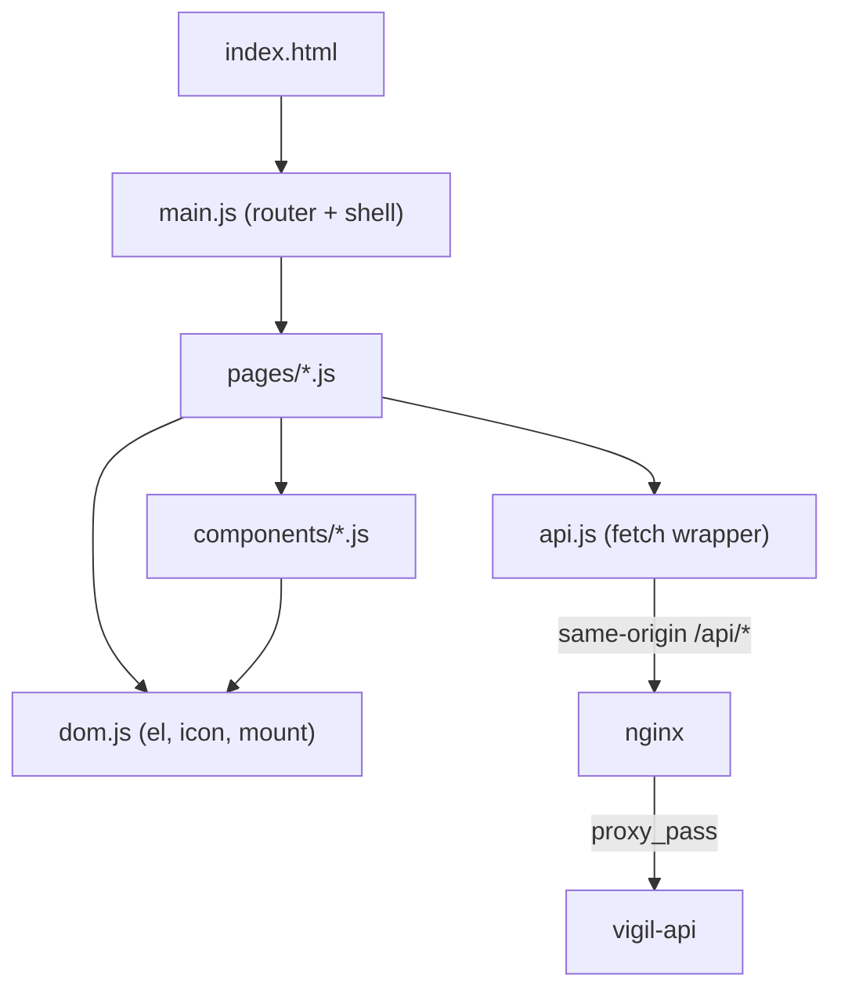
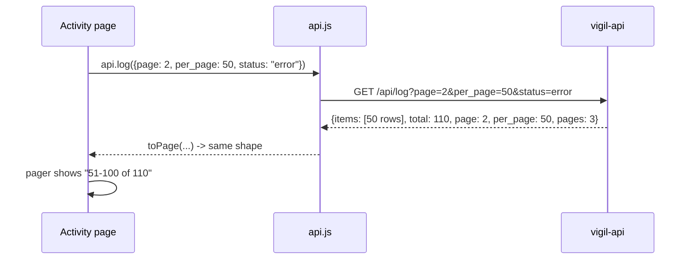

# Chapter 10 - The frontend: how the UI is built

> Chapter 7 showed the whole system with the UI as one box. This chapter opens that box.
> The UI is **plain HTML, CSS and JavaScript**, with no framework, no build step and no
> `node_modules`. nginx serves the files exactly as they are in `frontend/`. That keeps the
> image tiny, the supply chain short, and every line readable by a beginner.

---

## 10.1 The pages and the folder map

The sidebar has five pages. The inbox has its own page and its own bell icon with an
unread badge; the check log has its own page with paging.

| Page | Route (after the `#`) | Purpose |
|---|---|---|
| Watches | `#/watches`, `#/watches/<id>` | List, search, pause, delete; one watch with its chart and checks |
| Compare | `#/compare`, `#/compare/<id>` | Price comparison across sellers (chapter 9) |
| Inbox | `#/inbox` | Alerts, unread filter, "Mark all as read" |
| Activity | `#/activity` | Every check ever made, paged, filterable |
| System | `#/system` | What the API reports about itself |

```text
frontend/
  index.html          the page shell: sidebar, top bar, icon sprite
  css/                tokens.css (colours, sizes) base.css components.css pages.css
  js/
    main.js           hash router, shell, theme, unread badge
    api.js            the only file that calls fetch()
    dom.js            safe element builder (el, icon, mount)
    store.js          small shared state and URL-query helpers
    format.js         money, dates, numbers
    boot.js           applies saved theme before first paint
    pages/            one module per page
    components/       pager, chart, menu, status chips, new-watch drawer ...
  nginx.conf          serves the files, proxies /api/ to vigil-api
  security-headers.conf   the Content-Security-Policy and friends
```



---

## 10.2 The hash router (`main.js`)

A **single-page app** shows many "pages" without the browser loading a new document. The
simplest way to do that is a **hash router**: the part of the URL after `#` is never sent to
the server, so changing it costs nothing, and the browser's Back button just works.

> **Analogy.** The URL's `#/inbox` is a bookmark inside one big book. Turning to a bookmark
> does not fetch a new book; the script just opens the right chapter.

```javascript
const ROUTES = [
  { re: /^\/watches\/?$/, nav: "watches", page: watches, title: "Watches" },
  { re: /^\/watches\/([^/]+)$/, nav: "watches", page: watch, title: "Watch" },
  { re: /^\/compare\/?$/, nav: "compare", page: compare, title: "Compare prices" },
  { re: /^\/compare\/([^/]+)$/, nav: "compare", page: compareRun, title: "Comparison" },
  { re: /^\/inbox\/?$/, nav: "inbox", page: inbox, title: "Inbox" },
  { re: /^\/activity\/?$/, nav: "activity", page: activity, title: "Activity" },
  { re: /^\/system\/?$/, nav: "system", page: system, title: "System" },
];
```

| Line | What it does | Why it matters |
|---|---|---|
| `re: /^\/watches\/?$/` | A regular expression for the path. | The first match wins; `/watches` and `/watches/` both work. |
| `re: /^\/watches\/([^/]+)$/` | `([^/]+)` captures the id. | `#/watches/abc` passes `["abc"]` to the page as `params`. |
| `nav: "watches"` | Which sidebar item is highlighted. | Both watch routes light up "Watches". |
| `page: watches` | The imported page module. | Each page exports one function, `render(main, params, ctx)`. |
| `title: "Watches"` | Default title in the top bar and `document.title`. | A page can replace it later (e.g. with the product name). |

And the function that runs on every navigation:

```javascript
function route() {
  const hash = location.hash.replace(/^#/, "") || "/watches";
  const path = hash.split("?")[0];
  if (cleanup) { try { cleanup(); } catch (_) { /* ignore */ } cleanup = null; }
  closeMenus(); hideTip();
  let match = null, params = [];
  for (const r of ROUTES) { const m = path.match(r.re); if (m) { match = r; params = m.slice(1).map(decodeURIComponent); break; } }
  if (!match) { location.replace("#/watches"); return; }
```

| Line | What it does | Why it matters |
|---|---|---|
| `location.hash.replace(/^#/, "") \|\| "/watches"` | Drops the `#`; an empty hash means the Watches page. | Opening the site with no hash lands somewhere useful. |
| `hash.split("?")[0]` | Cuts off the query part (`?page=2`). | Paging does not change which page is shown (section 10.4). |
| `if (cleanup) { ... cleanup(); }` | Calls the *previous* page's cleanup function. | Pages start timers (polling); without cleanup they would keep running after you leave. |
| `closeMenus(); hideTip();` | Closes any open dropdown or tooltip. | No orphaned popups on the new page. |
| `decodeURIComponent` | Turns `%20` back into text. | Ids with special characters survive the round trip. |
| `location.replace("#/watches")` | Unknown route goes to Watches without adding a Back-button entry. | A mistyped URL never traps the Back button. |

`main.js` listens with `window.addEventListener("hashchange", route)` and calls `route()`
once at start-up. A render counter (`renderId`) lets a slow request from an old page notice
that you have already moved on (`ctx.isCurrent`, `alive()`) and throw its answer away.

---

## 10.3 ES modules and the API client

**ES modules** are JavaScript's built-in way to split code into files. `index.html` loads
one file with `<script type="module" src="js/main.js">`, and each file brings in what it
needs with `import`. The browser fetches them itself; no bundler is required. Modules also
run in strict mode and never leak variables into the global scope.

**One file talks to the server.** Every page calls `api.js`; no page calls `fetch` directly.
That gives one place for timeouts, error messages and the "API unreachable" indicator.

```javascript
export async function request(method, path, body, timeout = DEFAULT_TIMEOUT) {
  const ctl = new AbortController();
  const timer = setTimeout(() => ctl.abort(), timeout);
  let res;
  try {
    res = await fetch(path, {
      method,
      headers: body !== undefined ? { "Content-Type": "application/json", Accept: "application/json" } : { Accept: "application/json" },
      body: body !== undefined ? JSON.stringify(body) : undefined,
      signal: ctl.signal,
      cache: "no-store",
      credentials: "same-origin",
    });
```

| Line | What it does | Why it matters |
|---|---|---|
| `new AbortController()` + `setTimeout(() => ctl.abort(), timeout)` | Cancels the request after `timeout` ms (15 s by default). | A hung API shows "The request timed out." instead of a spinner forever. |
| `fetch(path, ...)` with a relative path like `/api/errands` | Same-origin request. | nginx proxies `/api/` to the api, so there are no cross-site (CORS) problems and the CSP can say `connect-src 'self'`. |
| `JSON.stringify(body)` | Sends JSON. | The API (FastAPI) validates it with Pydantic. |
| `cache: "no-store"` | Never serve a cached answer. | A price list must be fresh. |
| `credentials: "same-origin"` | Sends cookies only to our own origin. | Nothing leaks to other sites. |

Long operations get longer timeouts on purpose: `plan` 45 s and `dryrun` 75 s (a worker may
have to wake from zero first, chapter 3). After the call, `report(res.status !== 502 && ...)`
drives the green "Connected" / "API unreachable" dot in the sidebar.

The `api` object then lists every endpoint in one readable place:

```javascript
  compare: (query, maxPages) => request("POST", "/api/compare", maxPages ? { query, max_pages: maxPages } : { query }),
  compareRun: (id) => request("GET", "/api/compare/" + enc(id)),
  compareHistory: (p) => paged("/api/compare", p),
  trackCompare: (id, body) => request("POST", "/api/compare/" + enc(id) + "/track", body),
```

`enc` is `encodeURIComponent`, so an id can never break out of its path segment.

---

## 10.4 The pagination contract

Lists that can grow without limit (watches, checks, inbox, activity, compare history) are
**paged by the server**. Sending 5,000 log rows to the browser would be slow and pointless.
The contract is the same for every list endpoint in `api.py`:

```python
def paged(items: list, total: int, page: int, per_page: int) -> dict:
    return {
        "items": items,
        "total": total,
        "page": page,
        "per_page": per_page,
        "pages": max(1, math.ceil(total / per_page)),
    }
```

| Field | Meaning |
|---|---|
| `items` | This page's rows only. |
| `total` | How many rows exist in all (after filters). |
| `page` | The page number, starting at 1. |
| `per_page` | Rows per page (query parameters `page` and `per_page`, capped by the server). |
| `pages` | `ceil(total / per_page)`, at least 1. |



The client side has two matching pieces. `toPage()` in `api.js` normalises the answer and
even accepts a bare array (so an older server still works). The `pager()` component draws the
bar from it:

```javascript
export function pager(data, onChange, { sizes = [10, 25, 50], noun = "" } = {}) {
  const { page, pages, total, per_page: per } = data;
  const from = total === 0 ? 0 : (page - 1) * per + 1;
  const to = Math.min(total, page * per);
```

| Line | What it does | Why it matters |
|---|---|---|
| `data` has `page, pages, total, per_page` | Exactly the contract fields. | One component serves every list. |
| `from = total === 0 ? 0 : (page - 1) * per + 1` | First row number on this page. | Shows "0 of 0", not "1 of 0", on an empty list. |
| `to = Math.min(total, page * per)` | Last row number. | The last page shows "101-110 of 110", not "101-150". |
| `onChange(page, perPage)` | Callback when you press Next or change the row count. | The page re-requests; changing the size resets to page 1. |

**The page number lives in the URL.** `setHashQuery` in `store.js` rewrites
`#/activity?page=2&status=error` without triggering the router:

```javascript
  const s = u.toString();
  history.replaceState(null, "", path + (s ? "?" + s : ""));
```

So Refresh and "copy link" keep your place, and default values (`page=1`) are left out to
keep the link short. In the live test, 110 checks showed "1-50 of 110", and Next went to
`#/activity?page=2` showing "51-100 of 110".

---

## 10.5 Theming with CSS tokens

A **design token** is a named value (a colour, a spacing step) defined once and used
everywhere. CSS calls them **custom properties**: `--accent: #0f6e6a;`, used as
`color: var(--accent)`. To change the look of the whole UI you change the tokens, not 500
rules. From `css/tokens.css`:

```css
/* Design tokens. Light is the default; dark follows the OS unless the user picked a theme. */
:root {
  --font: "Segoe UI Variable Text", "Segoe UI Variable", "Segoe UI", system-ui, -apple-system, "Helvetica Neue", Arial, sans-serif;
  --mono: ui-monospace, "Cascadia Mono", "Cascadia Code", Consolas, "SF Mono", Menlo, monospace;
```

| Line | What it does | Why it matters |
|---|---|---|
| `:root { ... }` | Defines tokens on the document root. | Every element inherits them. |
| `--font: ... system-ui ...` | Uses fonts already on the user's computer. | No font files to download (the CSP allows only same-origin fonts anyway) and it looks native. |
| `--mono: ui-monospace ...` | The font for code and ids. | Numbers and ids line up. |

Light colours are the default; dark overrides the *same names*:

```css
@media (prefers-color-scheme: dark) {
  :root:not([data-theme="light"]) {
    --bg: #161514;
    --surface: #1e1d1b;
```

| Line | What it does | Why it matters |
|---|---|---|
| `@media (prefers-color-scheme: dark)` | Applies when the operating system is in dark mode. | First-time visitors get what their OS asks for. |
| `:root:not([data-theme="light"])` | ...unless the user explicitly chose Light. | An explicit choice beats the OS. |
| `--bg: #161514;` | Same token name, dark value. | No component needs to know which theme is active. |

A second block, `:root[data-theme="dark"]`, repeats the dark values for people who chose
Dark on a light-mode OS. The toggle in `main.js` sets the attribute and remembers it:

```javascript
  root.setAttribute("data-theme", next);
  try { localStorage.setItem("vigil.theme", next); } catch (_) { /* ignore */ }
```

and `boot.js`, a tiny script in `<head>`, reads it back **before the first paint** so the
page never flashes white:

```javascript
    var t = localStorage.getItem("vigil.theme");
    if (t === "light" || t === "dark") root.setAttribute("data-theme", t);
```

Both wrap storage in `try/catch`: in a private window `localStorage` can throw, and the UI
must still work (it then simply follows the OS). `boot.js` is a separate file, not inline,
because of the CSP in section 10.7. Status colours are tokens too (`--ok`, `--warn`,
`--danger`, each with `-soft` and `-text` variants chosen so text keeps enough contrast in
both themes).

---

## 10.6 Accessibility

Accessibility (a11y) means people using only a keyboard, a screen reader or a small phone
can use the app. It is also good engineering: it is mostly *using the right element*.

| Practice | Where | Why it matters |
|---|---|---|
| **Skip link**: `<a class="skip-link" href="#main">Skip to content</a>` | `index.html`, `base.css` (`.skip-link:focus { top: 8px; }`) | Keyboard users jump past the sidebar. Hidden until it gets focus. |
| **Visible focus**: `:focus-visible { outline: 2px solid var(--accent-ring); }` | `base.css` | You can always see where the keyboard is. Mouse clicks do not show the ring. |
| **Landmarks**: `<nav aria-label="Main">`, `<main id="main">`, `<header>` | `index.html` | Screen readers list them as shortcuts. |
| **Current page**: `aria-current="page"` on the active nav link | `main.js` | Announced as "current page", not only coloured. |
| **Buttons for actions, links for navigation** | all pages | Correct keyboard behaviour for free (Enter, Space). |
| **Labels for icon-only buttons**: `aria-label="Previous page"` | `pager.js`, `feedback.js` | An icon has no text; the label is its name. |
| **Decorative icons hidden**: `aria-hidden="true"` | `dom.js` `icon()` | Screen readers skip pure decoration. |
| **Live regions**: `<div class="toasts" role="status" aria-live="polite">` | `index.html` | A toast like "Deleted watch" is read out without stealing focus. |
| **Unread count in the name**: `aria-label` "Inbox, 3 unread" | `main.js` `refreshUnread` | The red badge is not colour-only. |
| **Focus moves to the title on navigation** | `main.js` (`titleEl.focus`) | After a route change a screen reader reads the new page title. |
| **Native `<dialog>` for modals** | `feedback.js` | The browser traps focus and handles Esc. |
| **Reduced motion**: `@media (prefers-reduced-motion: reduce)` | `components.css` | Spinners and skeleton pulses stop for people who asked for it. |
| **Responsive columns**: breakpoints at 1099, 1023 and 719 px | `pages.css` | Less important table columns (`col-lg`, `col-md`) hide on small screens; the live test found no sideways scrolling at 375 px. |
| **Keyboard shortcuts**: `/` focuses search, `n` opens New watch | `main.js` | Ignored while typing in a field or when a dialog is open. |

The shortcut guard in `main.js` is a good pattern to copy:

```javascript
  const typing = t && (t.tagName === "INPUT" || t.tagName === "TEXTAREA" || t.tagName === "SELECT" || t.isContentEditable);
  if (typing || document.querySelector("dialog[open]")) return;
```

Without it, typing the letter `n` in a text box would open a drawer.

---

## 10.7 The CSP, and why `textContent`

### What a Content-Security-Policy is

The **Content-Security-Policy (CSP)** is an HTTP header that tells the browser which
sources of code are allowed on the page. Even if an attacker managed to put `<script>` into
the page (an attack called **XSS**, cross-site scripting), the browser would refuse to run
it. nginx sends this header on every response (`frontend/security-headers.conf`):

```nginx
add_header Content-Security-Policy "default-src 'self'; script-src 'self'; style-src 'self'; img-src 'self'; font-src 'self'; connect-src 'self'; object-src 'none'; base-uri 'none'; form-action 'self'; frame-ancestors 'none'" always;
```

| Directive | What it allows | Why it matters |
|---|---|---|
| `default-src 'self'` | Everything only from our own origin, unless a rule below says otherwise. | A safe baseline: no CDN, no tracker. |
| `script-src 'self'` | Scripts only from files on our origin. **No inline `<script>`, no `eval`.** | The main XSS shield. This is why `boot.js` is a file and the UI has no inline handlers. |
| `style-src 'self'` | Stylesheets only from our files; **no inline `<style>`**. | The UI sets styles through the CSS object model (`node.style.cssText`), which the CSP allows. |
| `img-src 'self'` | Images only from our origin. | Product images from sellers are not loaded into the page. |
| `connect-src 'self'` | `fetch` only to our origin. | Even injected code could not send data to another site. |
| `object-src 'none'`, `base-uri 'none'` | No plug-ins; no `<base>` tag tricks. | Closes two old XSS routes. |
| `frame-ancestors 'none'` | Nobody may put Vigil in an `<iframe>`. | Stops click-jacking. |

The same file adds `X-Content-Type-Options: nosniff`, `X-Frame-Options: DENY`,
`Referrer-Policy: no-referrer` and a `Permissions-Policy` that switches off camera,
microphone, location, payment and USB. Its first comment explains a classic nginx trap:
`add_header` is **not inherited** by a `location` that declares its own headers, so
`nginx.conf` includes the snippet in every location.

### Why every piece of text uses `textContent`

The UI shows text it did not write: watch names typed by you, **product titles from seller
websites**, error messages, even LLM output. Any of those could contain ``.
If the page inserted them with `innerHTML`, the browser would *parse them as HTML*. With
`textContent` (or a text node) the browser shows them literally, as characters, always.

> **Analogy.** `innerHTML` is reading a stranger's note aloud *and obeying it*.
> `textContent` is reading it aloud as a quotation.

Vigil makes the safe way the easy way. `dom.js` is the only place elements are built:

```javascript
/* Tiny DOM helpers. Every piece of text from the API or the LLM goes through
   textContent / text nodes, never innerHTML. */
```

```javascript
    if (k === "class") node.className = v;
    else if (k === "text") node.textContent = String(v);
    else if (k === "href" && !/^(#|https?:\/\/|\/(?!\/))/i.test(String(v).trim())) continue; // no javascript: or data: links
```

| Line | What it does | Why it matters |
|---|---|---|
| `node.textContent = String(v)` | The `text:` option always sets plain text. | A product title `<b>x</b>` appears as the characters `<b>x</b>`. |
| `href` allow-list regex | Only `#...`, `http(s)://...` and same-site `/path` links are kept; anything else is skipped. | A seller URL like `javascript:alert(1)` can never become a clickable link. |
| `append()` turns non-Node values into `document.createTextNode(...)` | Strings given as children become text nodes. | Same protection for children, not just for `text:`. |

A repository-wide search finds no `innerHTML` in `frontend/js` outside that explanatory
comment. Two layers, so one mistake is not fatal: **don't create** HTML from data
(`textContent`), and **don't run** injected scripts (CSP). Security people call that
*defence in depth*.

---

## 10.8 How a page is written (reading `activity.js`)

All pages follow one recipe, so once you read one you can read them all:

1. `export function render(main, params, ctx)` builds the static layout with `el(...)`.
2. It reads its state from the URL (`hashQuery()`): page, page size, filters.
3. `load()` calls `api.something(...)`, shows skeleton rows while waiting, a banner on error,
   an empty state when `total` is 0, otherwise the rows plus `pager(...)`.
4. Changing a filter or page calls `setHashQuery(...)` then `load()` again.
5. It may start `poll(load, 10000)`, which skips while the browser tab is hidden.
6. It **returns a cleanup function** that stops timers; the router calls it on navigation.

```javascript
/** setInterval that pauses while the tab is hidden. Returns a stop function. */
export function poll(fn, ms) {
  let t = null;
  const start = () => { stop(); t = setInterval(() => { if (!document.hidden) fn(); }, ms); };
```

| Line | What it does | Why it matters |
|---|---|---|
| `if (!document.hidden) fn()` | Skips the refresh while the tab is in the background. | No pointless requests, no battery drain. |
| `return a stop function` | The caller keeps it as `cleanup`. | Section 10.2: the router calls it when you leave. |

---

## Try it yourself

```bash
# Serve the UI against a fake API on your PC (no cluster needed)
python frontend/dev/mock-server.py --port 8099      # then open http://127.0.0.1:8099
# (the mock server still uses some older field shapes; the UI accepts both)

# The real thing, in dev
#   http://vigil-dev.localhost:8081/#/activity?page=2&per_page=25
# Open DevTools (F12) -> Network and watch GET /api/log?page=2&per_page=25
# Open DevTools -> Console and type:  document.documentElement.dataset.theme = "dark"

# Check the security headers nginx sends
curl.exe -sI http://vigil-dev.localhost:8081/ | findstr /i "content-security x-frame"

# Prove the API contract
curl -s "http://vigil-dev.localhost:8081/api/log?page=1&per_page=5"
```

Experiments worth doing: tab through the whole page with only the keyboard; switch your OS
to dark mode and reload; set the browser window to 375 px wide; create a watch named
`<b>bold</b>` and see that it shows literally.

## Common mistakes

| Mistake | What you see | Fix |
|---|---|---|
| Adding an inline `<script>` or `onclick="..."` | Console: `Refused to execute inline script because it violates the Content Security Policy` | Put code in a module file and use `addEventListener`. |
| Using `innerHTML` for data from the API | Works in a test, becomes an XSS hole with a hostile title | Use `el(..., {text: value})`. |
| Fetching from another site (CDN, font service) | `Refused to connect` / blocked resource | Same-origin only; vendor the file into `frontend/` if you really need it. |
| Forgetting `cleanup` on a page with `poll` | Requests keep firing after you leave the page | Return the stop function from `render`. |
| Calling `fetch` directly in a page | No timeout, no "API unreachable" indicator | Add an endpoint to `api.js` and call that. |
| Adding a new `location` to `nginx.conf` without the header include | Security headers missing on that path | `include /etc/nginx/snippets/security-headers.conf;` in each location. |
| Hard-coding a colour in a component | Looks wrong in dark mode | Use a token: `var(--surface)`, `var(--text-2)`. |
| Assuming a list endpoint returns an array | `items` is `undefined` | Lists return `{items, total, page, per_page, pages}`; use `toPage`. |

## Key words

- **SPA (single-page app)** - one HTML document whose content is swapped by JavaScript.
- **Hash router** - routing by the part of the URL after `#`; never sent to the server.
- **ES module** - a JavaScript file that `import`s and `export`s; loaded with `type="module"`.
- **Same-origin** - same scheme, host and port; `/api/...` is same-origin because nginx proxies it.
- **Pagination contract** - every list answers `{items, total, page, per_page, pages}`.
- **Design token / custom property** - a named CSS value like `--accent`, used with `var(--accent)`.
- **`prefers-color-scheme`** - the CSS media query for the OS light/dark setting.
- **a11y** - accessibility; **ARIA** - attributes that describe roles and states to assistive technology.
- **Skip link** - a first, hidden link that jumps to the main content.
- **XSS** - cross-site scripting: injected script running in your page.
- **CSP** - Content-Security-Policy: the header that limits where code and data may come from.
- **`textContent`** - sets text that the browser never parses as HTML.
- **Defence in depth** - several independent protections, so one failure is not fatal.

---

Previous: [Chapter 9 - Price compare](09-price-compare.md) | [Start here](00-start-here.md)
